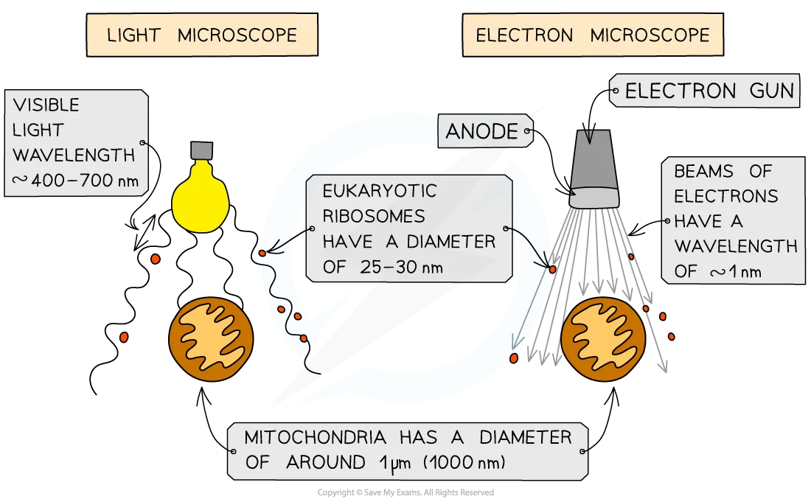

# Resolution & Magnification

## Resolution & Magnification

> **Spec point** — `spcpt_RJBCfNCrC8xqgpFG` · define resolution and magnification and explain the differences between these terms, with reference to light microscopy and electron microscopy

## Resolution & magnification

### Magnification

- Magnification is the number of times that a real-life *specimen* has been enlarged to give a larger view/image

  - E.g. a magnification of x100 means that a specimen has been enlarged 100 times to give the image shown
- A ***light microscope*** has two types of lens which allow it to achieve different levels of magnification:

  - An **eyepiece lens,** which often has a magnification of x10
  - A series of **objective lenses**, each with a different magnification, e.g. x4, x10, x40 and x100
- To calculate the **total magnification** of a specimen being viewed, the magnification of the **eyepiece** lens and the **objective** lens are **multiplied** together:

**Total magnification = eyepiece lens magnification x objective lens magnification**

### Resolution

- **Resolution** is the ability of a microscope to **distinguish two points** that are close together as separate objects; it determines how much detail can be seen

  - If** resolution is too low**, two separate objects appear as one point and the image looks blurry
- Resolution** limits useful magnification**; increasing magnification beyond this does not reveal more detail
- The resolution of a** light microscope** is limited by the** wavelength of light**

  - It cannot resolve points closer together than about** half the wavelength of visible light (400–700 nm)**
  - The shortest wavelength is 400 nm, so the resolution limit of a light microscope is about 200 nm
  - E.g. a phospholipid bilayer is about 7 nm wide, well below 200 nm, so its structure cannot be seen with a light microscope
- **Electron microscopes **have a much** higher resolution **than light microscopes because electrons have a much** smaller wavelength than visible light**

  - They can achieve a resolution of about 0.5 nm, so they can usefully magnify much more

> **Exam Hint**
> Don’t assume that increasing magnification will let you see more detail — it won’t if the resolution is too low.
> 
> Remember: magnification makes things bigger, resolution makes things clearer.
