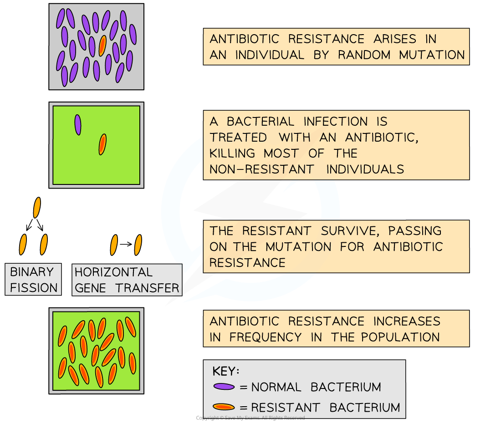

# Antibiotic Resistance

## Resistance to Antibiotics: An Outline

> **Spec point** — `spcpt_BNmYfWPgGWhkSbX3` · discuss the consequences of antibiotic resistance and the steps that can be taken to reduce its impact

## Resistance to antibiotics

- **Genetic variation** exists between individuals in a bacterial population

  - This is the result of **random mutation**
- A chance mutation might give rise to a** new ***allele*** **that provides **resistance** to an antibiotic

  - E.g. some pathogenic bacteria have become **resistant to penicillin**
  - They have acquired** **an allele that codes for the production of an enzyme which breaks down penicillin
- When the bacterial population is treated with this antibiotic** any bacteria with the resistance allele do not die**

  - The antibiotic acts as a *selection pressure*
- The resistant bacteria can continue to reproduce with **less competition from the non-resistant bacteria**, which are now dead
- The **allele for antibiotic resistance is passed on **with much greater frequency to the next generation

  - This can occur especially quickly in bacterial populations, due to:
  
    - short generation times
    - all offspring being clones of their parents
    - *horizontal gene transfer*
- The antibiotic resistance allele **increases in frequency**

  - A higher proportion of the bacterial population is now resistant to the antibiotic
- This is an example of **evolution by natural selection**

*Bacteria evolve rapidly due to their high mutation rate and short generation times; this means that antibiotic resistance can arise quickly when a population is exposed to a new antibiotic*

- Humans have caused an increase in the occurrence of antibiotic resistance

  - This is because treating infections with antibiotics** provides a selection pressure** which drives natural selection
- This problem is made worse when antibiotics are used improperly, e.g.

  - For treatment of non-serious infections
  - For treatment of viral infections
  - Routine treatment to animals in agriculture
  - A course of antibiotics is not fully completed

> **Exam Hint**
> Be careful when describing the development of antibiotic resistance; there are two major pitfalls to look out for:
> 
> - Antibiotic resistance mutations occur** by chance**, and not as the result of exposure to antibiotics; you should never say that antibiotics *cause* mutation
> - Mutation gives rise to a new resistance **allele**, and not a new gene
