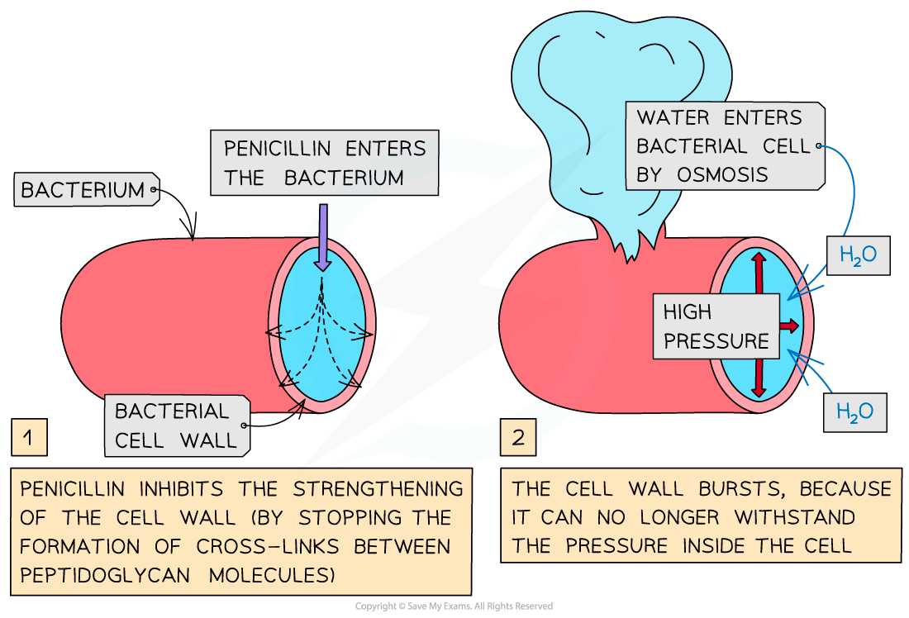

# Penicillin

## Penicillin: Why it Affects Bacteria & Not Viruses

> **Spec point** — `spcpt_Ys2dSMd7vQ3BH4hv`

## Penicillin affects bacteria & not viruses

- **Antibiotics** are **drugs** that **kill or stop the growth of bacteria**

  - Antibiotics do not harm the cells of the infected organism
- Some antibiotics are derived from living organisms

  - e.g. penicillin is produced by some fungi in the genus *Penicillium*
- Other antibiotics are made synthetically in a laboratory
- Antibiotics work by **interfering with the growth or metabolism of the target bacterium**, e.g.

  - synthesis of bacterial cell walls
  - activity of proteins in bacterial cell surface membranes
  - bacterial enzyme action
  - bacterial DNA synthesis
  - bacterial protein synthesis

### The effect of penicillin on bacteria

- When a new bacterial cell is growing it secretes enzymes (known as autolysins) that create **small holes** in the bacterial cell wall
- These holes allow the bacterial cell wall to **stretch** as the cell grows

  - New *peptidoglycan* molecules join up via formation of cross-link attachments
- Penicillin **stops the formation of cross-links** in the cell wall

  - However, the enzymes** keep creating holes **in the bacterial cell wall, making the walls **weaker and weaker**
- As bacteria live in watery environments and **take up water by osmosis**, their weakened cell walls eventually **burst** as they can no longer withstand the **pressure** exerted on them from within the cell
- This means **penicillin is only effective against bacteria that are still growing**

  - This is because autolysins no longer create holes and no more cross-links form once the growth of a bacterium is complete

*Penicillin prevents the formation of cross-linkages in bacterial cell walls during cell growth, resulting in a weakened cell wall*

### Penicillin and viruses

- Antibiotics, such as penicillin,** do not affect viruses**

  - This is because **viruses are not cells** and therefore cannot be targeted in any of the ways that an antibiotic targets a bacterial cell
- When a virus replicates, it uses the host cell’s mechanisms for transcription and translation, so not even these processes can be targeted

> **Exam Hint**
> Antibiotics are only effective against bacteria, not viruses. For example, cholera and TB can be treated with antibiotics, whereas HIV cannot, as it is a viral infection.
