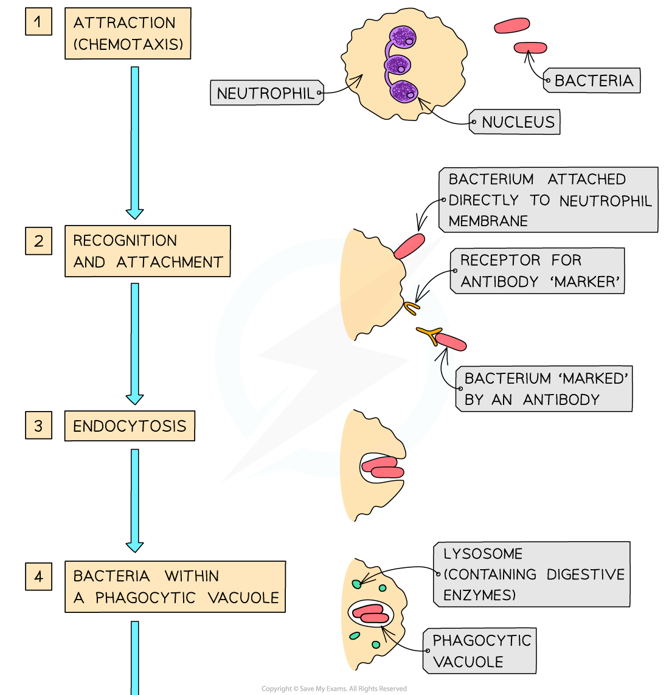
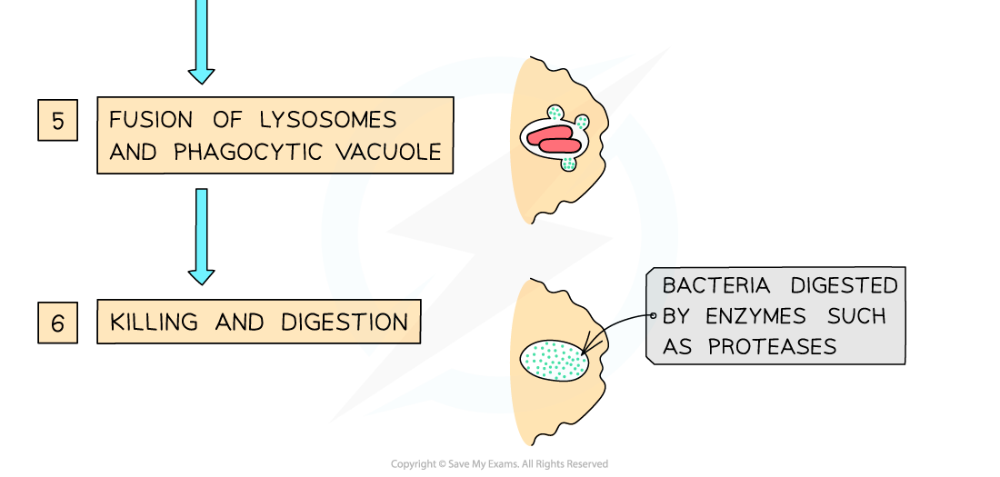

# Phagocytes

## Phagocytes: Origin & Mode of Action

> **Spec point** — `spcpt_tMBrvkXRTmfvZgvG` · describe the mode of action of phagocytes

## Phagocytes: origin & mode of action

- Phagocytes are white blood cells that are produced continuously in the **bone marrow**
- They are stored in the bone marrow before being **distributed around the body in the blood**
- They are responsible for **removing dead cells** and** invasive microorganisms**
- They carry out what is known as a **non-specific immune response**
- There are two main types of phagocyte, each with a specific mode of action. The two types are:

  - **Neutrophils**
  - **Macrophages**
- Phagocytes carry out ***phagocytosis***

### Neutrophils

- Neutrophils are short-lived cells that travel throughout the body and often leave the blood by squeezing through capillary walls to ‘patrol’ the body tissues
- During an infection they are released in **large numbers** from their stores
- Neutrophils carry out **phagocytosis** as follows:

  - **Chemicals** released by pathogens, as well as chemicals released by the body cells under attack, e.g. histamine,** attract neutrophils** to the site where the pathogens are located
  
    - This response to chemical stimuli is known as **chemotaxis**
  - Neutrophils move towards pathogens
  - **Receptor proteins** on the surface of neutrophils attach to antigens on the surface of pathogens
  - Once attached to a pathogen, the **cell surface membrane** of a neutrophil extends out and around the pathogen, **engulfing it** and trapping the pathogen within a **phagocytic vacuole**
  
    - This is an example of **endocytosis**
  - The neutrophil then secretes **digestive enzymes** into the vacuole
  
    - This occurs when the phagocytic vacuole, also known as the **phagosome**, fuses with a** lysosome**
    - The fused phagosome and lysosome are referred to as a **phagolysosome**
  - These digestive enzymes **destroy** the pathogen
- After killing and digesting the pathogens, the **neutrophils die**

  - **Pus** is a sign of dead neutrophils

*During phagocytosis by a neutrophil the pathogen is fully broken down and destroyed by digestive enzymes stored in lysosomes*

#### Macrophages

- Macrophages are **larger** than neutrophils and are **long-lived cells**
- Rather than remaining in the blood they **move into organs**

  - E.g. the lungs, liver, spleen, kidney and lymph nodes
- After being produced in the bone marrow, macrophages travel in the blood as **monocytes**, which then **develop into macrophages** once they leave the blood to settle in the various organs listed above
- Macrophages play a role in **initiating a specific immune response **as follows:

  - Macrophages **carry out phagocytosis **as described above, but they **do not destroy pathogens completely** during the digestion stage of the process
  - They cut the pathogens up so that they can **display the ***antigens* of the pathogens on their surface
  
    - Macrophages that present antigens in this way are known as **antigen presenting cells**
  - These displayed antigens can then be **recognised by lymphocytes**, another group of white blood cells

> **Exam Hint**
> Remember that while neutrophils and macrophages both carry out phagocytosis, only macrophages become antigen presenting cells that initiate the specific immune response
