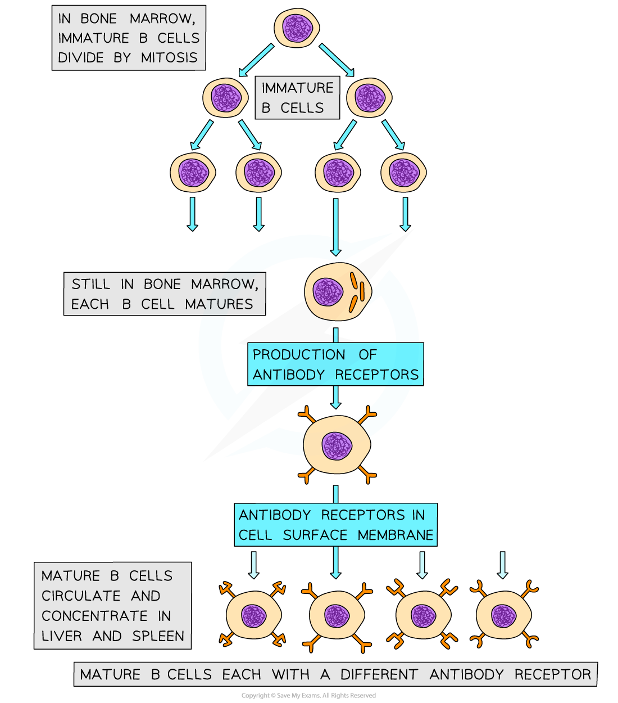
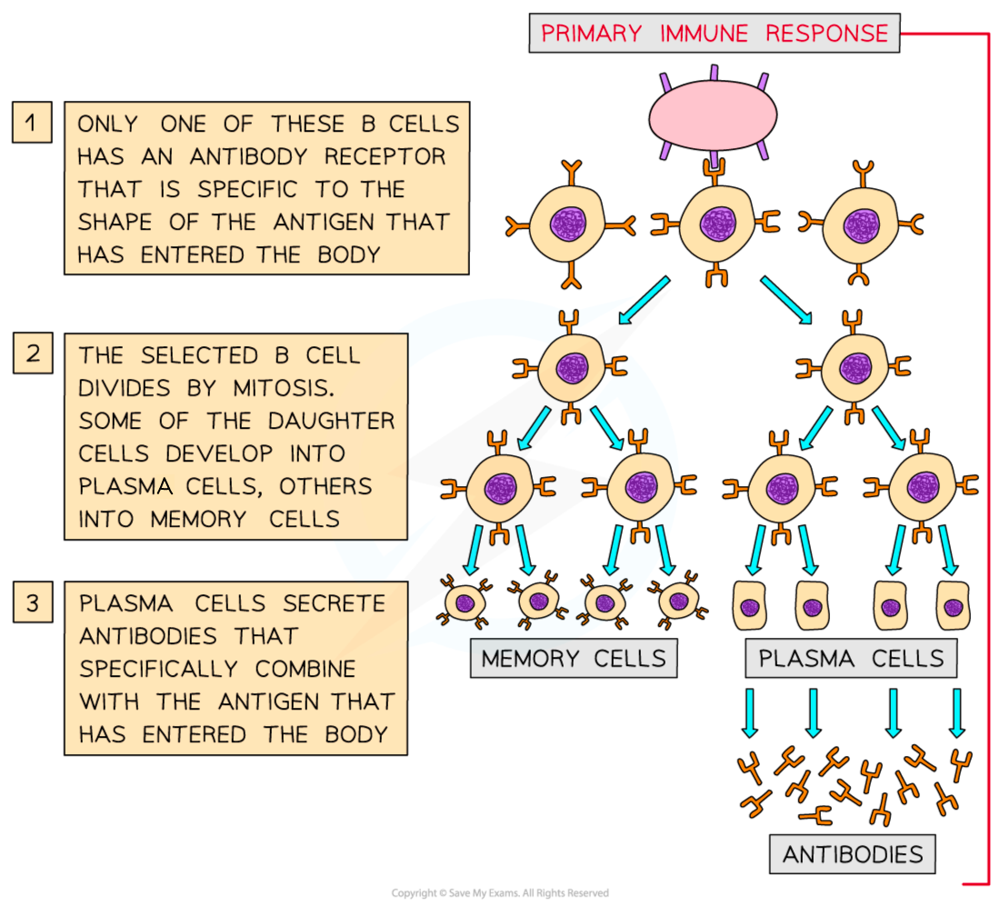
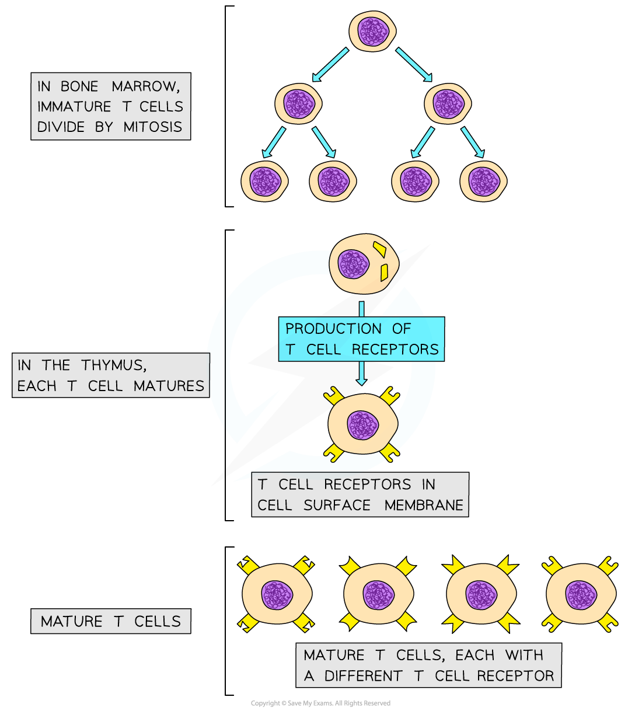
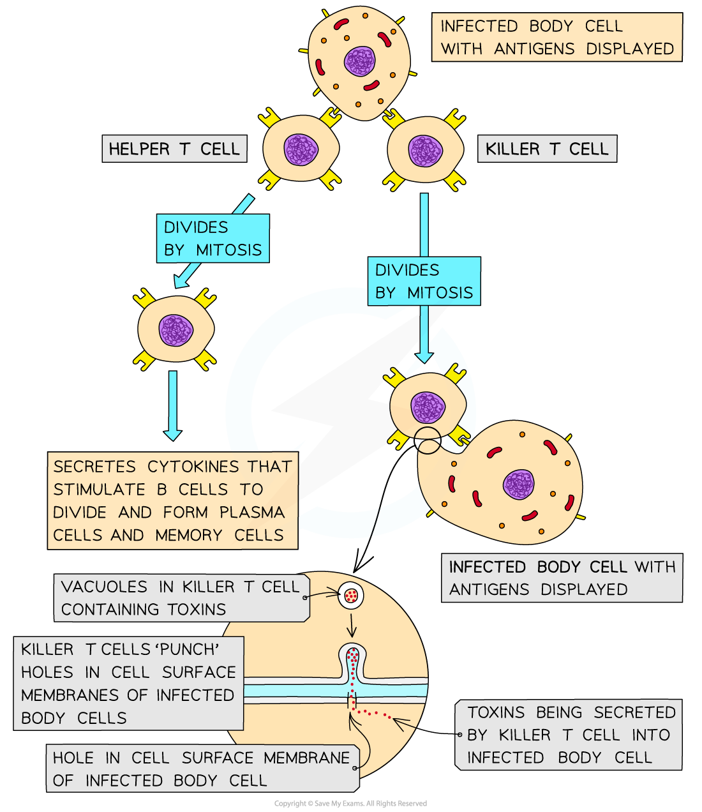

# Primary Immune Response

## Primary Immune Response

> **Spec point** — `spcpt_6khKV7HPXX23K5JJ` · describe the sequence of events that occurs during a primary immune response with reference to the roles of:
• macrophages
• B-lymphocytes, including plasma cells
• T-lymphocytes, limited to T-helper cells and T-killer cells

## Primary immune response

- **Lymphocytes** are another type of white blood cell
- They play an important part in the **specific** **immune response**
- They are **smaller** than *phagocytes* and they have a **large nucleus** that fills most of the cell
- They are produced in the **bone marrow**
- There are **two types** of lymphocytes with **different roles** in the immune response

  - **B-lymphocytes**, or** B cells**
  - **T-lymphocytes**, or** T cells**
- The action of lymphocytes is triggered by exposure to **non-self antigens**:

  - When a pathogen enters the body its antigens are displayed by **antigen presenting cells**
  - These antigens may be found:
  
    - On the surface of **macrophages** after phagocytosis
    - On the surface of** infected cells**
    - On the surface of the **pathogens** themselves

### B-lymphocytes

- **B-lymphocytes** remain in the **bone marrow** until they are **mature** and then spread through the body, concentrating in lymph nodes and the spleen

  - Millions of different B-lymphocyte cells are produced within the bone marrow
- Once mature, each different B-lymphocyte cell has a different** antibody molecule** on its surface

  - At this stage the antibody molecules do not leave the B-lymphocyte cell but **remain in the cell surface membrane**
- Part of each antibody molecule forms a** receptor** that can combine with **complementary antigens** from pathogens

  - These receptors are known as **antibody receptors**
  
    - This is because they are made of antibodies
  - Each different B cell has an antibody receptor that is **specific to one type of pathogenic antigen**
  
    - This is why the action of B cells is part of the **specific immune response**

*Mature B cells have many different antibody receptors on their cell surface membranes*

#### B-lymphocytes in the specific immune response

- The arrival of non-self antigens in the body triggers the following series of events in B-lymphocytes

  - The B-lymphocytes, with antibody receptors that are complementary to the new antigen, come into contact with the new antigen
  - The B-lymphocytes **bind to their complementary antigens** and are stimulated to divide by **mitosis**
  
    - This process of finding and stimulating the correct lymphocytes is known as **clonal selection**
    - *T-helper cells* play an important role in initiating the division of B cells at this stage (see below)
  - The B-lymphocytes divide repeatedly by mitosis, producing many **cloned **B-lymphocytes with complementary antibody receptors
  
    - The cloning of B-lymphocytes at this stage is known as **clonal expansion**
  - The cloned B-lymphocytes develop into
  
    - **Plasma cells** that secrete **antibodies**
    
      - The antibodies are complementary to the antigens that initiated the immune response
    - **Memory cells** that remain in the blood, providing immunity; these are known as B memory cells

*During a primary immune response, B-lymphocytes divide by mitosis, resulting in the production of plasma cells and memory cells*

### T-lymphocytes

- Immature **T-lymphocytes** leave the bone marrow to **mature** in the **thymus**
- Mature **T-lymphocytes** have specific cell surface receptors called **T cell receptors**
- These receptors have a **similar structure to antibodies** and are each **specific to one type of antigen**

*Mature T cells have many different types of T cell receptors on the cell surface membranes*

#### T-lymphocytes in the specific immune response

- The T-lymphocytes undergo a similar process to that seen in B cells

  - T-lymphocytes are **activated** when they encounter and **bind to** their specific antigen
  
    - This is **clonal selection**
  - These activated T-lymphocytes **divide** by **mitosis** to increase in number
  
    - This is **clonal expansion**
  - These T-lymphocytes differentiate into different types of T cell:
  
    - **T-helper cells**
    
      - These cells **release cytokines, **a group of chemicals that
      
        - **stimulate B-lymphocytes to divide**
        - cause an **increase in the rate of phagocytosis** by macrophages
    - **T-killer cells**
    
      - These cells **attach to antigens** on the cell surface membranes of **infected body cells **and secrete toxic substances that **kill** the infected cells
- This response to a **newly encountered antigen** is known as a **primary immune response**

  - Primary responses are** slow **due to the time taken for **clonal selection **and **expansion**

*T helper cells are involved with the activation of B cells, while T killer cells kill infected body cells*

> **Exam Hint**
> These events are complex, and you may come across slight variations in the precise order of events and the key terminology used, so you should focus on the main principles, including:
> 
> - The **complementary** nature of antibody receptors and T cell receptors to specific non-self antigens
> - Lymphocytes divide by **mitosis** to increase the numbers of cells during an immune response
> - B cells produce** plasma cells** and **memory cells**
> - T cells produce **T-helper** and **T-killer cells**
