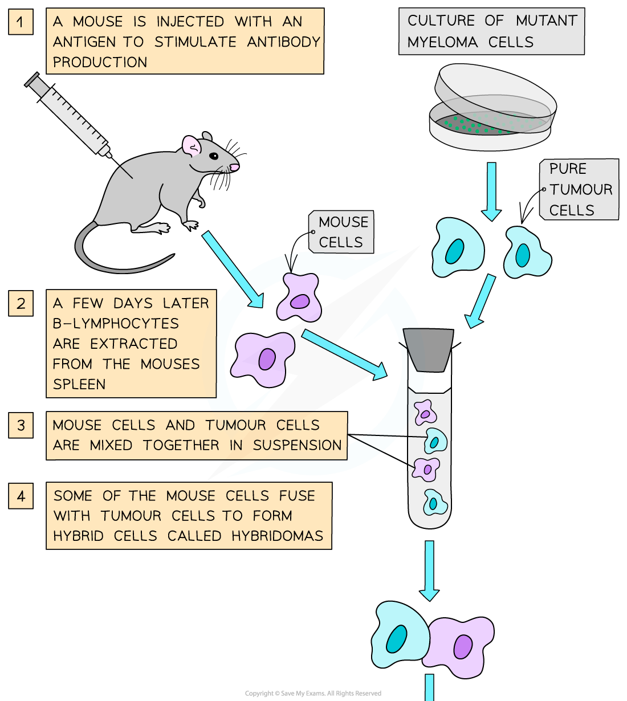
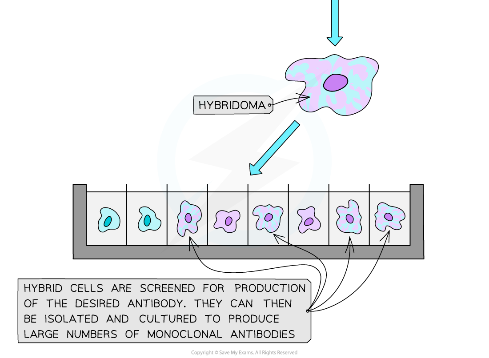

# Making Monoclonal Antibodies

## The Hybridoma Method

> **Spec point** — `spcpt_b2j8qfWTJgRPzrFS` · outline the hybridoma method for the production of monoclonal antibodies

## The hybridoma method

- Monoclonal antibodies (mAbs) are artificially produced antibodies produced from a **single** B cell **clone**

  - Monoclonal antibodies bind to antigens in the same way as naturally produced antibodies
- The **hybridoma method** is used to make monoclonal antibodies

  - The method enables large quantities of identical antibodies to be produced
  - The hybridoma method fuses plasma cells with tumour cells, combining their useful properties
  
    - Plasma cells can **produce antibodies**
    - Tumour cells can **divide indefinitely** by mitosis and produce more identical cells
- The hybridoma method involves the following stages

  - Mice are injected with an antigen that stimulates the production of antibody-producing **plasma cells**
  - Isolated** **plasma cells from the mice are fused with immortal **tumour cells**, producing **hybridoma cells**
  
    - The fusion of plasma and tumour cells can be assisted with the use of fusogens such as polyethylene glycol or an electric current
  - These hybrid cells are grown in a selective growth medium and screened for the production of the desired antibody
  - They are then cultured to produce large numbers of monoclonal antibodies
- Monoclonal antibodies have multiple applications, including diagnostics, treating disease, food safety testing and pregnancy testing

*The hybridoma method is used to produce monoclonal antibodies*
