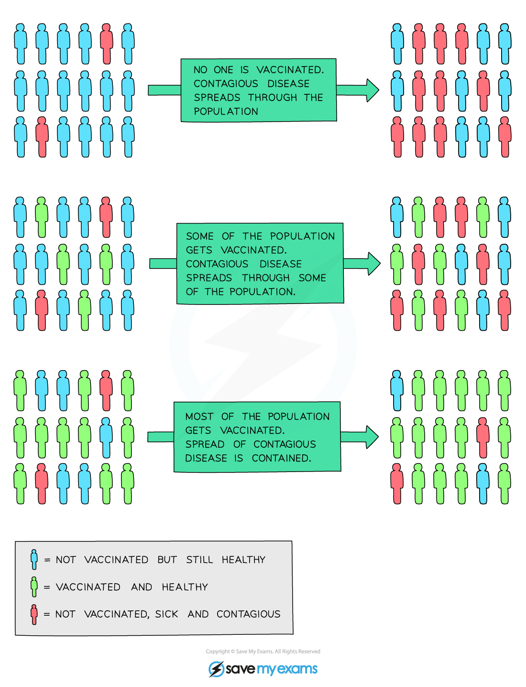

# Vaccination to Control Disease

## Vaccination to Control Disease

> **Spec point** — `spcpt_wPb4YRz2x7TtFMk6` · explain how vaccination programmes can help to control the spread of infectious diseases

## Vaccination to control disease

- There are many safe and effective vaccines that exist against many pathogens
- These vaccines have managed to push a number of childhood diseases to the verge of extinction

  - Vaccines against such diseases as mumps, chicken pox and whooping cough are administered to children as part of an immunisation schedule and they successfully result in immunity
- As a result, many childhood diseases are kept at low levels within populations due to **herd immunity**

  - Herd immunity arises when a sufficiently **large proportion of the population has been vaccinated** (and are therefore immune)
  - This makes it difficult for a pathogen to spread within that population, as **those not immunised are protected **and unlikely to contract it as the levels of the disease are so low

*The process of herd immunity to protect populations from communicable disease through vaccination*
