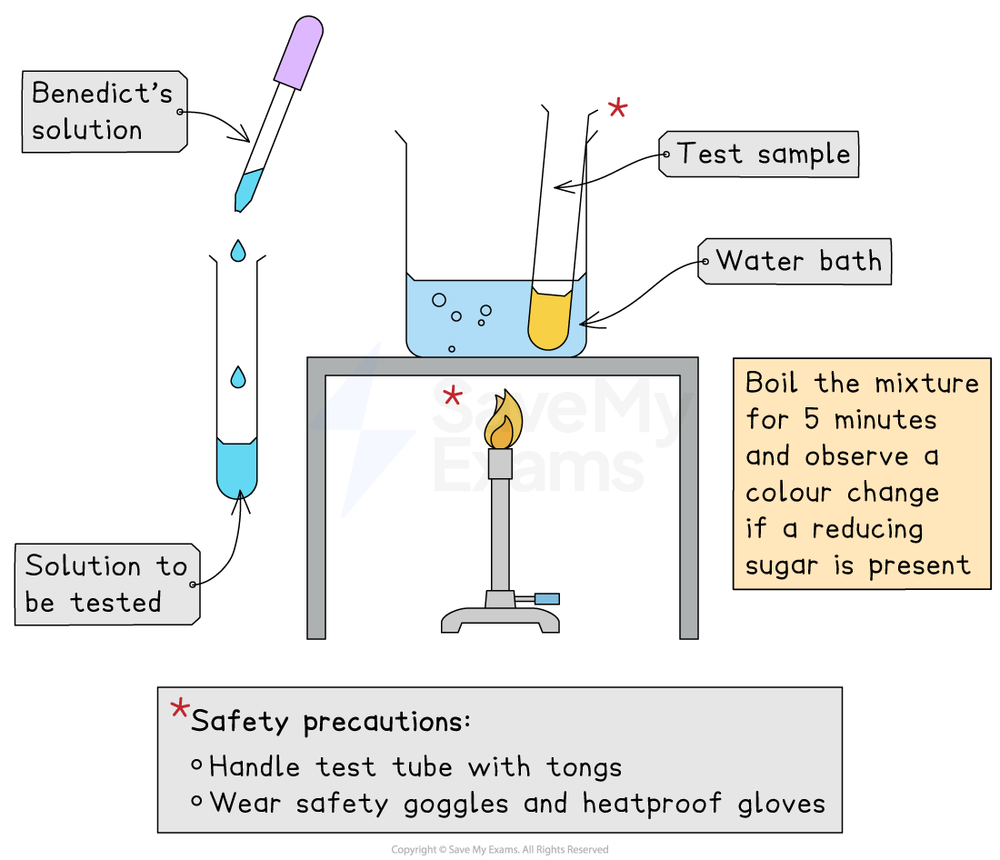
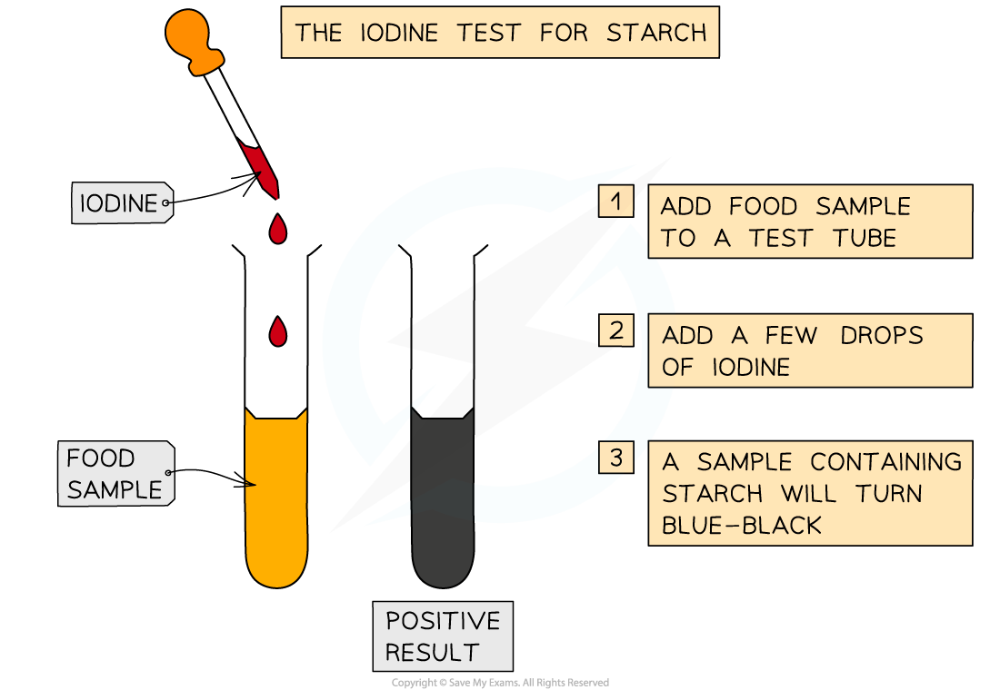
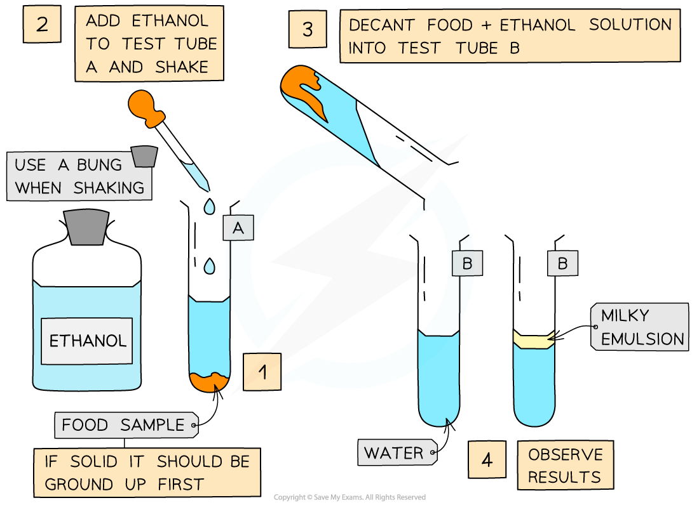
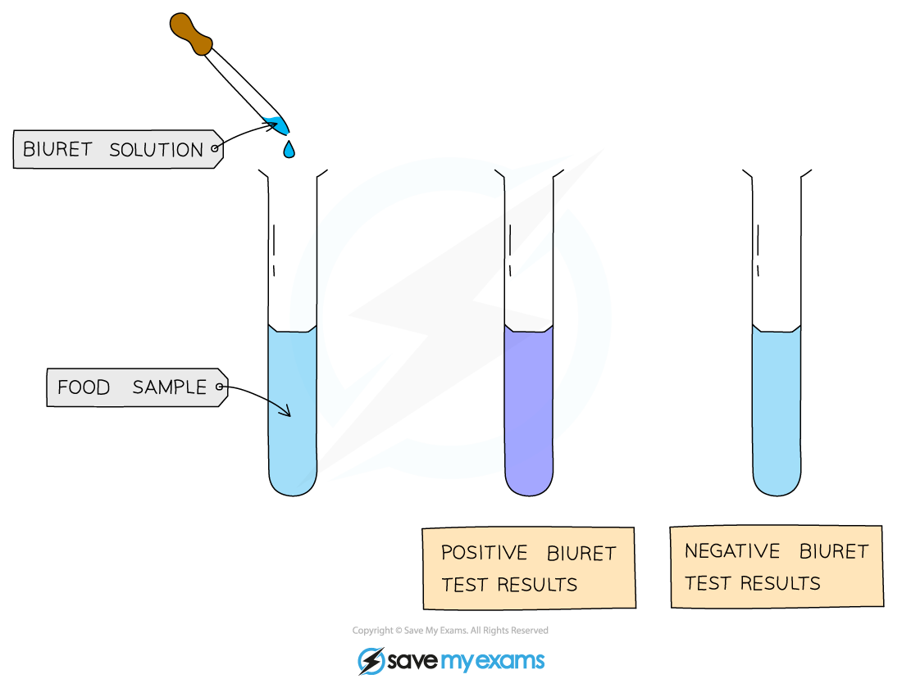

# Biological Molecule Tests

## Testing for Key Biological Molecules

> **Spec point** — `spcpt_G7dg5x3dpK4fzkmj` · describe and carry out the Benedict’s test for reducing sugars, the iodine test for starch, the emulsion test for lipids and the biuret test for proteins

## Testing for key biological molecules

- There are a number of tests that can be carried out quickly and easily in a lab to **determine **if a sample contains one of the key biological molecules (carbohydrates, proteins and lipids)
- The following tests are *qualitative*

  - They **do not **give a *quantitative* value as to **how much** of each type of molecule may be present in a sample

### The Benedict’s test for reducing sugars

- Add **Benedict's reagent** (which is blue as it contains copper (II) sulfate ions) to a sample solution in a test tube
- **Heat** the test tube in a water bath or beaker of water that has been brought to a boil for a few minutes
- If a *reducing sugar* is present, a coloured precipitate will form as copper (II) sulfate is reduced to copper (I) oxide which is insoluble in water
- A positive test result is, therefore, a colour change somewhere along a colour scale from blue (no reducing sugar) to brown/brick-red (a high concentration of reducing sugar)

  - This test is **semi-quantitative** as the degree of the colour change can give an indication of how much (the concentration of) reducing sugar present

*The Benedict's test for reducing sugars produces a colour change from blue towards red if a reducing sugar is present*

### The iodine test for starch

- To test for the presence of starch in a sample, add a few drops of **orange/brown iodine** in potassium iodide solution to the sample

  - The iodine is in potassium iodide solution as iodine is insoluble in water
- If starch is present, iodide ions in the solution interact with the centre of starch molecules, producing a complex with a distinctive **blue-black colour**
- This test is useful in experiments for showing that starch in a sample has been digested by enzymes

*Iodine solution can be used to test for the presence of starch*

### The emulsion test for lipids

- **Lipids are nonpolar** molecules that do not dissolve in water but will dissolve in organic solvents such as ethanol
- Add **ethanol **to the sample to be tested, shake to mix and then add the mixture to a test tube of water
- If lipids are present, a **milky emulsion** will form (the solution appears ‘cloudy’); the more lipid present, the more obvious the milky colour of the solution
- If no lipid is present, the solution remains clear

*The emulsion test for lipids forms a milky colour*

#### The biuret test for proteins

- A liquid solution of a sample is treated with sodium or potassium hydroxide to make the solution alkaline
- A few drops of copper (II) sulfate solution (which is blue) is added to the sample

  - Biuret ‘reagent’ contains an alkali and copper (II) sulfate
- If a colour change is observed from blue to lilac/purple, then protein is present.

  - The colour change can be very subtle, it’s wise to hold the test tubes up against a white tile when making observations)
- If no colour change is observed, no protein is present

  - For this test to work, there must be at least two peptide bonds present in any protein molecules, so if the sample contains amino acids or dipeptides, the result will be negative

*Biuret solution can be used to test for the presence of proteins in a sample of food*

> **Exam Hint**
> A common mistake is just writing the colour change (e.g. “goes brick-red”) without naming the reagent. For full marks, always say **what you add** (e.g. *Benedict’s reagent*), **what you do** (e.g. *heat in a water bath*), and **what result shows a positive test** (e.g. *a brick-red precipitate*). This is how exam mark schemes are often structured.
