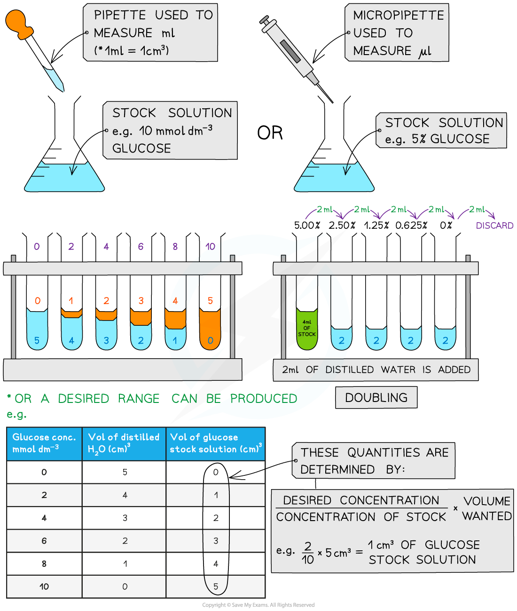
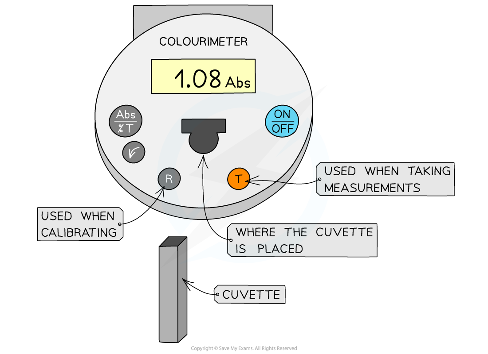
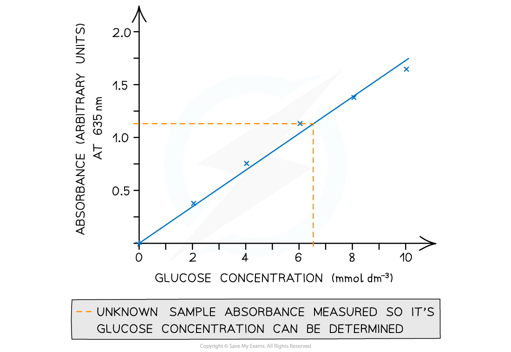

# The Benedict's Test

## The Benedict's Test for Reducing Sugars

> **Spec point** — `spcpt_TB4xGj4B9qtCnMmM` · describe and carry out a semi-quantitative Benedict’s test on a reducing sugar solution by standardising the test and using the results (time to first colour change or comparison to colour standards) to estimate the concentration

## The Benedict's test for reducing sugars

### Method

- Add **Benedict's reagent** (which is blue as it contains copper (II) sulfate ions) to a sample solution in a test tube

  - It is important that an **excess **of Benedict’s solution is used so that there is more than enough copper (II) sulfate present to react with any sugar present
- **Heat** the test tube in a water bath or beaker of water that has been brought to a boil for a few minutes
- If a *reducing sugar* is present, a **coloured precipitate** will form as copper (II) sulfate is reduced to copper (I) oxide which is insoluble in water
- A positive test result is, therefore, a colour change somewhere along a colour scale from blue (no reducing sugar) to brown/brick-red (a high concentration of reducing sugar)

  - This test is *semi-quantitative* as the degree of the colour change can give an indication of how much (the concentration of) reducing sugar present

### Semi-quantitative Benedict's test

- A semi-quantitative test can be carried out by setting up **standard solutions with known concentrations** of reducing sugar (such as glucose)
- These solutions should be set up using a ***serial dilution*** of an existing stock solution
- Each solution is then treated in the same way:

  - Add the same volume of Benedict’s solution to each sample
  - Heat in a water bath that has been boiled (ideally at the same temperature each time) for a set time (5 minutes or so) to allow colour changes to occur
  - It is important to ensure that an excess of Benedict’s solution is used
- Any **colour change** observed for each solution of a **known concentration** in that time can be attributed to the **concentration **of reducing sugar present in that solution
- The same procedure is carried out on a sample with an **unknown concentration** of reducing sugar which is then compared to the colours of the standard solutions to estimate the concentration of reducing sugar present

### Alterations

- It is also possible to **standardise **this test but instead of waiting a **fixed amount of time** for a range of colours to be observed, time how long it takes for the first colour change to occur (blue to green)

  - The** higher the concentration of reducing sugar in a sample, the less time it would take for a colour change **to be observed
- To avoid issues with human interpretation of colour, a **colourimeter **could be used to measure the absorbance or transmission of light through the sugar solutions of known concentration to establish a range of values that an unknown sample can be compared against a calibration curve

### Serial dilutions

- Serial dilutions are created by taking a **series of dilutions of a stock solution**. In a serial dilution the concentration decreases by the same factor (e.g. halved in doubling dilutions) between each test tube. A range such as 0, 2, 4, 6, 8, 10 mmol dm-3 is made by proportional (simple) dilution, not serial dilution

  - They can either be ‘doubling dilutions’ (where the concentration is halved between each test tube) or a desired range (e.g. 0, 2, 4, 6, 8, 10 mmol dm-3)
- Serial dilutions are completed to create a **standard to compare unknown concentrations **against

  - The comparison can be:
  
    - Visual
    - Measured through a calibration/standard curve
    - Measured using a colourimeter
  - They can be used when:
  
    - Counting bacteria or yeast populations
    - Determining unknown glucose, starch, protein concentrations

*Making serial dilutions*

### Using a colorimeter

- A colorimeter is an instrument that beams a specific wavelength (colour) of light through a sample and measures how much of this light is **absorbed** by the sample

  - Colour filters are used to control the light wavelength emitted
  - The colour used will be **in contrast** to the colour of the solution, e.g. Benedict's solution turns orange in the presence of sugar, so the colorimeter will* *assess the intensity of the orange colour
  - In order to do this a blue light filter would be used to shine blue light through the sample
  
    - Blue light is absorbed by an orange solution as orange light is reflected to give the orange appearance
    - The extent to which the blue light is absorbed will differ depending on the intensity of the orange colour; a solution that is orange/green will absorb less blue light than a solution that is brick red
    - The absorbance value therefore provides a **quantitative** measure of the strength of the orange colour
- Colorimeters must be **calibrated** before taking measurements

  - This is completed by placing a *blank* into the colorimeter and taking a reference; it should read 0 (that is, no light is being absorbed)
  - This step should be repeated periodically whilst taking measurements to ensure that the absorbance is still 0
- The results can then be used to plot a calibration or standard curve

  - Absorbance against the known concentrations can be used
  - Unknown concentrations can then be determined from this graph

*A colourimeter is used to obtain quantitative data that can be plotted to create a calibration curve*

> **Exam Hint**
> For fair comparison in semi-quantitative tests, make sure **volume of sample, volume of Benedict’s, temperature, and heating time are the same** for every tube — exam questions may award marks for recognising these as **control variables**.
