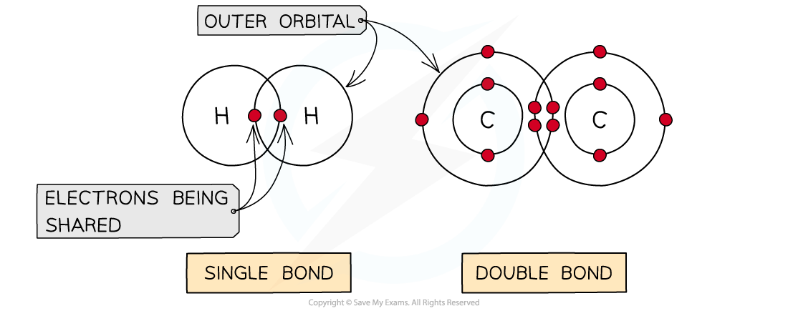
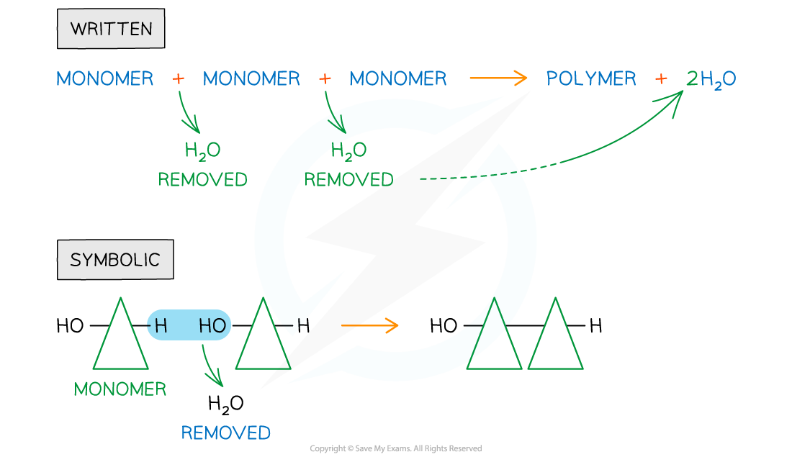
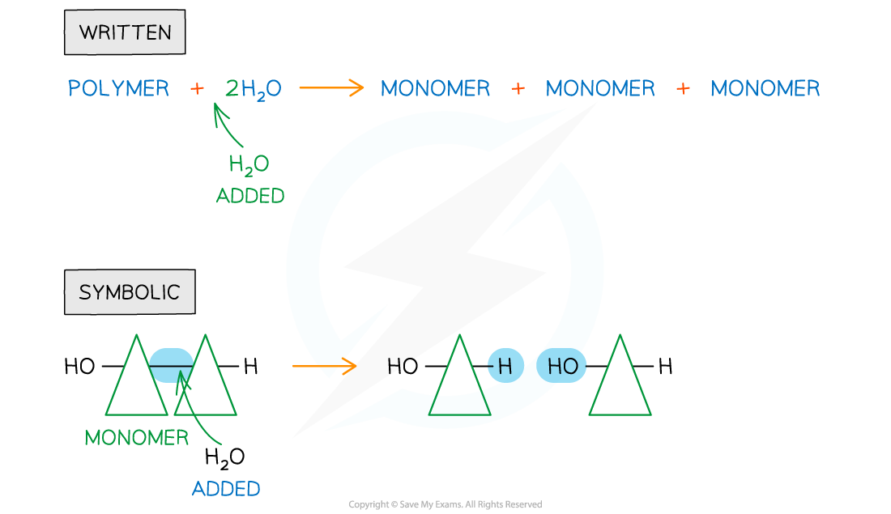

# Covalent Bonds in Polymers

## Covalent Bonds in Polymers

> **Spec point** — `spcpt_mCSKW8xytfX26fsT` · state the role of covalent bonds in joining smaller molecules together to form polymers

## Covalent bonds in polymers

- A **covalent bond** is the **sharing **of two or more electrons between two atoms

  - The electrons can be shared **equally **forming a **nonpolar **covalent bond or **unequally **(where an atom can be more *electronegative* δ-) to form a **polar** covalent bond
- Generally, each atom will form a certain number of covalent bonds due to the number of free electrons in the outer orbital e.g. H = 1 bond, C = 4 bonds
- Covalent bonds are very **stable **as high energies are required to break the bonds
- Multiple pairs of electrons can be shared forming **double** bonds (e.g. unsaturated fats C=C) or **triple **bonds

*Different types of covalent bonds*

- When two monomers are close enough that their outer orbitals overlap this results in their electrons being shared and a covalent bond forming

  - If more monomers are added then *polymerisation* occurs (and a polymer forms)

### Condensation

- A **condensation reaction** occurs when **monomers** combine together by **covalent bonds** to form **polymers** (polymerisation) or macromolecules (lipids) and **water** is **removed**

*Written and symbolic illustrations of the removal of water to form a covalent bond between two or more monomers during a condensation reaction*

### Hydrolysis

- Hydrolysis means ‘*lyse*’ (to break) and ‘*hydro*’ (with water)
- In the hydrolysis of polymers, **covalent bonds** are **broken** when **water** is **added**

*Written and symbolic illustrations of the addition of water to break down covalent bond/s during a hydrolysis reaction*

| **Organic Molecules** | **Covalent Bonds** | **Diagram of Covalent Bonds** |
|---|---|---|
| Carbohydrates | Glycosidic |  |
| Proteins | Peptide |  |
| Lipids | Ester |  |
| Nucleic Acids | Phosphodiester |  |

> **Exam Hint**
> You must be able to recognise and identify the** location of the covalent bonds **in the molecules – note that these molecules may be unfamiliar to you.
