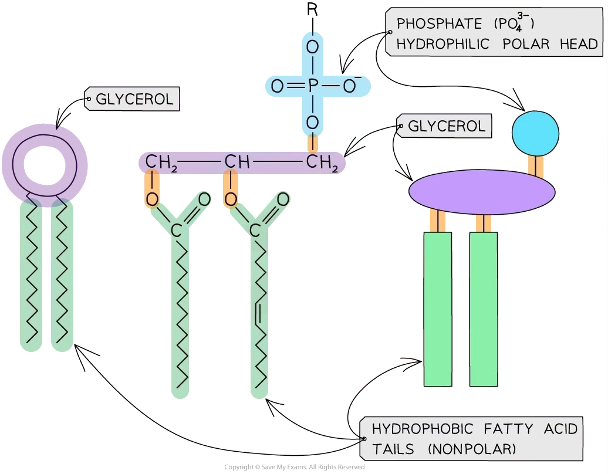
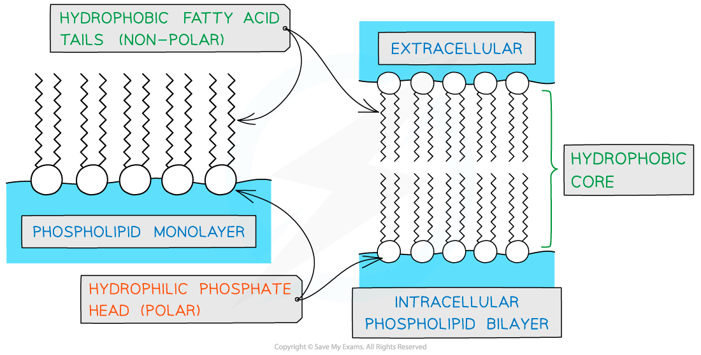

# Phospholipids

## The Vital Role of Phospholipids

> **Spec point** — `spcpt_8bgqvNnWTkzrjRRk` · describe the molecular structure of phospholipids with reference to their hydrophilic (polar) phosphate heads and hydrophobic (non-polar) fatty acid tails

## The vital role of phospholipids

### Structure

- Phospholipids are a type of lipid, formed from **glycerol and fatty acids** (lipids are not polymers, so glycerol and fatty acids are not monomers)
- Unlike triglycerides, there are only **two fatty acids** bonded to a glycerol molecule in a phospholipid as one has been replaced by a **phosphate** ion (PO43-)
- As the **phosphate **is **polar** it is soluble in water and described as **hydrophilic**
- The **fatty acid ‘tails’** are **non-polar** and therefore insoluble in water and described as **hydrophobic**

*Phospholipids are the major components of cell surface membranes. They have fatty acid tails that are hydrophobic and a phosphate head, that is hydrophilic, attached to a glycerol molecule.*

- Phospholipids are **amphipathic** (they have both hydrophobic and hydrophilic parts)
- As a result of having hydrophobic and hydrophilic parts phospholipid molecules form **monolayers or bilayers** in water

*In the presence of water due to the hydrophobic and hydrophilic parts phospholipids will form monolayers or bilayers.*

### Role of phospholipids

- They are the main component (building block) of cell membranes
- Due to the presence of hydrophobic fatty acid tails, a **hydrophobic core** is created when a phospholipid bilayer forms

  - This acts as a barrier to water-soluble molecules
- The **hydrophilic** **phosphate heads** form hydrogen bonds with water allowing the cell membrane to be used to **compartmentalise**

  - This enables the cells to organise specific roles into organelles helping with efficiency
- Composition of phospholipids contributes to the **fluidity** of the cell membrane

  - If there are mainly **saturated** fatty acid tails then the membrane will be **less fluid**
  - If there are mainly **unsaturated** fatty acid tails then the membrane will be **more fluid**
- Phospholipids control membrane protein orientation

  - **Weak hydrophobic interactions** between the phospholipids and membrane proteins hold the proteins within the membrane but still allow movement within the layer

| **Feature ** | **Phospholipid** | **Triglyceride** |
|---|---|---|
| **Number of fatty acid tails** | 2 | 3 |
| **Presence of phosphate** | Yes | No |
| **Number of ester bonds** | 2 | 3 |
| **Polar or non-polar** | Polar phosphate head | Non-polar |
| **Number of water molecules released during formation** | 3 | 3 |
| **Function** | Cell membrane component | Energy storage |

> **Exam Hint**
> Ensure you know the difference between **phospholipids **and **triglycerides**!
