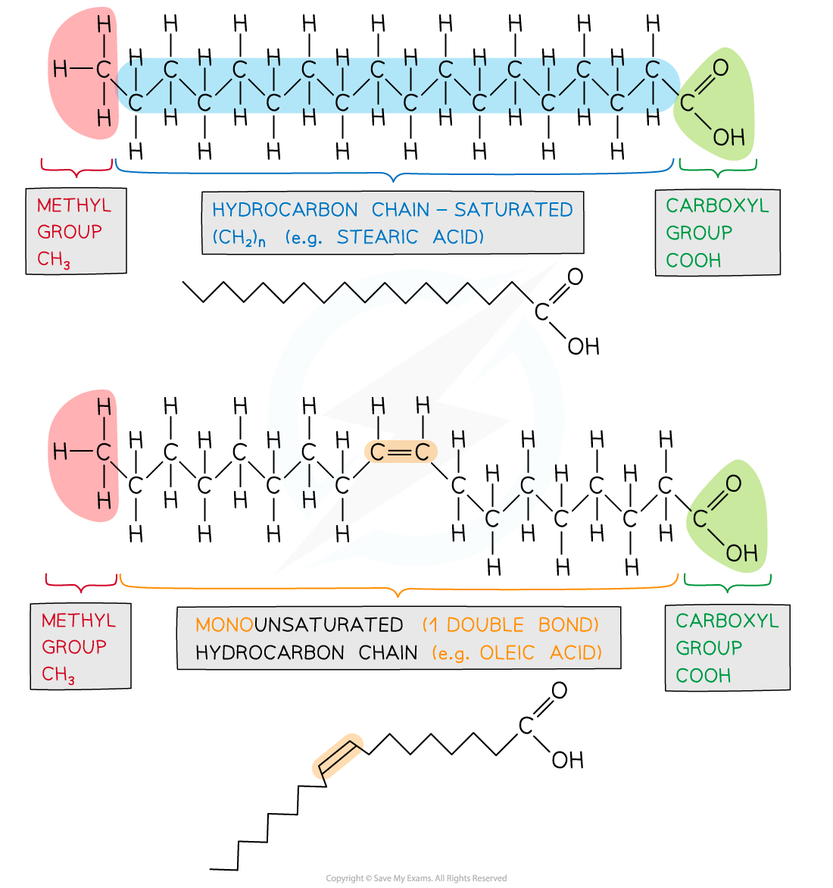
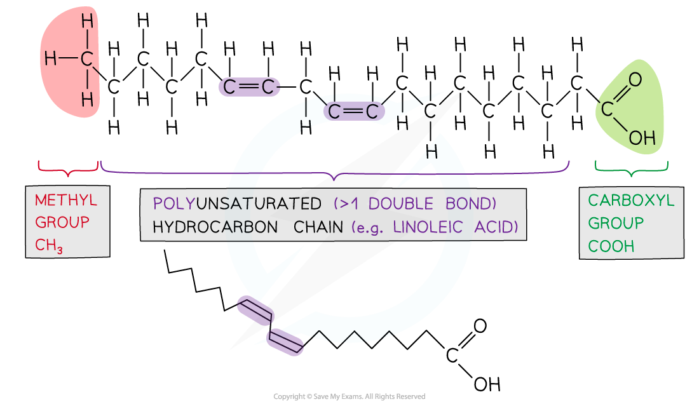
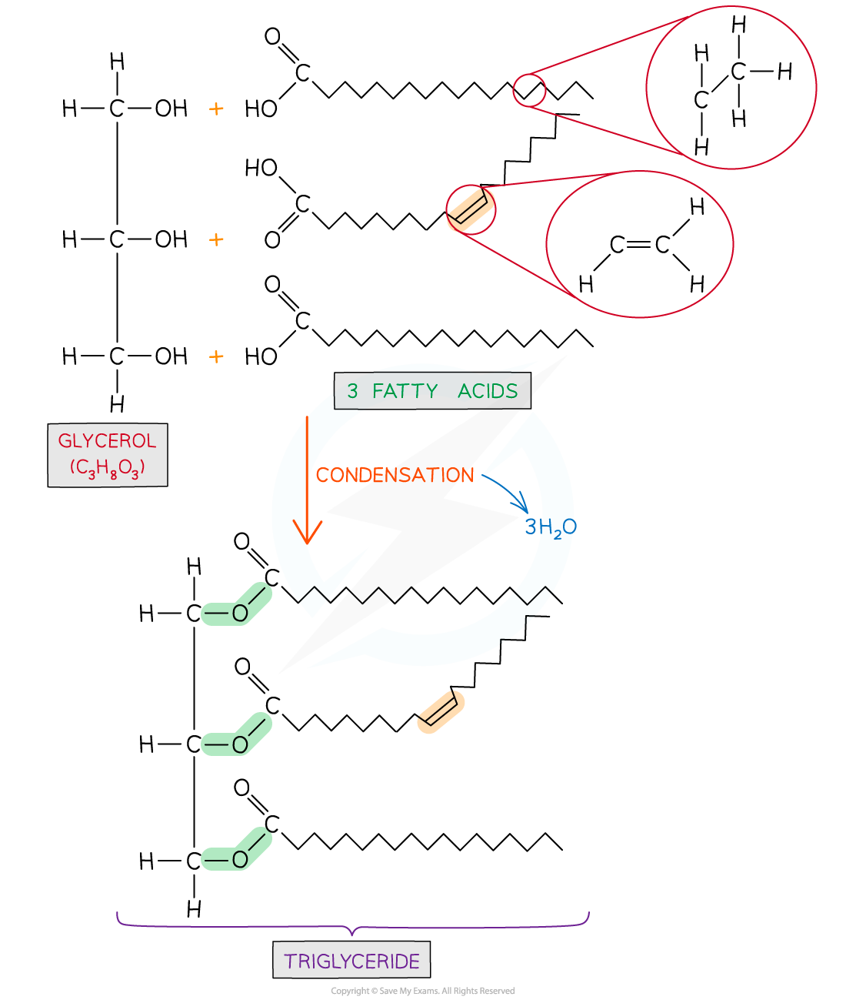
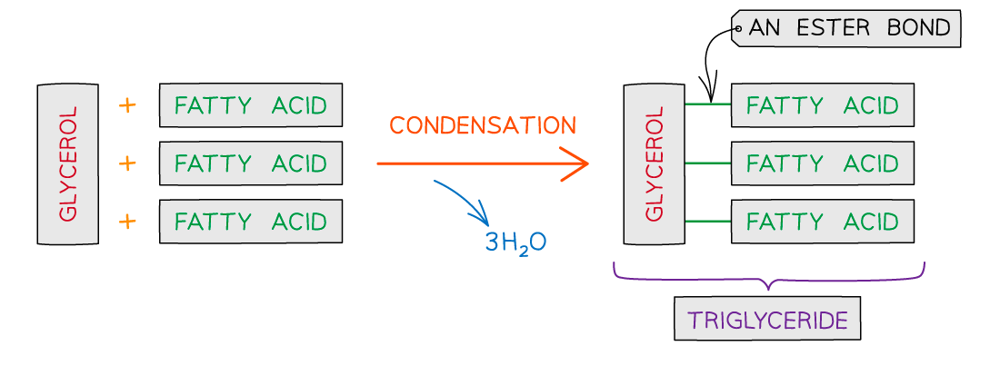

# Triglycerides

## Triglycerides: Basics

> **Spec point** — `spcpt_Z3RM9vry6fGh3TVh` · state that triglycerides are non-polar hydrophobic molecules and describe the molecular structure of triglycerides with reference to fatty acids (saturated and unsaturated), glycerol and the formation of ester bonds

## Triglycerides: basics

### Lipids

- Lipids are macromolecules which contain **carbon, hydrogen and oxygen atoms**. However, unlike carbohydrates lipids contain a lower proportion of oxygen
- They are *non-polar* and **hydrophobic** meaning they are **insoluble** in water
- Different types include:

  - Fats and Oils (composed mainly of triglycerides)
  - Phospholipids
  - Steroids and waxes (considered lipids as they are hydrophobic thus insoluble in water)

### Triglycerides

- These are **non-polar, hydrophobic** molecules
- A triglyceride is made from one **glycerol** molecule and three **fatty acids** (it is a macromolecule but not a polymer, as it is not made of repeating monomers)

  - Glycerol is an alcohol (an organic molecule that contains a hydroxyl group bonded to a carbon atom)
  - Fatty acids contain a **methyl** group at one end of a **hydrocarbon** chain (chains of hydrogens bonded to carbon atoms, typically 4 to 24 carbons long) and at the other is a **carboxyl** group
- Fatty acids can vary in two ways:

  - Length of the hydrocarbon chain
  - The fatty acid may be *saturated* (mainly in animal fat) or **unsaturated** (mainly vegetable oils, although there are exceptions e.g. coconut and palm oil)
- Unsaturated fatty acids can be *mono* or  *poly*-unsaturated

*Examples of different types of fatty acids with the functional groups and presence of double bonds highlighted*

- Triglycerides are formed by *esterification*

  - An **ester bond** forms when the hydroxyl group of the glycerol bonds with the carboxyl group of the fatty acid
  
    - For each ester bond formed a water molecule is released
    - Therefore, for **one triglyceride** to form **three water molecules** are released

*Formation of a triglyceride from a glycerol molecule and three fatty acid molecules by the process of esterification*

> **Exam Hint**
> Ensure that you are familiar with the structure of a triglyceride and that you can recognise whether the fatty acids are **saturated **or **unsaturated**.

## Triglycerides: Structure & Function

> **Spec point** — `spcpt_StvZthxQ8KDnff5M` · relate the molecular structure of triglycerides to their functions in living organisms

## Triglycerides: structure & function

### Energy storage

- The **long hydrocarbon chains** contain many carbon-hydrogen bonds with little oxygen

  - So when triglycerides are *oxidised* during cellular respiration this causes these bonds to break **releasing energy** used to produce ATP
- Triglycerides therefore store **more energy per gram** than carbohydrates and proteins (37kJ compared to 17kJ)
- As triglycerides are **hydrophobic** they do not cause **osmotic water uptake** in cells so more can be stored

  - Plants store triglycerides, in the form of **oils**, in their seeds and fruits. If extracted from seeds and fruits these are generally liquid at room temperature due to the presence of double bonds which add kinks to the fatty acid chains altering their properties
  - Mammals store triglycerides as oil droplets in **adipose tissue** to help them survive when food is scarce (e.g. hibernating bears)
- The oxidation of the carbon-hydrogen bonds releases large numbers of water molecules (**metabolic water**) during cellular respiration

  - Desert animals retain this water if there is no liquid water to drink
  - Bird and reptile embryos in their shells also use this water

### Insulation

- Triglycerides compose part of the **adipose tissue** layer below the skin which acts as insulation **against heat loss** (e.g. blubber of whales and sea lions)

### Buoyancy

- The **low density** of fat tissue increases the ability of animals to float more easily

### Protection

- The adipose tissue in mammals contains stored triglycerides and this tissue helps **protect organs **from the risk of damage

> **Exam Hint**
> It is common to be asked why triglycerides are **energy reserves** (they store **more energy per gram** due to their hydrocarbon chains).
