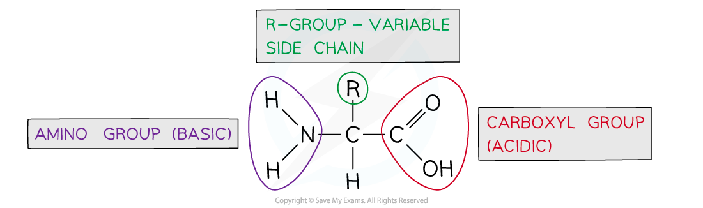
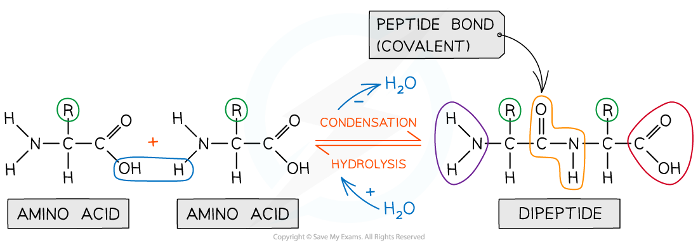

# Amino Acids & the Peptide Bond

## Amino Acids & the Peptide Bond

> **Spec point** — `spcpt_YhWm9GsNszgQk8S5` · describe and draw the general structure of an amino acid and the formation and breakage of a peptide bond

## Amino acids & the peptide bond

### Proteins

- Proteins are **polymers **(and macromolecules) made of monomers called **amino acids**
- The sequence, type and number of the amino acids within a protein determines its shape and therefore its function
- Proteins are extremely important in cells because they form all of the following:

  - **Enzymes**
  - Cell membrane proteins (e.g. carrier)
  - Hormones
  - Immunoproteins (e.g immunoglobulins)
  - Transport proteins (e.g haemoglobin)
  - Structural proteins (e.g keratin, collagen)
  - Contractile proteins (e.g. myosin)

### Amino acids

- Amino acids are the **monomers** of proteins
- There are 20 amino acids found in proteins common to all living organisms
- The general structure of all amino acids is a central carbon atom bonded to:

  - An **amine** group -NH2
  - A **carboxylic acid** group -COOH
  - A **hydrogen** atom
  - An **R** group (which is how each amino acid differs and why amino acid properties differ e.g. whether they are acidic or *basic* or whether they are polar or non-polar)

*The generalised structure of an amino acid*

### The peptide bond

- In order to form a **peptide bond** a hydroxyl group (-OH) is lost from the carboxylic group of one amino acid and a hydrogen atom is lost from the amine group of another amino acid
- The remaining carbon atom (with the double-bonded oxygen) from the first amino acid bonds to the nitrogen atom of the second amino acid
- This is a **condensation** reaction so water is released
- The resulting molecule is a **dipeptide**
- When many amino acids are bonded together by peptide bonds the molecule formed is called a **polypeptide**

  - A protein may have only one polypeptide chain or it may have multiple chains interacting with each other
- During **hydrolysis** reactions polypeptides are broken down to amino acids when the addition of water **breaks the peptide bonds**

*Amino acids are bonded together by covalent peptide bonds to form a dipeptide in a condensation reaction*

> **Exam Hint**
> You will be expected to recognise whether an unfamiliar molecule is an **amino acid** or **protein **so look for the **functional groups** (amine and carboxyl).
> 
> When asked to identify the location of the peptide bond, look for where nitrogen is bonded to a carbon which has a double bond with an oxygen atom, note the R group is **not involved** in the formation of a peptide bond.
> 
> You will also be expected to **draw **the general structure of an amino acid so be sure to practise this skill lots.
