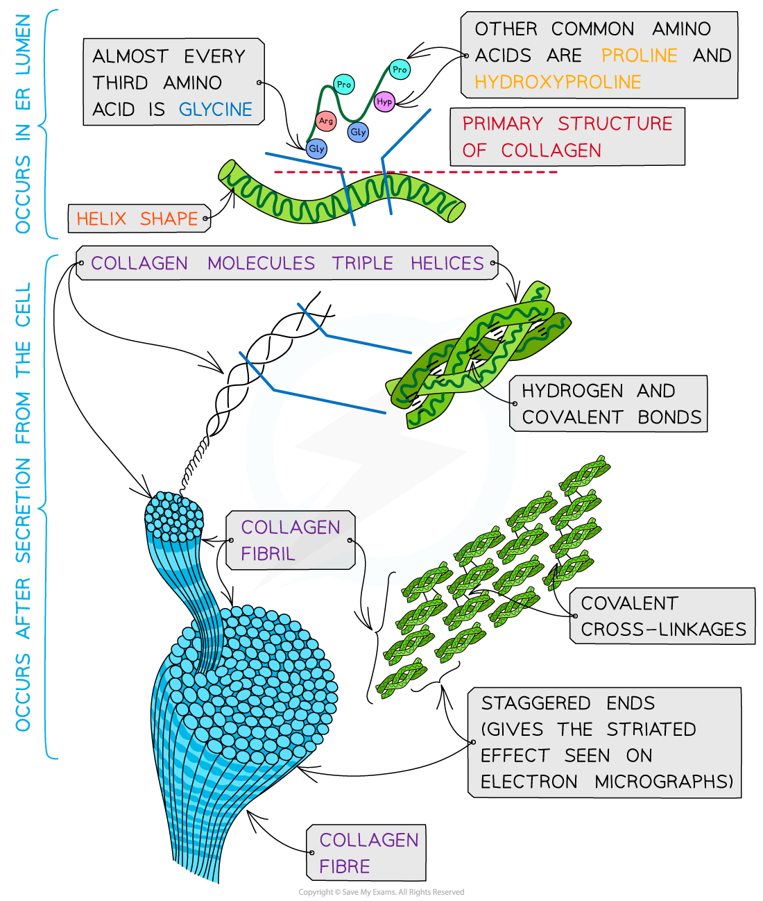

# Collagen

## The Molecular Structure of Collagen

> **Spec point** — `spcpt_JWFjxCzffB2PzWqt` · describe the structure of a molecule of collagen as an example of a fibrous protein, and the arrangement of collagen molecules to form collagen fibres.
relate the structures of collagen molecules and collagen fibres to their function

## The molecular structure of collagen

- **Collagen** is the most common **structural** protein found in vertebrates
- In vertebrates it is the component of **connective tissue** which forms:

  - Tendons
  - Cartilage
  - Ligaments
  - Bones
  - Teeth
  - Skin
  - Walls of blood vessels
  - Cornea of the eye
- Collagen is an **insoluble** **fibrous** protein

### Structure

- Collagen is formed from **three polypeptide chains** closely held together by **hydrogen bonds** to form a **triple helix** (known as tropocollagen)
- Each polypeptide chain:

  - Is a **helix shape** (but not α-helix as the chain is not as tightly wound)
  - Contains about 1000 amino acids with glycine, proline and hydroxyproline being the most common
- In the primary structure of collagen almost **every third** amino acid is **glycine**

  - This is the smallest amino acid with a R group that contains a **single hydrogen atom**
  - Glycine tends to be found on the inside of the polypeptide chains allowing the three chains to be arranged closely together forming a **tight triple helix** structure
- Along with hydrogen bonds forming between the three chains there are also **covalent bonds** present
- Covalent bonds also form **cross-links** between R groups of amino acids in interacting **triple helices** when they are arranged parallel to each other

  - The cross-links hold the collagen molecules together to form **fibrils**
- The collagen molecules are positioned in the **fibrils** so that there are **staggered ends**

  - This gives the striated effect seen in electron micrographs
- When many fibrils are arranged together they form collagen **fibres**
- Collagen fibres are positioned so that they are lined up with the forces they are withstanding

*Collagen is a fibrous structural protein that is formed by triple helices collagen molecules arranging into collagen fibrils and finally into collagen fibres which have high tensile strength*

### Function

- Collagen is a **flexible structural** protein forming **connective tissues**
- The presence of the **many hydrogen bonds** within the **triple helix structure** of collagen results in **great tensile strength**

  - This enables collagen to be able to withstand large pulling forces without stretching or breaking
- The **staggered ends** of the collagen molecules within the **fibrils** provide **strength**
- Collagen is a **stable** protein due to the high proportion of proline and hydroxyproline amino acids

  - This results in more stability as their R groups repel each other
- Collagen molecules are very large and are cross-linked into fibrils and fibres, so collagen is **insoluble** in water

| **Feature** | **Collagen** | **Haemoglobin** |
|---|---|---|
| **Number of polypeptide chains** | 3 (triple helix) | 4 (two alpha globin, two beta globin) |
| **Outline (shape)** | Long, thin | Spherical |
| **Type of protein** | Fibrous | Globular |
| **Main function** | Structural (forms connective tissue) | Functional (transports oxygen) |
| **Amino acid variation** | Repetitive | Variable |
| **Prosthetic group** | No | Yes (haem group) |
| **Solubility** | Insoluble in water | Soluble in water |

> **Exam Hint**
> Use the acronym **NOT MAPS **(number, outline, type etc.) to help you revise how the function relates to the structure of collagen and know the difference between collagen and haemoglobin.
