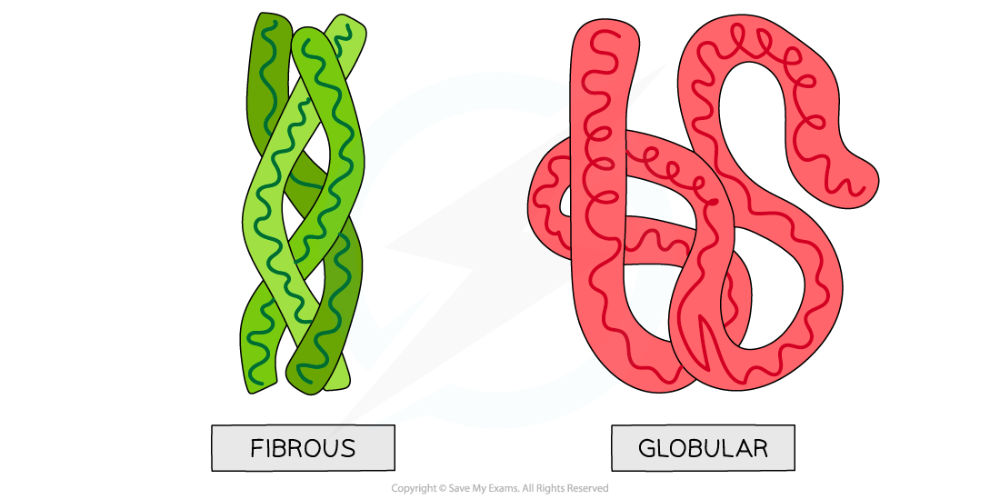

# Globular & Fibrous Proteins

## Proteins: Globular & Fibrous

> **Spec point** — `spcpt_hH76Qrmb6jgvn2MV` · state that globular proteins are generally soluble and have physiological roles and fibrous proteins are generally insoluble and have structural roles

## Proteins: globular & fibrous

### Globular

- Globular proteins** **are **compact**, roughly **spherical** (circular) in shape and **soluble** in water
- Globular proteins form a spherical shape when folding into their tertiary structure because:

  - their **non-polar hydrophobic R groups** are orientated towards the **centre** of the protein away from the aqueous surroundings
  - their **polar hydrophilic R groups** orientate themselves on the **outside** of the protein
- This orientation enables globular proteins to be (generally) **soluble** in water as the water molecules can surround the **polar hydrophilic R groups**
- The **solubility** of globular proteins in water means they play important **physiological** roles; globular proteins can be easily **transported** around organisms and be involved in **metabolic reactions**
- The folding of the protein due to the interactions between the R groups results in globular proteins having **specific shapes**. This also enables globular proteins to play physiological roles, for example, **enzymes** can catalyse specific reactions and **immunoglobulins** can respond to specific antigens
- Some globular proteins are *conjugated* proteins that contain a *prosthetic* group e.g. haemoglobin which contains the prosthetic group called haem

### Fibrous

- Fibrous proteins** **are **long strands **of polypeptide chains that have cross-linkages due to hydrogen bonds
- They have **little or no tertiary structure**
- Due to the large number of **hydrophobic R groups** fibrous proteins are **insoluble** in water
- Fibrous proteins have a limited number of amino acids with the sequence usually being highly repetitive
- The highly repetitive sequence creates **very organised structures** that are **strong **and this along with their insolubility property, makes fibrous proteins very suitable for **structural **roles, e.g. keratin that makes up hair, nails, horns and feathers and collagen which is a connective tissue found in skin, tendons and ligaments

*Globular and fibrous protein models illustrating the roughly spherical shape of globular proteins and the long, stranded shape of fibrous proteins*

| **Feature** | **Globular** | **Fibrous** |
|---|---|---|
| **Shape** | Roughly spherical | Long strands |
| **Amino Acid Sequence** | Irregular with a wide range of R groups | Repetitive with a limited range of R groups |
| **Function** | Physiological/functional | Structural |
| **Examples** | Haemoglobin, insulin, immunoglobulins | Collagen, keratin, myosin, actin, fibrin |
| **Solubility** | Generally soluble in water | Generally insoluble in water |

> **Exam Hint**
> To distinguish between the two proteins, learn **SAFES** (**S**hape, **A**mino acid sequence, **F**unction, **E**xamples and **S**olubility).
