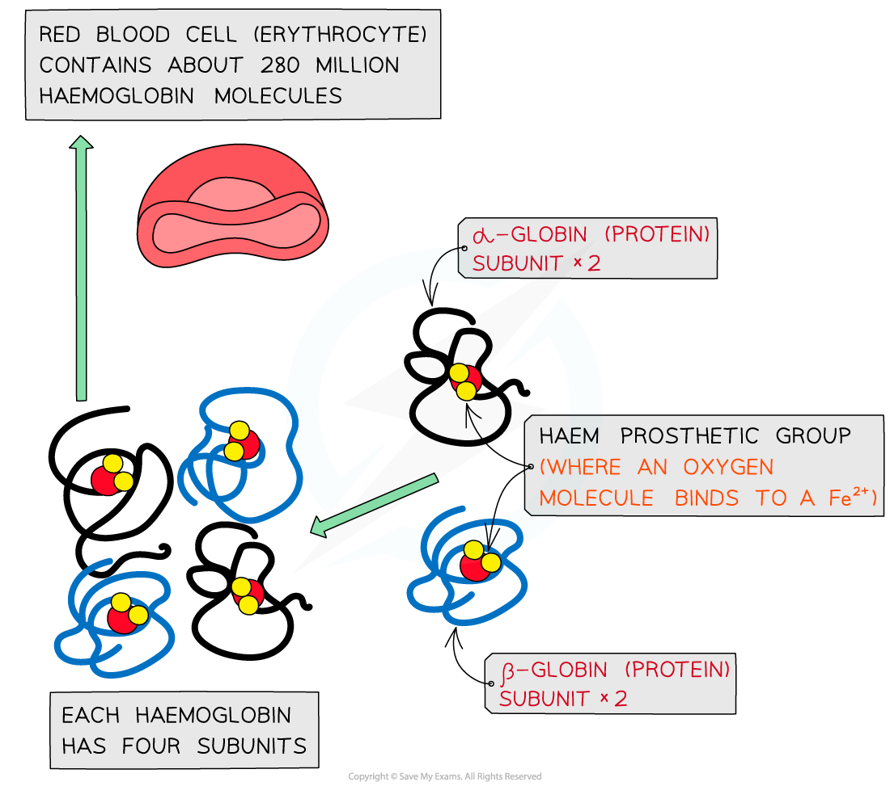

# Haemoglobin

## The Molecular Structure of Haemoglobin

> **Spec point** — `spcpt_DZZv9yn3Qbq7K3Gb` · describe the structure of a molecule of haemoglobin as an example of a globular protein, including the formation of its quaternary structure from two alpha (α) chains (α–globin), two beta (β) chains (β–globin) and a haem group.
relate the structure of haemoglobin to its function, including the importance of iron in the haem group

## The molecular structure of haemoglobin

### Structure

- Haemoglobin is a **globular** protein which is an oxygen-carrying pigment found in vast quantities in red blood cells
- It has a **quaternary** structure as there are **four polypeptide chains**

  - These chains or subunits are **globin** proteins (two **α–globins** and two **β–globins**) and each subunit has a *prosthetic* **haem** group
- The four globin subunits are held together by **hydrogen bonds, ionic bonds and hydrophobic interactions** between the chains, and are arranged so that:

  - The **hydrophobic R groups** are facing **inwards** (helping preserve the **three-dimensional spherical shape**)
  - The **hydrophilic R groups** are facing **outwards** (helping maintain its **solubility**)
- The arrangements of the R groups is important to the functioning of haemoglobin
- If changes occur to the sequence of amino acids in the subunits this can result in the properties of haemoglobin changing

  - This is what happens to cause **sickle cell anaemia**
- The prosthetic **haem** group contains an **iron** II ion (Fe2+) which is able to **reversibly** combine with an **oxygen** molecule forming **oxyhaemoglobin**

  - This results in the haemoglobin appearing bright red
- Each **haemoglobin** with the four haem groups can therefore **carry** **four oxygen** **molecules** (eight oxygen atoms)

*The structure of haemoglobin showing the α–globin and β–globin subunits, the prosthetic haem group with oxygen molecules bonded to form oxyhaemoglobin.*

### Function

- Haemoglobin is responsible for binding oxygen in the lung and **transporting **the** oxygen **to tissue to be used in aerobic respiration
- As **oxygen is not very soluble** in water and haemoglobin is, oxygen can be carried more efficiently around the body when bound to the haemoglobin
- The **presence** of the **haem group** (and Fe2+) enables small molecules like oxygen to be bound more easily:

  - As each **oxygen molecule** binds, it **alters** the **quaternary structure** (due to alterations in the tertiary structure) of the protein
  - This causes haemoglobin to have a higher affinity for the subsequent oxygen molecules and they bind more easily
- The **existence** of the iron II ion (**Fe****2+**) in the prosthetic haem group also allows **oxygen** to **reversibly bind**

  - This is because none of the amino acids that make up the polypeptide chains in haemoglobin are well suited to binding with oxygen

> **Exam Hint**
> You need to know the **structure **of haemoglobin and** how this relates to the function** (its ability to transport oxygen).
