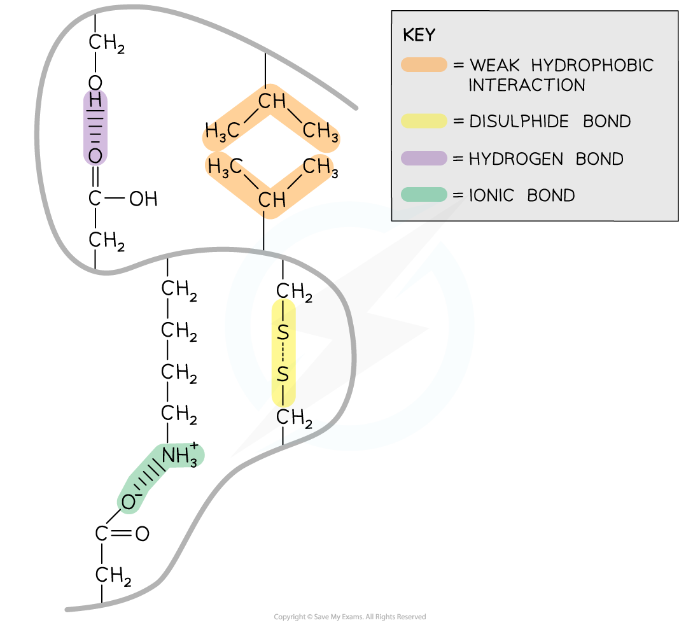

# Protein Shape

## Proteins: Interactions & Shape

> **Spec point** — `spcpt_xp5QpdmpyGbMwng6` · "describe the types of interaction that hold protein molecules in shape:
• hydrophobic interactions
• hydrogen bonding
• ionic bonding
• covalent bonding, including disulfide bonds"

## Proteins: interactions & shape

- A polypeptide chain will fold differently due to the interactions (and the bonds that form) between **R groups**

  - The three-dimensional configuration that forms is called the **tertiary structure **of a protein
- Each of the **twenty amino acids** that make up proteins has a unique **R group**

  - This means that many different interactions can occur creating a vast range of protein configurations and therefore functions
- Within proteins with a tertiary structure the following bonds occur:

  - Strong covalent **disulfide**
  - **Ionic**
  - Weak **hydrogen**
  - Weak **hydrophobic interactions**

*The interactions that occur between the R groups of amino acids determines the shape and function of a protein. These interactions are found within tertiary structures of proteins*

### Disulfide

- **Disulfide bonds** are **strong** covalent bonds that form between **two cysteine R groups** (as this is the only amino acid with **an available sulfur atom** in its R group)
- These bonds are the strongest within a protein, but occur less frequently, and help stabilise the proteins
- These are also known as disulfide bridges
- Can be broken by *reduction*
- Disulfide bonds are common in proteins secreted from cells e.g. insulin

### Ionic

- **Ionic bonds** form between** positively charged **(amine group -NH3+) and **negatively charged **(carboxylic acid -COO-) **R groups**
- Ionic bonds are stronger than hydrogen bonds but they are not common
- These bonds are broken by pH changes

### Hydrogen

- **Hydrogen bonds** form between strongly polar **R groups**. These are the weakest bonds that form but the most common as they form between a wide variety of R groups

### Hydrophobic interactions

- **Hydrophobic interactions** form between the **non-polar (hydrophobic) R groups** within the interior of proteins

> **Exam Hint**
> Note that an interaction is **not the same** as a bond. An **interaction** refers to a **low energy attraction** between two groups, whereas a **bond **is **high energy** and typically involves the **electrons **of the molecules concerned.
> 
> You need to be able to determine which bonds are found in tertiary structures and recognise them in diagrams.
