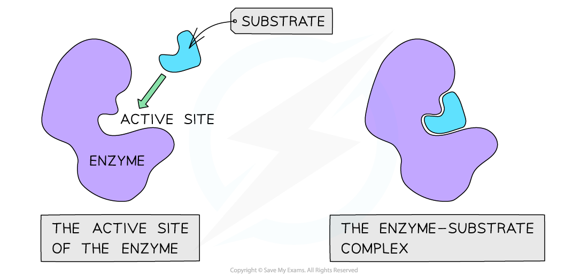
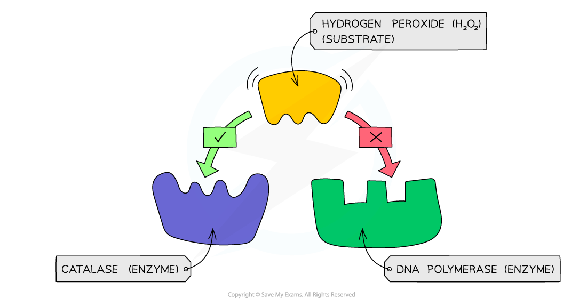
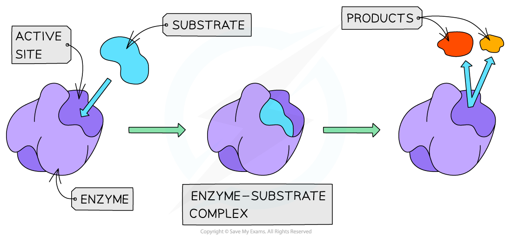
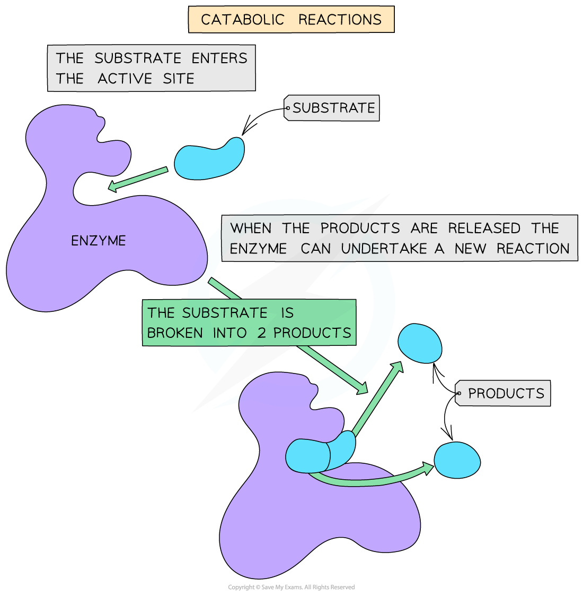
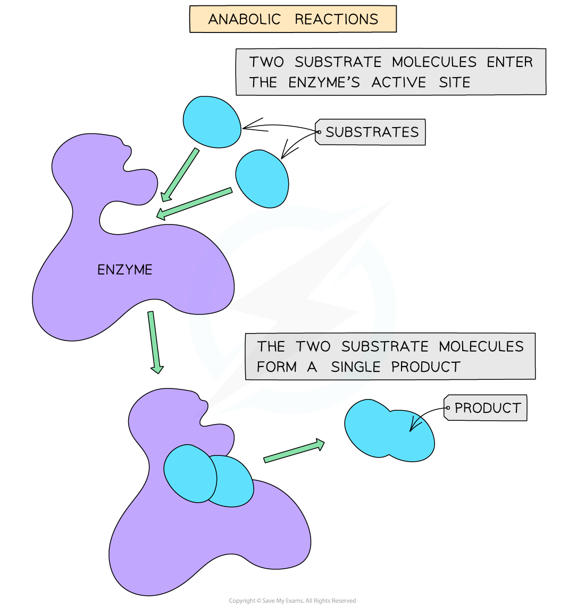
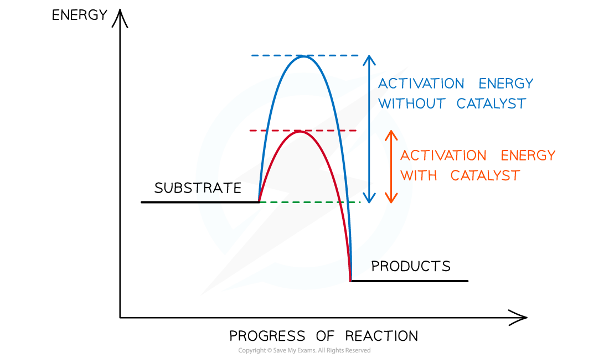

# Enzyme Action

## Mode of Enzyme Action

> **Spec point** — `spcpt_SQBJcHQvQzxzY6DM` · explain the mode of action of enzymes in terms of an active site, enzyme–substrate complex, lowering of activation energy and enzyme specificity, including the lock-and-key hypothesis and the induced-fit hypothesis

## Mode of enzyme action

- Enzymes have an **active site** where **specific ***substrates* **bind **forming an **enzyme-substrate complex**
- The **active site** of an enzyme has a **specific shape** to fit a specific substrate
- Extremes of heat or pH can change the shape of the active site, preventing substrate binding

  - This is called **denaturation**
- Substrates collide with the enzyme's active site and this must happen at the correct **orientation and speed** in order for a reaction to occur

*The active site of an enzyme has a specific shape to fit a specific substrate (when the substrate binds an enzyme-substrate complex is formed)*

- The **specificity** of an enzyme is a result of the **complementary nature** between the shape of the active site on the enzyme and its substrate(s)
- The shape of the active site (and therefore the specificity of the enzyme) is determined by the complex **tertiary structure of the protein **that makes up the enzyme:

  - Proteins are formed from chains of amino acids held together by peptide bonds
  - The order of amino acids determines the shape of an enzyme
  - If the order is altered, the resulting three-dimensional shape changes and therefore the enzyme's shape and active site will change

*An example of enzyme specificity – the enzyme catalase can bind to its substrate hydrogen peroxide as they are complementary in shape, whereas DNA polymerase is not*

- An **enzyme-substrate complex** forms when an enzyme and its substrate join together
- The enzyme-substrate complex is only formed **temporarily**, before the enzyme catalyses the reaction and the product(s) are released

*The temporary formation of an enzyme-substrate complex*

- Enzyme reactions can either be **catabolic** or **anabolic**
- **Catabolic** reactions involve the **breakdown** of complex molecules into simpler products

  - Thishappens when a single substrate is drawn into the active site and broken apart into two or more distinct molecules
- Examples of catabolic reactions include** cellular respiration** and **hydrolysis** reactions

*A catabolic reaction*

- **Anabolic** reactions involve the **building** of more complex molecules from simpler ones by:

  - Drawing two or more substrates into the active site
  - Forming bonds between them
  - Releasing a single product
- Examples of anabolic reactions include **protein synthesis** and **photosynthesis**

*An anabolic reaction*

### Enzymes work by lowering the activation energy of a reaction

- All chemical reactions are associated with energy changes
- For a reaction to proceed there must be enough **activation energy**
- Activation energy is the **amount of energy needed** by the substrate to become just unstable enough for a **reaction to occur** and for **products to be formed**

  - Enzymes speed up chemical reactions because they influence the stability of bonds in the reactants
  - The destabilisation of bonds in the substrate makes it more reactive
- Enzymes work by **lowering the activation energy** of a reaction and in doing so they provide an **alternative energy pathway**

*The activation energy of a chemical reaction is lowered by the presence of a catalyst (an enzyme)*

> **Exam Hint**
> Don't forget that both enzymes and their substrates are highly **specific **to each other – this is known as enzyme-substrate specificity.
