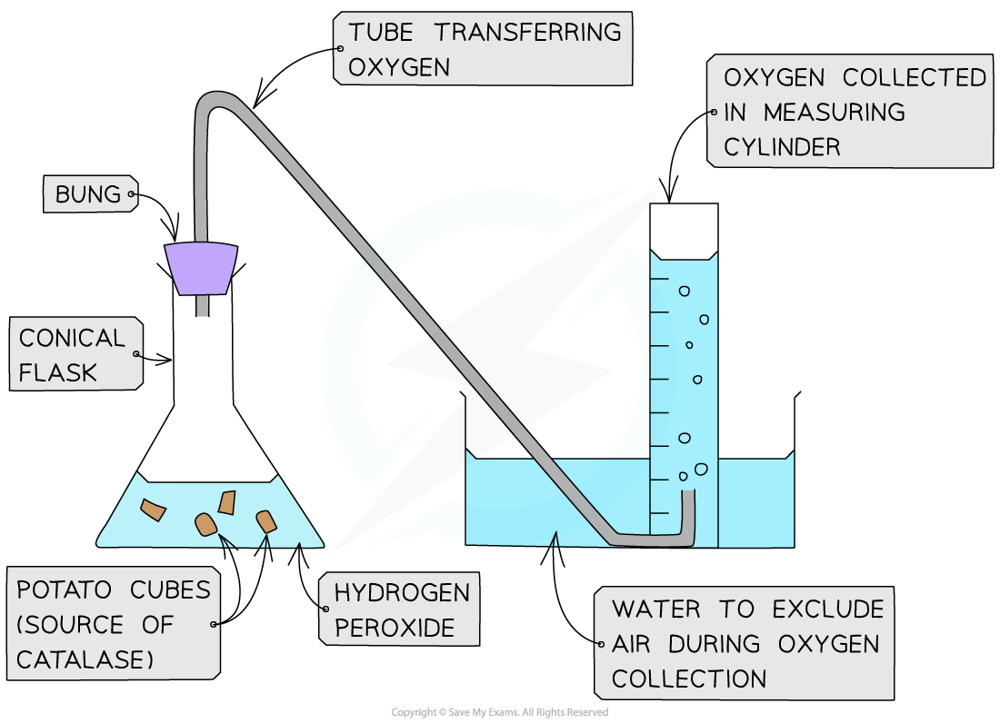
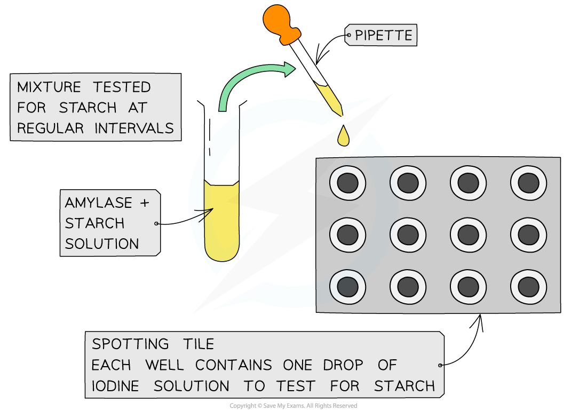

# Measuring Enzyme Activity

## Measuring Enzyme Activity

> **Spec point** — `spcpt_ZBdVJ2yQMDMWQ6pT` · investigate the progress of enzyme-catalysed reactions by measuring rates of formation of products using catalase and rates of disappearance of substrate using amylase

## Measuring enzyme activity

- The **progress** of **enzyme-catalysed reactions** can be investigated by:

  - Measuring the** rate of formation of a product** using catalase
  - Measuring the **rate of disappearance of a substrate** using amylase

### Investigating catalase activity

- In this investigation, the rate of **product formation** is used to measure the rate of an enzyme-controlled reaction:

  - **Hydrogen peroxide** is a common but **toxic** by-product of metabolism
  - This means it must be **broken down** quickly
  - **Catalase** is an enzyme found in the cells of most organisms that **breaks hydrogen peroxide down into water and oxygen**
  - Hydrogen peroxide and catalase are combined and the **volume of oxygen generated **is measured in a set time
  - The **rate of reaction** can then be calculated

*Experimental set-up for investigating the rate of formation of a product using catalase*

### Investigating amylase activity

- In this investigation, the rate of **substrate disappearance** is used to compare rates of reaction under different conditions:

  - **Amylase** is a digestive enzyme that **hydrolyses starch **into **maltose **and **glucose**
  - Amylase functions best at pH 7 and 37oC (all enzymes operate best under specific optimal conditions)
  - **Amylase **and **starch **are **combined **and this reaction mixture is then **tested for starch** at regular time intervals
  - This can be done by taking samples from the reaction mixture at each time interval and adding each sample to some** iodine solution** (starch forms a **blue-black** colour with this solution)
  - In this way, the time taken for starch to be broken down can be measured
  - The investigation can be **repeated under a variety of conditions** (e.g. by altering pH or temperature) and the **reaction rates can then be compared**

*Experimental set-up for investigating the rate of disappearance of a substrate using amylase*

> **Exam Hint**
> Examiners look for awareness of **control variables** such as temperature, pH, enzyme concentration, and substrate concentration.
> 
> If these are not kept the same, you can’t be sure that **changes in rate are due only to the factor you’re testing**.
