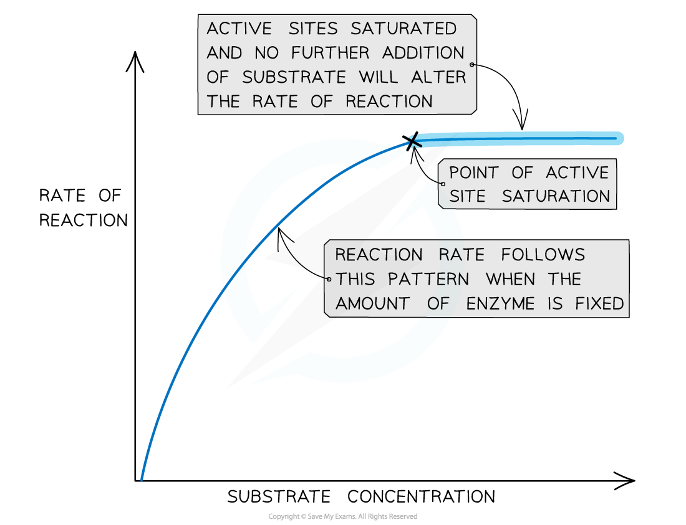

# Rate: Substrate Concentration

## Rate: Substrate Concentration

> **Spec point** — `spcpt_Fj8TKBBztFW7TMDY` · investigate and explain the effects of the following factors on the rate of enzyme-catalysed reactions:
• substrate concentration

## Rate: substrate concentration

- The **greater** the **substrate concentration**, the **higher** the **rate of reaction:**

  - As the number of substrate molecules increase, the likelihood of enzyme-substrate complex formation increases
  - If the enzyme concentration remains **fixed** but the amount of substrate is increased, past a certain point all available active sites eventually become **saturated**
  
    - At this point, any further increase in substrate concentration will **not increase** the reaction rate
  - When the active sites of the enzymes are all full, any substrate molecules that are added have **nowhere to bind** in order to form an **enzyme-substrate complex**
  
    - This means the reaction rate will not increase any further until active sites become free again
- For this reason, in the graph below there is a **linear increase** in reaction rate as substrate is added, which then **plateaus** when all active sites become occupied

*The effect of substrate concentration on the rate of an enzyme-catalysed reaction*

> **Exam Hint**
> If substrate concentration is continually increased but enzyme concentration is kept constant, there eventually comes a point where every enzyme active site is working continuously.
> 
> At this point, the substrate molecules are effectively ‘queuing up’ for an active site to become available. At this stage, the enzyme is working at its maximum possible rate, known as Vmax (V stands for velocity).
