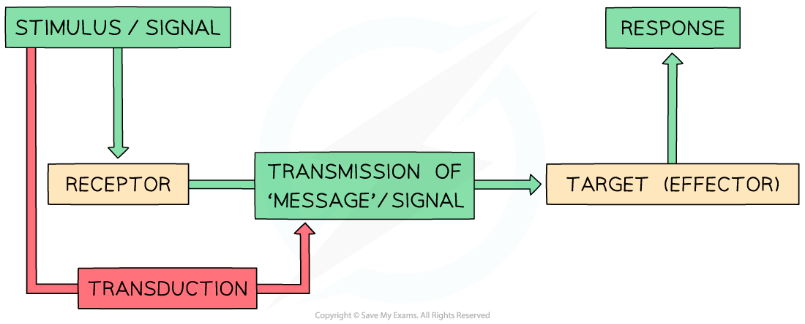
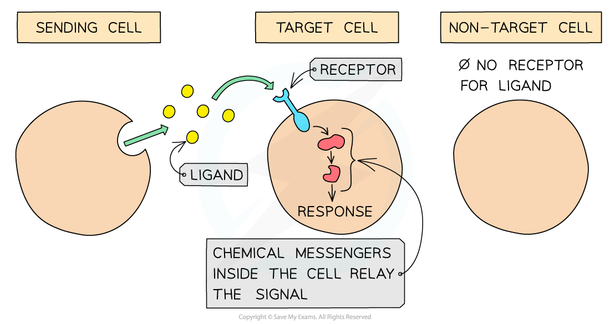

# Cell Signalling

## Cell Signalling

> **Spec point** — `spcpt_4YF5qNJckNZkpXB5` · "outline the main stages in the process of cell signalling leading to specific responses:
• secretion of specific chemicals (ligands) from cells
• transport of ligands to target cells
• binding of ligands to cell surface receptors on target cells"

## Cell signalling

- Cell signalling is the process by which messages are sent to cells
- Cell signalling is very important as it **allows multicellular organisms to control / coordinate their bodies and respond to their environments**
- Cell signalling pathways coordinate the activities of cells, even if they are large distances apart within the organism
- The basic stages of a cell signalling pathway are:

  1. A stimulus or signal is received by a receptor
  2. The signal is converted to a ‘message’ that can be passed on – this process is known as **transduction**
  3. The ‘message’ is transmitted to a target (effector)
  4. An appropriate response is made

*The basic stages of a cell signalling pathway*

- Transmission of messages in cell signalling pathways requires **crossing barriers** such as cell surface membranes
- Cell surface **membranes are therefore very important** in signalling pathways because the membrane controls which molecules (including cell signalling molecules) can move between the internal and external environments of the cell
- Many signalling molecules (ligands) do not enter the target cell; they bind to specific receptors on the cell surface membrane
- Typically in cell signalling pathways, signalling molecules need to **cross or interact** with cell membranes

### Ligands

- Signalling molecules are often called *ligands*
- Ligands are involved in the following stages of a cell signalling pathway:

  - Ligands are **secreted** from a cell (the sending cell) into the extracellular space
  - The ligands are then **transported** through the extracellular space to the **target cell**
  - The ligands **bind to surface receptors** (specific to that ligand) on the target cell
  
    - These receptors are formed from glycolipids and glycoproteins
  - The message carried by the ligand is relayed through a **chain of chemical messengers inside the cell**, triggering a **response**

*The role of ligands in a cell signalling pathway*
