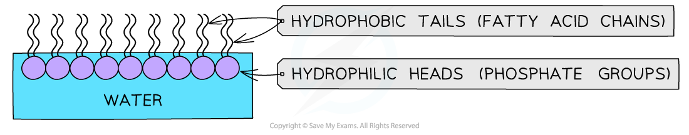
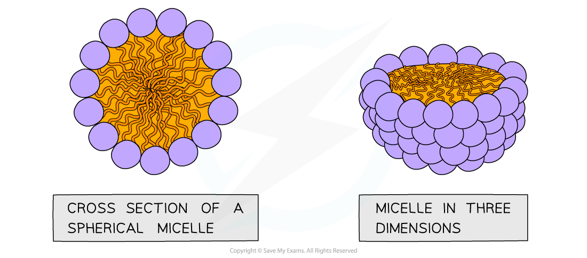
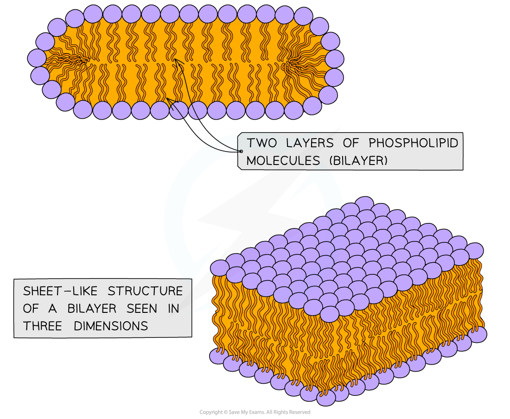
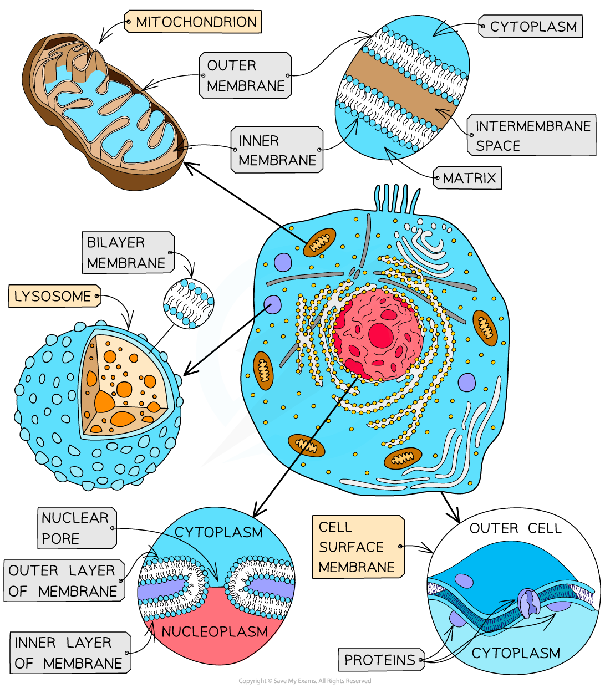
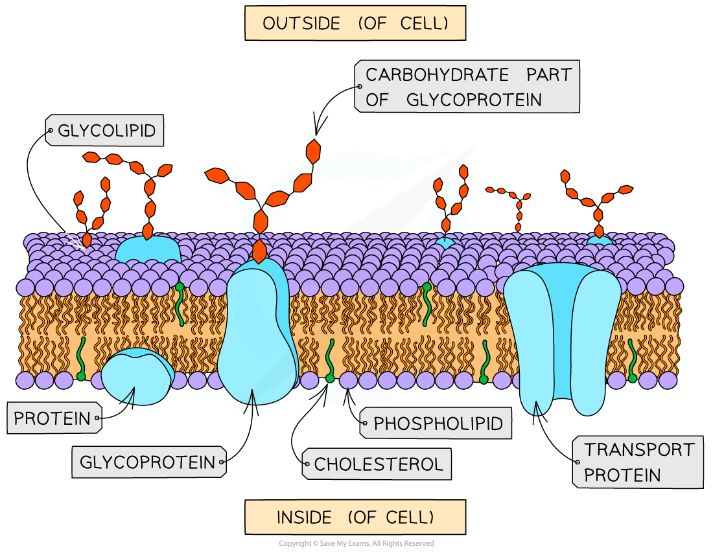

# The Fluid Mosaic Model

## The Fluid Mosaic Model of Membranes

> **Spec point** — `spcpt_bBRD5dy6KX2Y2Msz` · describe the fluid mosaic model of membrane structure with reference to the hydrophobic and hydrophilic interactions that account for the formation of the phospholipid bilayer and the arrangement of proteins

## The fluid mosaic model of membranes

- Membranes are vital structures found in all cells
- The cell surface membrane creates an enclosed space separating the internal cell environment from the external environment

  - Intracellular membranes form compartments within the cell such as the nucleus, mitochondria and RER
- Membranes do not only separate different areas but also control the exchange of materials across them, as well as acting as an interface for communication

  - Membranes are *selectively permeable*
  - Substances can cross membranes by diffusion, osmosis and active transport

- Cellular membranes are formed from a bilayer of **phospholipids** which is roughly 7nm (7 × 10-9 metres) wide and therefore just visible under an electron microscope at very high magnifications
- The** fluid mosaic model** of the membrane was first outlined in 1972 and it explains how biological molecules are arranged to form cell membranes
- The fluid mosaic model also helps to explain:

  - **Passive and active movement between cells and their surroundings**
  - **Cell-to-cell interactions**
  - **Cell signalling**

### Phospholipids

- Phospholipids structurally contain two distinct regions: a polar head and two nonpolar tails

  - The **phosphate head** of a phospholipid is **polar** (*hydrophilic*) and therefore **soluble** in water
  - The lipid tail is **non-polar** (*hydrophobic*) and insoluble in water
- If phospholipids are spread over the surface of water they form a single layer with the hydrophilic phosphate heads in the water and the hydrophobic fatty acid tails sticking up away from the water

  - This is called a **phospholipid monolayer**

*A phospholipid monolayer*

- If phospholipids are mixed/shaken with water they **form spheres**

  - With the hydrophilic phosphate heads facing out towards the water, and
  - The hydrophobic fatty acid tails facing in towards each other
  - This is called a **micelle**

*A micelle*

- Alternatively, two-layered structures may form in sheets
- These are called **phospholipid bilayers** – this is the basic structure of the cell membrane

*A phospholipid bilayer is composed of two layers of phospholipids; their hydrophobic tails facing inwards and hydrophilic heads facing outwards*

- Phospholipid bilayers can form **compartments **– the bilayer forming the cell surface membrane establishing the boundary of each cell
- Internally, membrane-bound compartments formed from phospholipid bilayers provide the basic structure of organelles

  - This allows for specialisation of processes within the cell
- An example of a membrane-bound organelle is the lysosome (found in animal cells)

  - Each lysosome contains many hydrolytic enzymes that can break down many different kinds of biomolecule
- These enzymes need to be kept compartmentalised otherwise they would break down most of the cellular components

*Membranes formed from phospholipid bilayers help to compartmentalise different regions of the cell*

### Structure of membranes

- The phospholipid bilayers that make up cell membranes also contain **proteins**

  - The proteins can either be **intrinsic** (or **integral**) or **extrinsic** (**peripheral**)
  - Intrinsic proteins are embedded in the membrane with their arrangement determined by their **hydrophilic** and **hydrophobic** regions
  - Extrinsic proteins are found on the outer or inner surfaces of the membrane
- The fluid mosaic model describes cell membranes as **‘fluid’** because:

  - The **phospholipids and proteins can move around via diffusion**
  - The phospholipids mainly move sideways, within their own layers
  - The many different types of protein that are interspersed throughout the bilayer move about within it (a bit like icebergs in the sea) although some may be fixed in position
- The fluid mosaic model describes cell membranes as **‘mosaics’** because:

  - The scattered pattern produced by the **proteins** within the phospholipid bilayer looks somewhat like a mosaic when viewed from above

*The distribution of the proteins within the membrane gives a mosaic appearance and the structure of proteins determines their position in the membrane*

> **Exam Hint**
> You must know how to **draw** and **label** the fluid mosaic model, as well as ensure that you can describe **why** it is **called** the **fluid mosaic model**.
