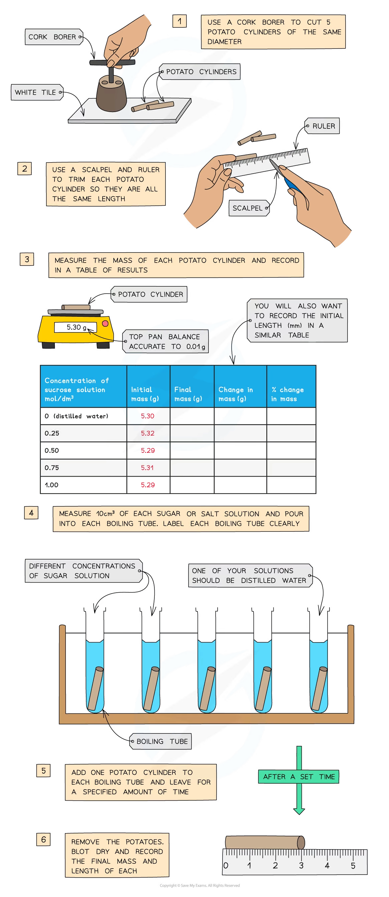
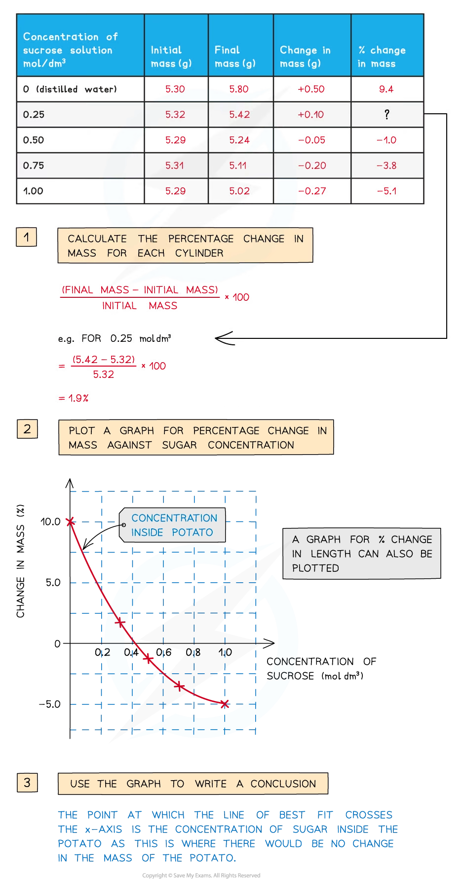

# Estimating Water Potential in Plants

## Estimating Water Potential in Plant Tissue

> **Spec point** — `spcpt_bkCB7fgmKTwB3vZT` · investigate the effects of immersing plant tissues in solutions of different water potentials, using the results to estimate the water potential of the tissues

## Estimating water potential in plant tissue

- It is possible to investigate the effects of immersing plant tissue in **solutions of different water potentials **and then **use the results to estimate the water potential of the plant tissue** itself
- The most common osmosis practical of this kind involves cutting **cylinders of potato** and placing them into solutions with a **range of different water potentials**

  - These are usually sucrose solutions of increasing concentration
  - At least five different concentrations are usually required

### Method

- The required number of potato cylinders are cut (one for each of the solutions you are testing—or more than one per solution if you require repeats; this is good experimental practice)
- They are all cut to the **same length** and, once blotted dry to remove any excess moisture, their **initial mass is measured and recorded** before placing into the solutions
- They are left in the solutions for a set length of time (e.g., 30 minutes), usually in a water bath (set at around 30o)
- They are then removed and **dried to remove excess liquid**
- The **final length and mass **of each potato cylinder are then measured and recorded

*You will need to use apparatus appropriately to measure out the volumes of your solutions and record your measurements*

### Analysis

- The **percentage change** in mass for each potato cylinder is calculated
- If there is a potato cylinder that has neither increased nor decreased in mass, it means there was **no overall net movement of water** into or out of the potato cells
- This is because the solution that this particular potato cylinder was in had the **same water potential** as the solution found in the cytoplasm of the potato cells

  - So there was **no water potential gradient** and therefore no net movement of water into or out of the potato cells
- The water potential of the potato tissue can be estimated if a graph is plotted showing how the percentage change in mass changes with the concentration of sucrose solution

  - **The point at which the line of best fit crosses the x-axis is the concentration of sucrose solution that has the same water potential as the potato tissue**

*A positive change in mass indicates that the potato tissue has gained water by osmosis, whereas a negative change would suggest the opposite*

- A **positive** percentage change in mass indicates that the potato has gained water by osmosis (net movement of water from the solution into the potato) meaning the **solution** had a **higher water potential** than the potato

  - This would make the potato cells **turgid,** as the water exerts turgor pressure (or hydrostatic pressure) on the cell walls—the potatoes will feel firm
- A **negative** percentage change suggests the opposite, that is, the solution had a **lower** water potential than the potato

  - The potato cylinder in the **strongest sucrose concentration** will have **decreased in mass** the most as there is the **greatest water potential gradient** in this tube between the potato cells (higher water potential) and the sucrose solution (lower water potential)
  - This means more water molecules will move out of the potato cells by **osmosis**, making them **flaccid** and decreasing the mass of the potato cylinder – the potato cylinders will feel floppy
  - If looked at underneath the microscope, cells from this potato cylinder might be **plasmolysed**, meaning the cell membrane has pulled away from the cell wall

> **Exam Hint**
> Questions involving osmosis experiments are common and you should be able to use your knowledge of osmosis to explain the results obtained.
> 
> If describing or analysing an experiment remember to include mention of variables that need to be **controlled **and mention **repeats**, as this helps improve the **reliability **of the results obtained.
> 
> Don’t worry if it is an experiment you haven’t done yourself in the lab – simply figure out which solution has the higher water potential and explain that water moves by osmosis from the higher to the lower water potential, down the water potential gradient.
