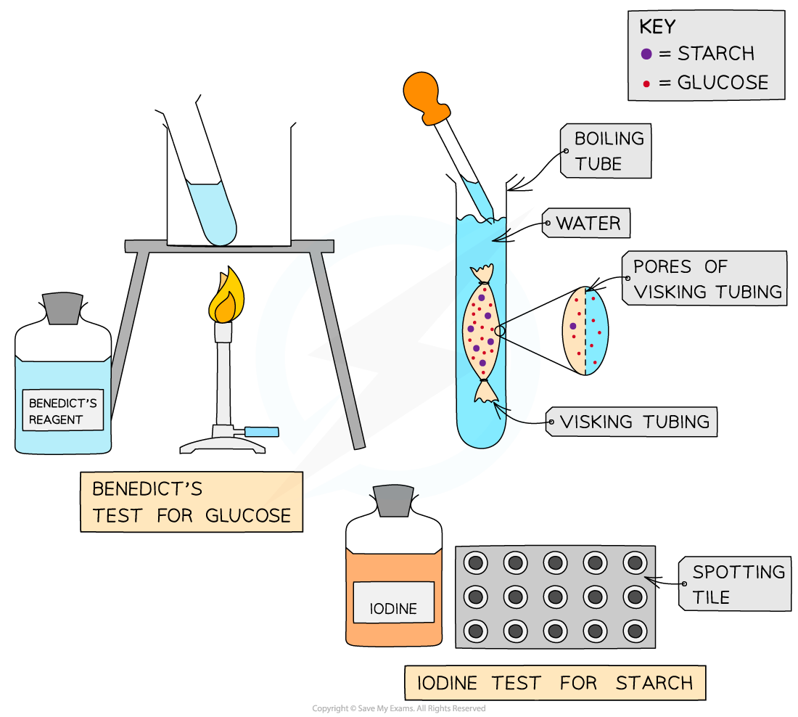
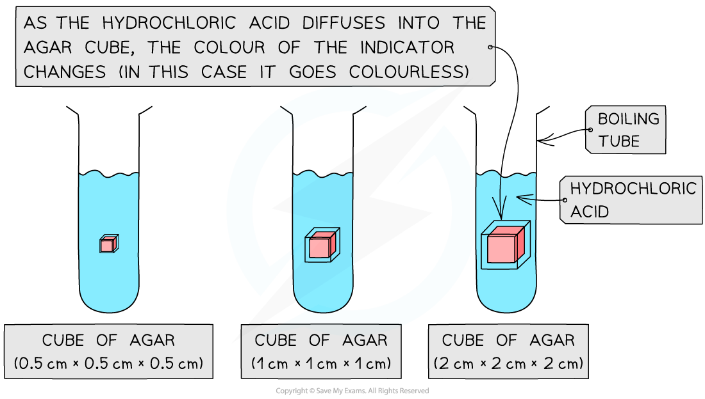

# Investigating Diffusion

## Investigating Diffusion

> **Spec point** — `spcpt_X58HCcFcv4RR3sGH` · investigate simple diffusion and osmosis using plant tissue and non-living materials, including dialysis (Visking) tubing and agar

## Investigating diffusion

### Investigating diffusion using Visking tubing

- **Visking tubing** (sometimes referred to as dialysis tubing) is a non-living, **selectively permeable** membrane made from cellulose
- Pores in this membrane are small enough to **prevent the passage of large molecules** (such as **starch**) but allow **smaller molecules** (such as **glucose**) to pass through by **diffusion**
- This can be demonstrated by:

  - Filling a section of Visking tubing with a mixture of starch and glucose solutions
  - Suspending the tubing in a boiling tube of water for a set period time
  - Testing the water outside of the visking tubing at regular intervals for the presence of starch and glucose to monitor whether diffusion of either substance out of the tubing has occurred
  - The results should indicate that glucose, but not starch, diffuses out of the tubing

*An example of how to set up an experiment to investigate diffusion*

### Using agar to investigate the effect of changing surface area to volume ratio on diffusion

- The effect of size (surface area to volume ratio) on diffusion can be investigated by timing the diffusion of ions through different-sized cubes of agar
- Agar, coloured with an indicator, is cut into cubes of the required dimensions (eg. 0.5cm × 0.5cm × 0.5cm, 1cm × 1cm × 1cm and 2cm × 2cm × 2cm)

  - Purple agar can be created if it is made up of very dilute **sodium hydroxide solution and Universal Indicato**r
  - Alternatively, the agar can be made up with **Universal Indicator only**
  - Another method is to use **sodium hydroxide and phenolphthalein** to colour agar pink (this will turn colourless in the presence of acid)
- The cubes are then placed into boiling tubes containing a **diffusion solution** (such as dilute hydrochloric acid)

  - The acid should have a higher concentration than the sodium hydroxide so that a change in the colour of the indicator in the agar blocks can be used to monitor **diffusion**
- Measurements can be taken of either:

  - The **time taken for the acid to completely change the colour **of the indicator in the agar blocks
  - The** distance travelled into the block by the acid** (shown by the change in colour of the indicator) in a given time period (eg. 5 minutes)
- These times can be **converted to rates** (1 ÷ time taken)
- A graph could be plotted showing how the rate of diffusion (rate of colour change) changes with the surface area : volume ratio of the agar cubes

*An example of how to set up an experiment to investigate the effect of changing surface area to volume ratio on diffusion, here phenolphthalein has been used as the indicator*

> **Exam Hint**
> When an agar cube (or for example a biological cell or organism) increases in size, the volume increases faster than the surface area, because the volume is cubed whereas the surface area is squared.
> 
> When an agar cube (or biological cell / organism) has more volume but proportionately less surface area, diffusion takes longer and is less effective. In more precise scientific terms, the **greater the surface area to volume ratio**, the **faster the rate of diffusion**!
