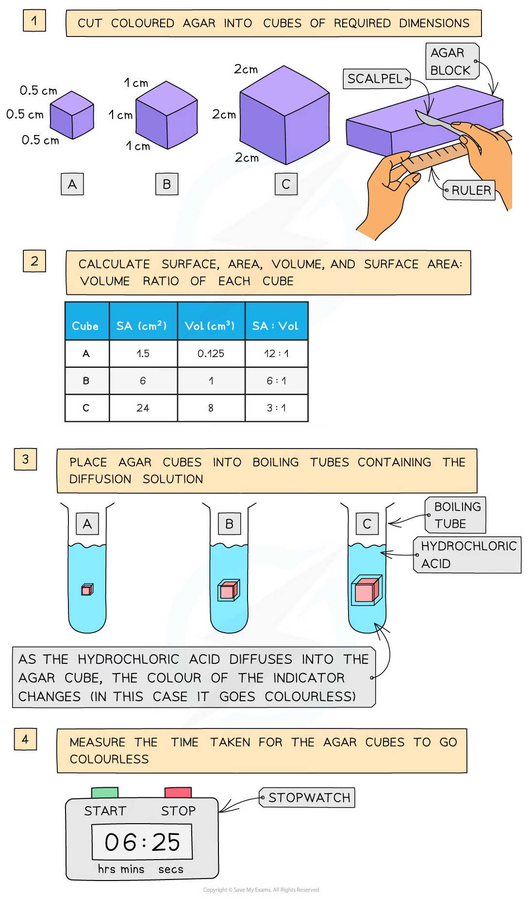
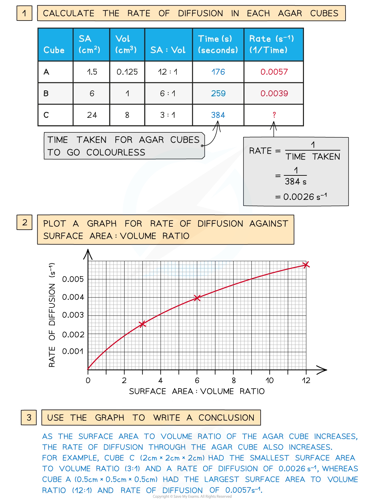

# Investigating Surface Area

## Investigating SA with Agar

> **Spec point** — `spcpt_H8TGx6dp4hKvgVSf` · investigate the effect of changing surface area to volume ratio on diffusion using agar blocks of different sizes

## Investigating SA with agar

- The effect of changing surface area to volume ratio on diffusion can be investigated by timing the diffusion of ions through cubes of agar of different sizes

### Method

- Coloured agar is made up and cut into cubes of the required dimensions (eg. 0.5 cm × 0.5 cm × 0.5 cm, 1 cm × 1 cm × 1 cm and 2 cm × 2 cm × 2 cm)
- The surface area, volume and surface area to volume ratio of these cubes is calculated and recorded
- The cubes are then placed into boiling tubes containing a diffusion solution (such as dilute hydrochloric acid)

  - The same volume of dilute hydrochloric acid should be measured carefully into each boiling tube
  - The acid should have higher concentration than the sodium hydroxide so that its diffusion can be monitored by a change in colour of the indicator in the agar blocks
- Measurements can be taken of either:

  - The time taken for the acid to completely change the colour of the indicator in the agar blocks
  - The distance travelled into the block by the acid (shown by the change in colour of the indicator) in a given time (e.g., 5 minutes)

*The steps used to investigate the effect of changing the surface area to volume ratio on diffusion*

### Analysis

- If the time taken for the acid to completely change the colour of the indicator in the agar blocks is recorded, these times can be converted to rates
- A graph could be plotted showing how the rate of diffusion (rate of colour change) changes with the surface area : volume ratio of the agar cubes

*To analyse the results of the investigation, calculate the rates of diffusion before plotting a graph for rate of diffusion against surface area : volume ratio*
