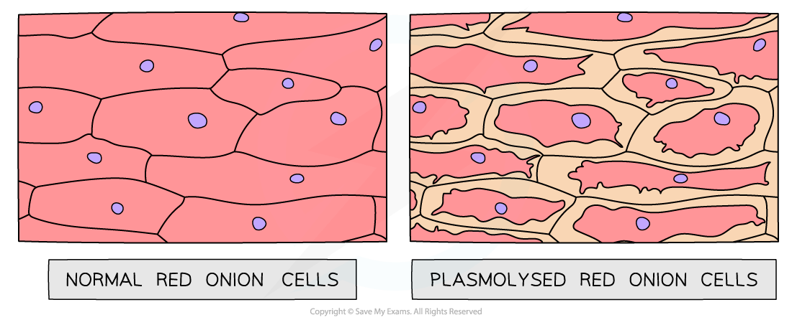

# Investigating Transport Processes in Plants

## Investigating Diffusion & Osmosis: Plant Tissue

> **Spec point** — `spcpt_gVNXBKsqPs2YydCD` · investigate simple diffusion and osmosis using plant tissue and non-living materials, including dialysis (Visking) tubing and agar

## Investigating diffusion & osmosis: plant tissue

### Investigating diffusion

- The **permeability** of cell membranes can be affected by environmental factors such as **chemicals or temperature**
- This can be investigated using beetroot:

  - Pieces of beetroot (obtained using a cork borer) are placed into water at **different temperatures** or into **different alcohol concentrations**
  - Increases in cell membrane permeability result in the red pigment (normally contained within the large central vacuole) leaking out of the beetroot cells by **diffusion**
  - Qualitative or quantitative measurements of the changes in the colour of the surrounding solution can be taken e.g., using a colorimeter or a set of colour standards
- The red pigment leaks out via **diffusion** from regions of **high concentration in the large central vacuoles** of the beetroot cells to a region of **low concentration in the solution** outside the beetroot pieces

### Investigating osmosis

- Evidence of osmosis occurring in plant cells can be shown when plant cells undergo **plasmolysis**:

  - If a plant cell is placed in a solution with a **lower water potential **than the plant cell (such as a concentrated sucrose solution), water will **leave** the plant cell through its selectively permeable cell surface membrane by **osmosis**
  - As water leaves the **vacuole** of the plant cell, the volume of the plant cell **decreases**
  - The protoplast (living part of the cell inside the cell wall) gradually shrinks and no longer exerts pressure on the cell wall
  - As the protoplast continues to shrink, it begins to pull away from the cell wall
  - This process is known as **plasmolysis** – the plant cell is **plasmolysed**
- This process can be observed using **epidermal strips** (sections of the very thin outer layer of tissue in plants)
- Plants with coloured sap (such as red onion bulbs, rhubarb petioles and red cabbage) make observations easier
- The epidermal strips are placed in a **range of concentrations of sucrose solution **or **sodium chloride solution**
- The strips are then viewed under a light microscope
- Plasmolysis may take several minutes to occur

*Light micrograph of normal red onion cells alongside those that have plasmolysed (artistic impression)*
