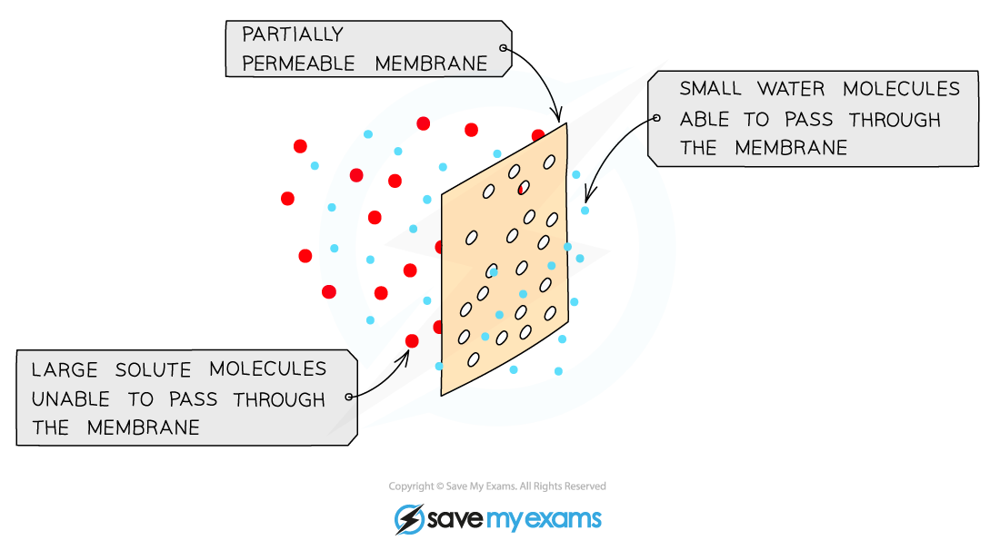
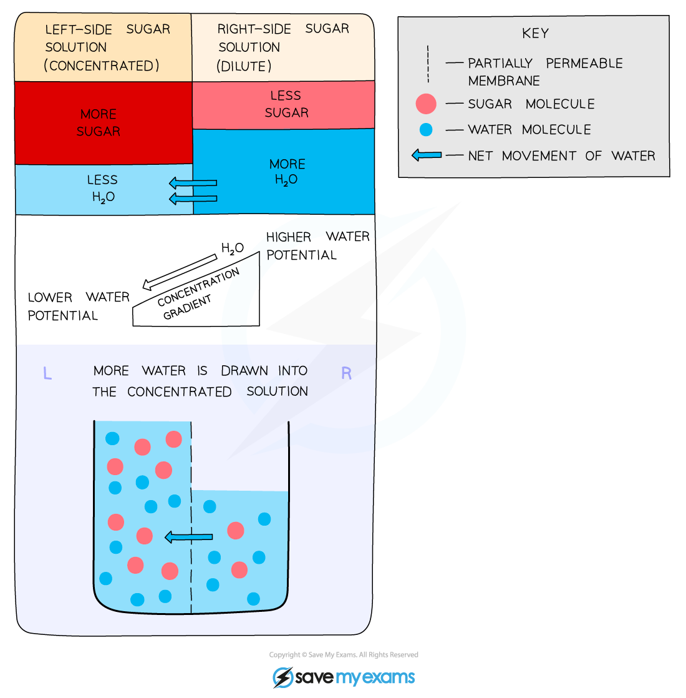

# Osmosis

## The Process of Osmosis

> **Spec point** — `spcpt_VvXvQVK9xGypjSDG` · describe and explain the processes of  osmosis

## The process of osmosis

- All cells are surrounded by a cell membrane which is **selectively permeable**
- Water can move in and out of cells by **osmosis**
- Osmosis is the **diffusion or net movement of water molecules** from a dilute solution (high water potential) to a more concentrated solution (low water potential) across a** selectively permeable membrane**

  - The cell membrane is selectively permeable which means it allows certain molecules (like water) through the bilayer

*Osmosis and the selectively permeable membrane*

*How osmosis works*

> **Exam Hint**
> Water can pass through the phospholipid bilayer because water molecules are small molecules that can pass between phospholipids in the cell membrane.
> 
> Although water molecules are polar, they can still pass through the bilayer because of their small size.
