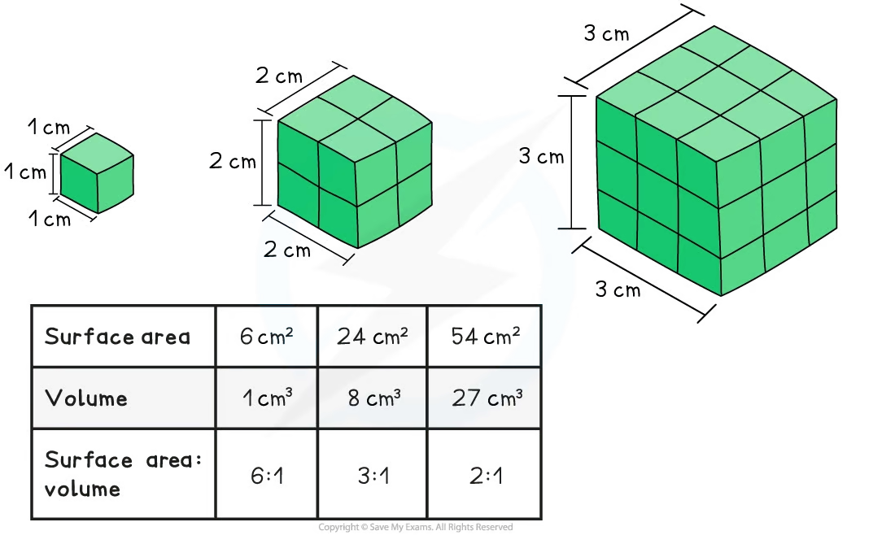

# Surface Area to Volume Ratios

## Principles of SA:V

> **Spec point** — `spcpt_CgFHy6WqfnBgnCd6` · illustrate the principle that surface area to volume ratios decrease with increasing size by calculating surface areas and volumes of simple -D shapes (as shown in the Mathematical requirements)

## Principles of SA:V

- **Surface area** and **volume** are both very important factors in the **exchange of materials** in organisms
- As the surface area and volume of an organism increase (and therefore the overall ‘size’ of the organism increases), the surface area : volume ratio **decreases**
- This is because **volume increases more rapidly than surface area as size increases**

### Importance of a high surface area to volume ratio

- Having a high surface area to volume ratio increases the ability of a biological system to perform the following important functions

  - Obtaining necessary **resources **eg, oxygen, glucose, amino acids
  - **Eliminating waste** products eg. carbon dioxide, urea
  - Acquiring or dissipating **thermal energy** (heat)
  - Otherwise **exchanging chemicals and energy** with the surroundings eg. absorbing hormones at the cell surface in the hormone's target organ

*As size increases, the surface area : volume ratio decreases*

|   | Cube | Cuboid | Cylinder |
|---|---|---|---|
| Diagram |  |  |  |
| Surface Area | 6s2 | 2lh + 2lw + 2wh | 1x rectangle = 2πrh  2x circular ends = 2πr2  SA = 2πrh + 2πr2 |
| Volume | s3 | l × w × h | πr2h |
| Example | If s = 1 cm then SA = (1×1)×6 SA = 6cm2  V = s3 = 13 =1cm3 ∴ SA:V ratio = **6:1** | If l = 4cm, w = 2cm, h = 1cm, then SA = 2((4×1)+(4×2)+(2×1)) = 28cm2  V = 4 × 2 × 1 = 8cm3  ∴ SA:V ratio = 28:8 = **3.5:1** | If r = 2 cm and h = 6cm, then SA = 2πrh + 2πr2 = 8π +24π = 32π cm2  V = π(2)2 × 6 = 24π cm3  ∴ SA : V ratio = 32 : 24 = **1.33:1** |

> **Worked Example**
> Calculate the surface area-to-volume ratios of the two following microorganisms:
> 
> 1. A bacterial cell from the species *Staphylococcus aureus*; you can assume that each cell is a **cube **with side length of 800 nm (8 × 10-7 m)
> 2. A bacterial cell from the species *Bacillus subtilis*; these are **rod-shaped cells** which you can assume to be **cylindrical **in shape. They are 5 µm long and 1 µm in diameter
> 
> Comment on your calculated answers.
> 
> **Solution**
> 
> *1. For the **Staphylococcus aureus** cell:* side length = 800 nm
> 
> > *Convert this value into µm by dividing by 1000*
> 
> $\frac{800\mathrm{nm}}{1000}=0.8\mathrm{μm}$
> 
> *Surface area* *of cube* = 6(s2)
> 
> = 6 × (0.8 × 0.8) = 3.84 µm2
> 
> *Volume* =  0.8  × 0.8 × 0.8
> 
> = 0.512 µm3
> 
> > *The SA:V ratio is the surface area divided by the volume, so*
> 
> $\text{SA} : \mathrm{V} \text{ratio} = \frac{3.84}{0.512} = \frac{7.5}{1} = 7.5 : 1 ( \text{or} \text{simply} 7.5 )$
> 
> ___________
> 
> *2. For the **Bacillus subtilis **cell:* radius = 0.5 µm (half of diameter 1µm)  
> *Surface area of a cylinder* =  2πrh + 2πr2 
> = (2π × 0.5 × 5) + (2π × 0.52) 
> = 15.708 + 1.571 µm2 
> = 17.278 µm2
> 
> *Volume of a cylinder*: formula is πr2h 
> = π × 0.52 × 5 
> = 3.927 µm3
> 
> $\text{SA} : \mathrm{V} \text{ratio} = \frac{17.278}{3.927} = \frac{4.4}{1} = 4.4 : 1 ( \text{or} \text{simply} 4.4 )$
> 
> > *The cuboid cell of **Staphylococcus aureus** has a surface area-to-volume ratio of **7.5 : 1*
> 
> > *The cylindrical cell of **Bacillus subtilis** has a surface area-to-volume ratio of **4.4 : 1*
> 
> > *The smaller cell has the largest surface area-to-volume ratio of the two shapes. This allows efficient diffusion into / out of the cell. The larger the surface area to volume ratio, the more membrane there is per unit volume, so exchange by diffusion can keep up with the needs of the whole cell. So the larger the surface area to volume ratio, the better adapted to simple diffusion that organism is.*

> **Exam Hint**
> This worked example assumes that *Staphylococcus aureus* is a cuboid shaped cell; in fact it is a **spherical **cell.
> 
> You are not required to know how to calculate the surface area and volume of a sphere for this exam. For a given volume, a sphere has the smallest surface area of any shape, so cells that rely on diffusion stay small, or are flattened or elongated, to keep a large surface area to volume ratio.
> 
> However, you are expected to be able to calculate the SA:V ratio for a cube, cuboid or cylinder and explain how the increasing size of an organism affects the SA:V ratio.
