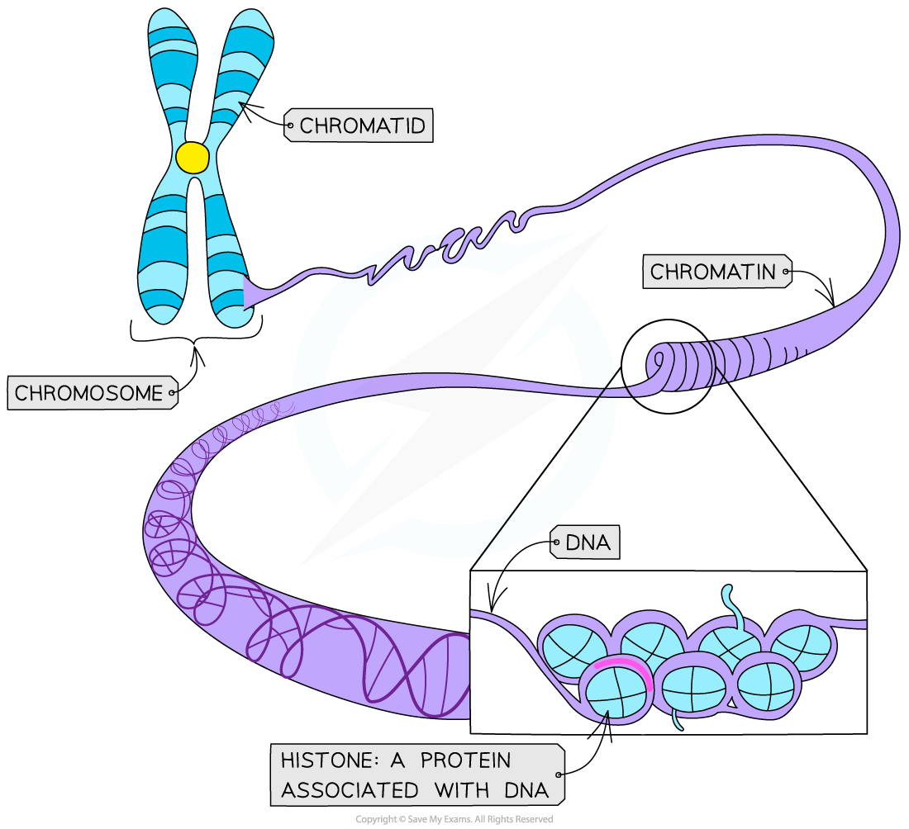
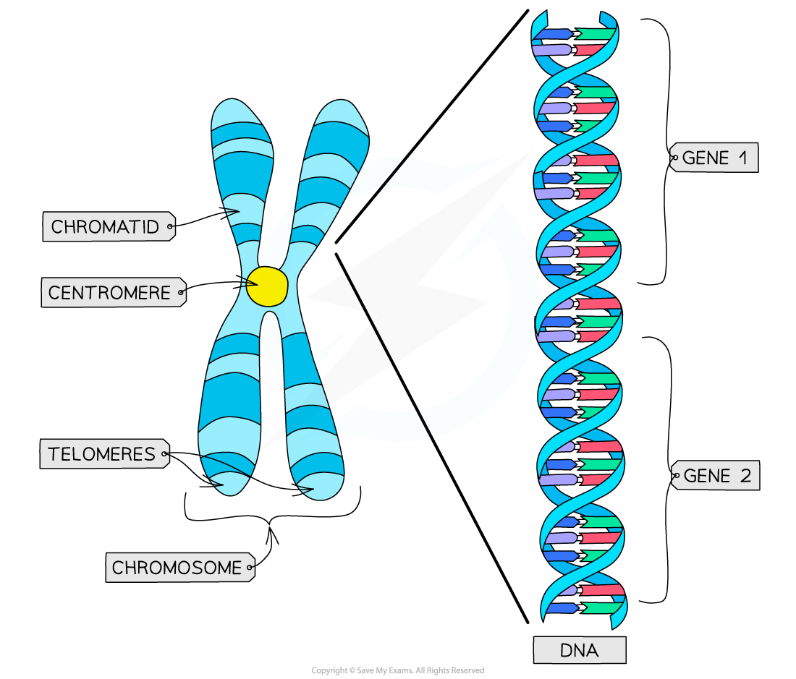
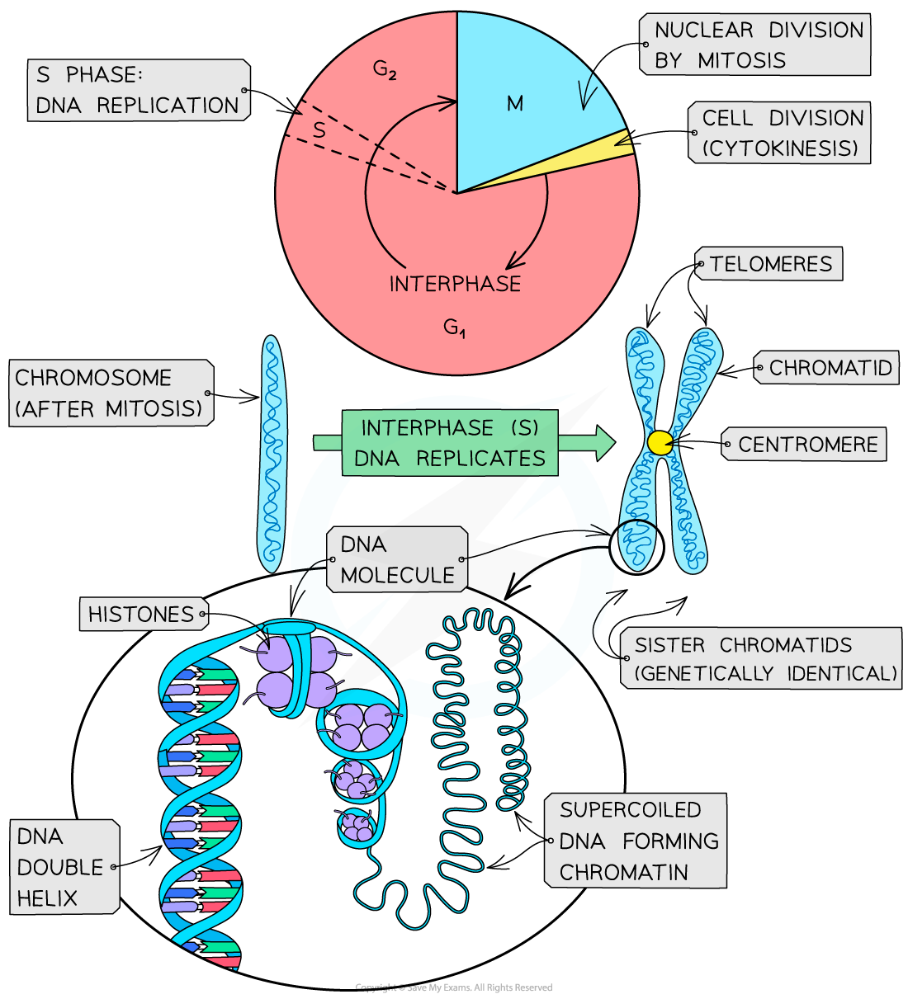

# Chromosome Structure

## Chromosome Structure

> **Spec point** — `spcpt_6Q8sFR74mR3rtCCY` · describe the structure of a chromosome, limited to:
• DNA
• histone proteins
• sister chromatids
• centromere
• telomeres

## Chromosome structure

- Chromosomes are made of **one** **very long, condensed DNA molecule** associated with proteins (in eukaryotic cells)

  - The main proteins present are the large positively charged globular proteins called **histones**
  - Their role is to **organise** and **condense** the DNA tightly so that it fits into the nucleus
- The tightly coiled combination of DNA and proteins is called **chromatin**—this is what chromatids, and therefore chromosomes, are made of

#### 

*DNA is coiled around histone proteins to make chromatin*

- During **interphase** (S phase) the DNA replicates to create **two identical strands of DNA called chromatids**

  - These chromatids are joined together by a narrow region called the **centromere**
- The two chromatids that make up the double structure of a chromosome are known as **‘sister chromatids’**
- It is important that the **sister** **chromatids** are **identical** (contain the same genes) because this is key to cell division

  - One chromatid goes into one daughter cell and one goes into the other daughter cell during mitosis, ensuring the daughter cells are **genetically identical**
- Each chromatid is made up of one very long, condensed DNA molecule, which is made up of a series of **genes**
- The **ends** of the chromatids in chromosomes are ‘sealed’ with **protective structures** called *telomeres*

*Simplified diagram of the structure of a chromosome*

*Diagram illustrating the structure of a chromosome before and after the S phase*

> **Exam Hint**
> It is important that you are able to distinguish when the terms **chromatid**, **sister chromatids** and **chromosomes** are used.
