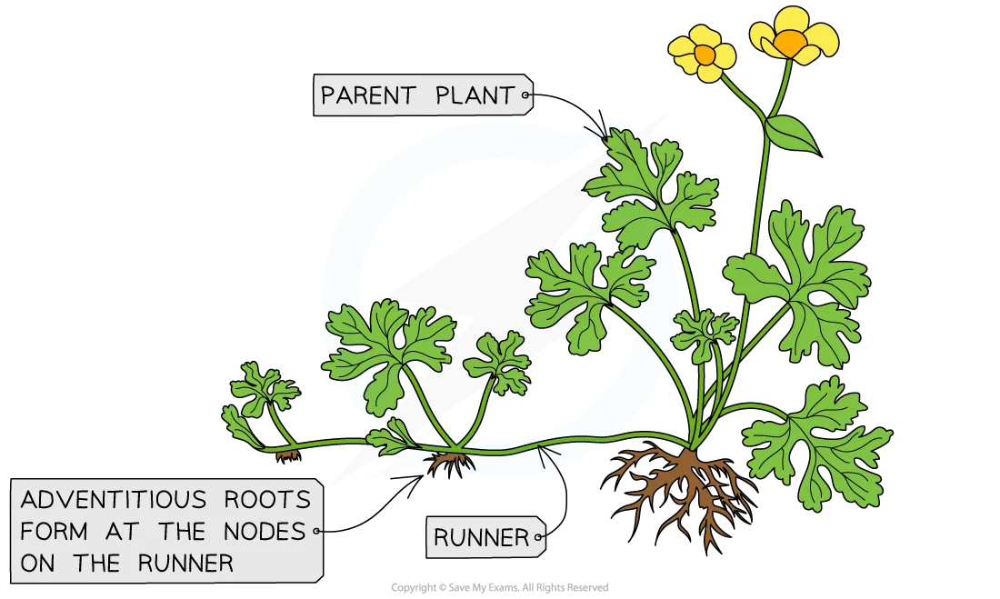

# Mitosis

## The Importance of Mitosis

> **Spec point** — `spcpt_8sK9cVTyg6kWfjSW` · explain the importance of mitosis in the production of genetically identical daughter cells during:
• growth of multicellular organisms
• replacement of damaged or dead cells
• repair of tissues by cell replacement
• asexual reproduction

## The importance of mitosis

- Mitosis is the process of nuclear division by which **two genetically identical daughter nuclei are produced **that are also genetically identical to the parent nucleus
- The process of mitosis is of great biological significance and is **fundamental to many biological processes**:

### Growth of multicellular organisms

- The two daughter cells produced are genetically identical to one another (**clones**)
- They have the same number of chromosomes as the parent cell
- This enables **unicellular zygotes** (as the zygote divides by mitosis) **to grow into multicellular organisms**
- Growth may occur across the whole body of the organism or be confined to certain regions, such as in the meristems (growing points) of plants

### Replacement of cells & repair of tissues

- Damaged tissues can be repaired by mitosis followed by cell division
- Dead and damaged cells need to be **continually replaced by genetically identical cells**

  - In humans, for example, cell replacement occurs particularly rapidly in the skin and the lining of the gut

### Asexual reproduction

- Asexual reproduction is the production of new individuals of a species by a **single** parent organism

  - The offspring are genetically identical to the parent
- For unicellular organisms such as *Amoeba*, cell division results in the reproduction of **genetically identical** offspring
- For multicellular organisms (as seen with many plant species) new individuals grow from the parent organism (by cell division) and then detach (‘bud off’) from the parent in different ways

  - Some examples of these are budding in *Hydra* and yeast and runners from strawberries

*Runners from strawberry plants are an example of asexual reproduction. The new strawberry plants that grow from these runners are genetically identical to the parent plant*

> **Exam Hint**
> Be mindful of the terminology here; dead and damaged cells are **replaced** to repair tissues. Do not make the mistake in an exam of saying that damaged cells are repaired.
