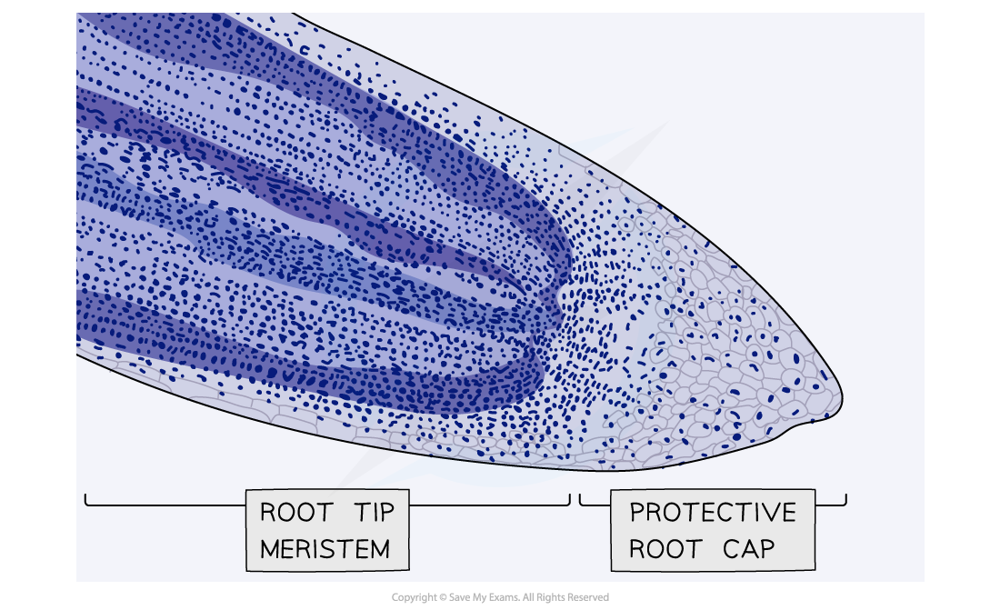
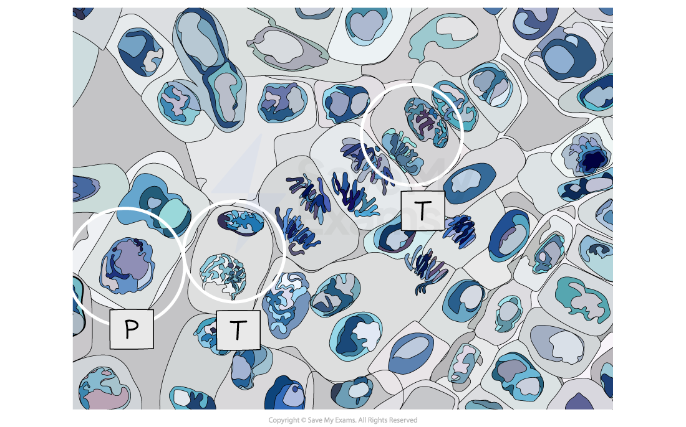
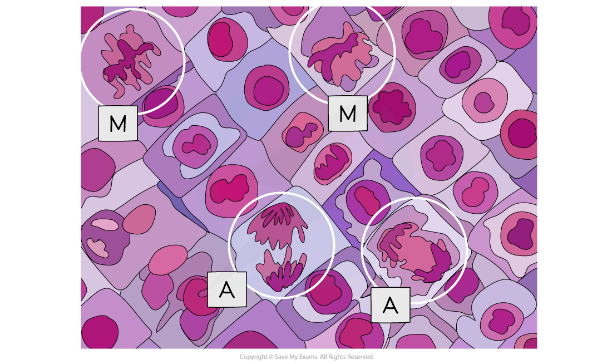
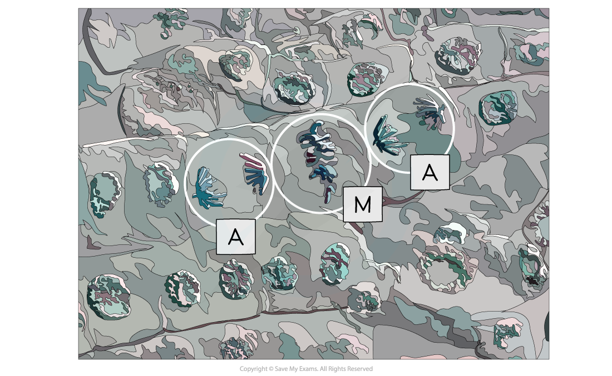
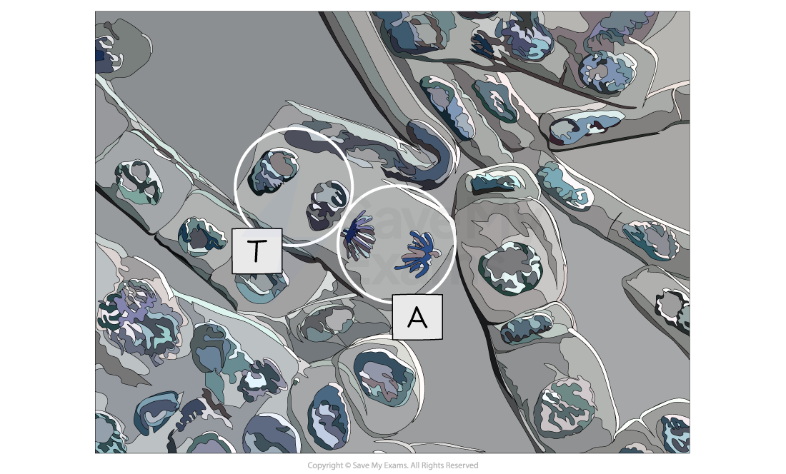

# Observing Mitosis

## Mitosis in Root Tips: Observing & Drawing

> **Spec point** — `spcpt_mYXzprsmJNYdMwp2` · interpret photomicrographs, diagrams and microscope slides of cells in different stages of the mitotic cell cycle and identify the main stages of mitosis

## Mitosis in root tips: observing & drawing

- Growth in plants occurs in specific regions called **meristems**
- The root tip meristem can be used to study **mitosis**

  - The root tip meristem can be found **just behind the protective root cap**
  - In the root tip meristem, there is a** zone of cell division** that contains cells undergoing **mitosis**
- Pre-prepared slides of root tips can be studied or temporary slides can be prepared using the **squash technique** (root tips are **stained** and then **gently squashed**, spreading the cells out into a thin sheet and allowing individual cells undergoing mitosis to be clearly seen)

*Micrograph showing a stained root tip*

### Analysis

*Micrograph showing a cell undergoing prophase (P) and telophase (T)*

*Micrograph showing cells undergoing metaphase (M) and anaphase (A)*

*Micrograph showing cells undergoing metaphase (M) and anaphase (A)*

*Micrograph showing a cell undergoing anaphase (A) and telophase (T)*

> **Exam Hint**
> It is important to be able to **recognise each mitotic stage **from electron micrographs and to be able to explain why that cell is in the stage you have selected.
