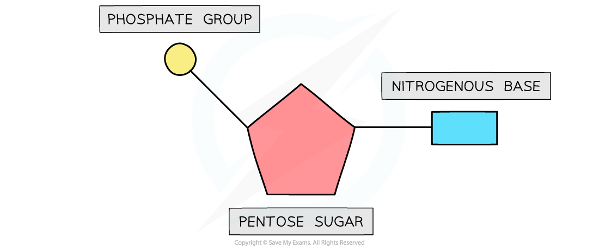
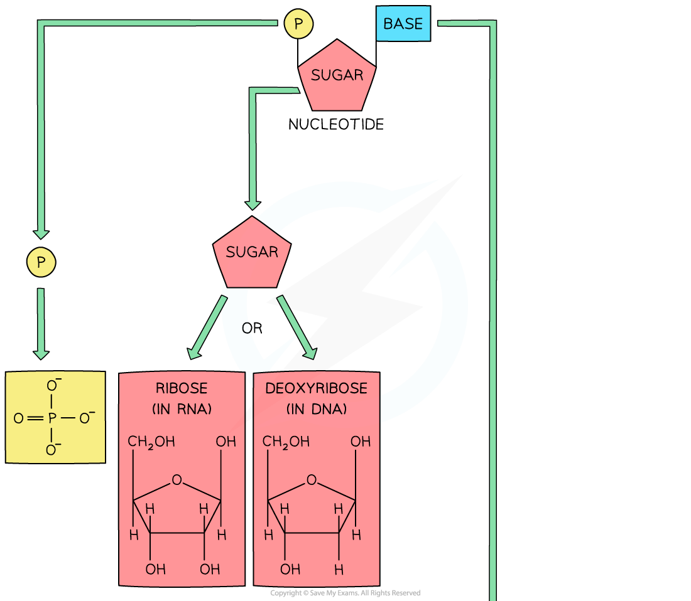
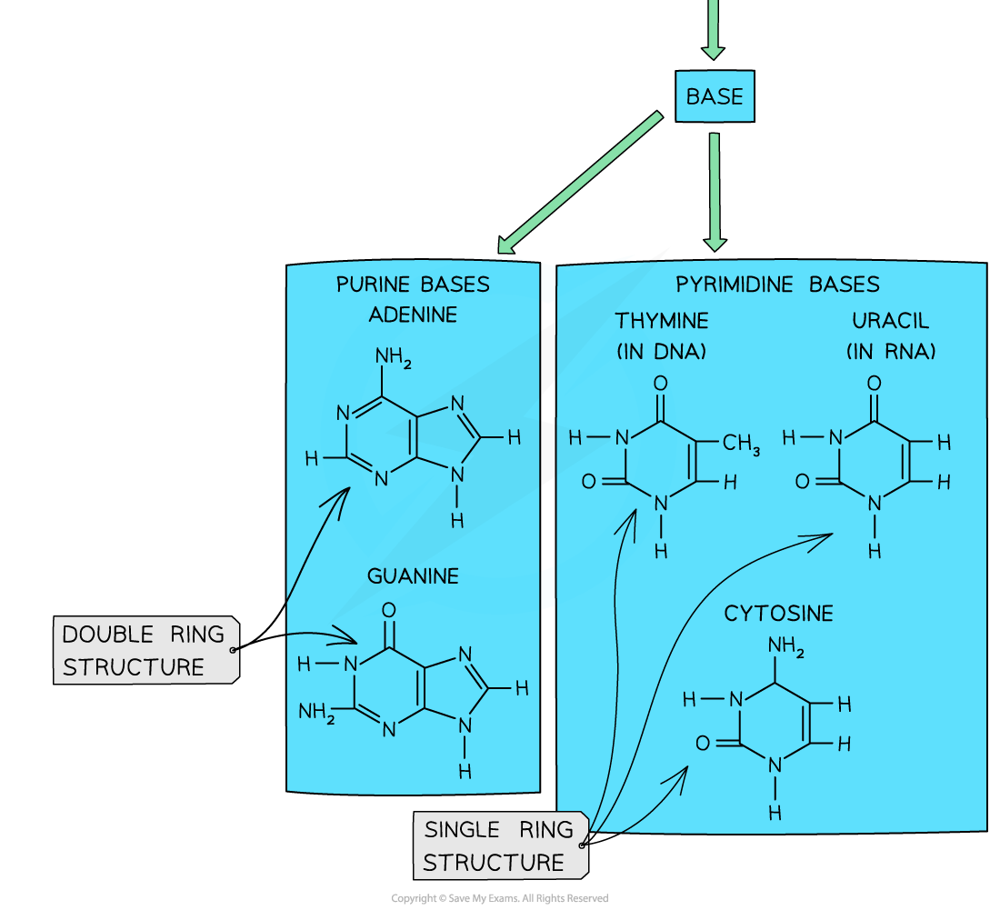

# Nucleotides

## Nucleotide Structure

> **Spec point** — `spcpt_RZ3hjDzybMmQGt6n` · describe the structure of nucleotides, including the phosphorylated nucleotide ATP

## Nucleotide structure

- **Nucleic acids** such as **DNA** (deoxyribonucleic acid) and **RNA** (ribonucleic acid) are *macromolecules*

  - Like proteins (polypeptides) and carbohydrates (polysaccharides), these nucleic acids are *polymers*
  - This means they are made up of many similar, smaller molecules (known as **subunits** or **monomers**) joined into a long chain
  - The subunits that make up DNA and RNA are known as **nucleotides**
  - Therefore DNA and RNA can also be known as **polynucleotides**

### Nucleotides

- Nucleotides are made up of three components:

  - A **nitrogen-containing base** (also known as a nitrogenous base)
  - A **pentose sugar** (containing 5 carbon atoms)
  - A **phosphate group**

*The basic structure of a nucleotide*

### ATP

- **Adenosine triphosphate** (ATP) is the energy-carrying molecule that provides the energy to drive many processes inside living cells
- ATP is **another type of nucleotide** and hence it is structurally very similar to the nucleotides that make up DNA and RNA
- It is a *phosphorylated* nucleotide

> **Exam Hint**
> You need to learn the **different groups **that nucleotides are made up of (phosphate groups, pentose sugars and nitrogenous bases).

## Purines & Pyrimidines

> **Spec point** — `spcpt_rcgBdM9xcm7FdXcg` · state that the bases adenine and guanine are purines with a double ring structure, and that the bases cytosine, thymine and uracil are pyrimidines with a single ring structure

## Purines & pyrimidines

- The **nitrogenous base** molecules that are found in the nucleotides of DNA (A, T, C, G) and RNA (A, U, C, G) occur in **two structural forms**: **purines** and **pyrimidines**
- The bases **adenine** and **guanine** are **purines**

  - This means that they have a **double-ring structure**
- The bases **cytosine**, **thymine,** and **uracil** are **pyrimidines**

  - These bases have a **single-ring structure**

*The molecular structures of purines and pyrimidines are slightly different*

> **Exam Hint**
> You don’t need to know the structural formulae of these bases (as shown in the diagram above)—you just need to know which are purines and which are pyrimidines.
