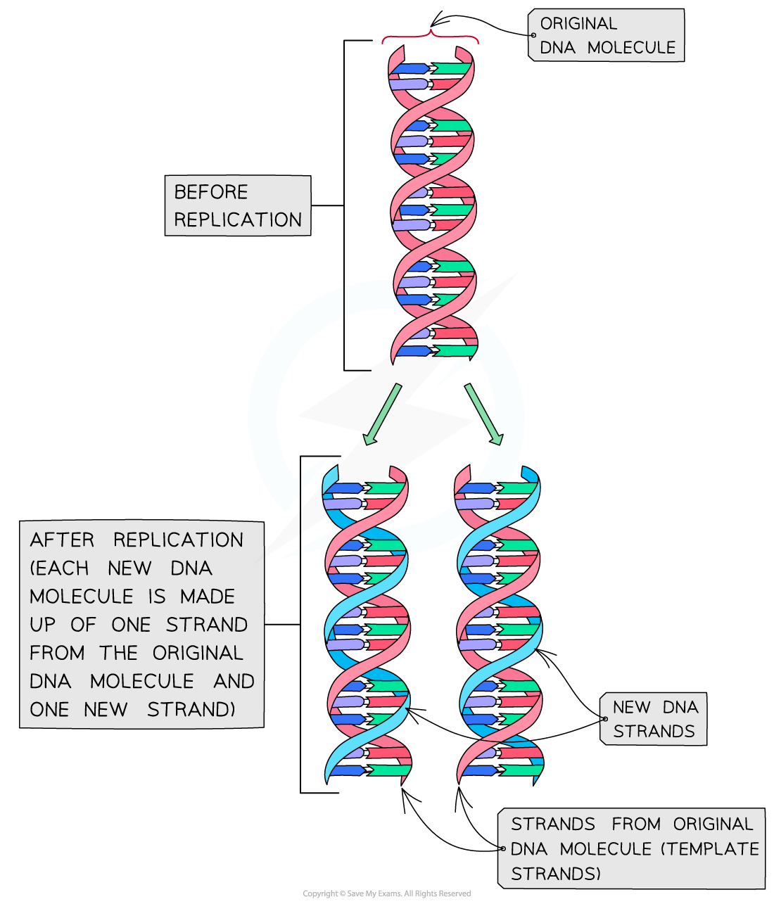
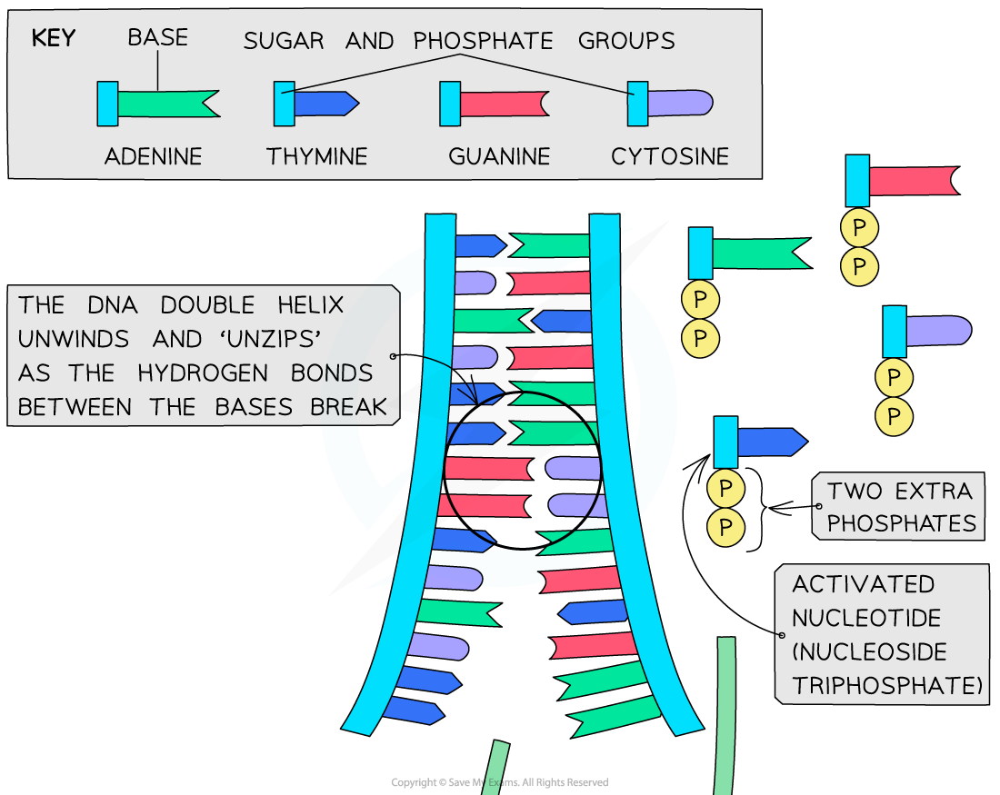
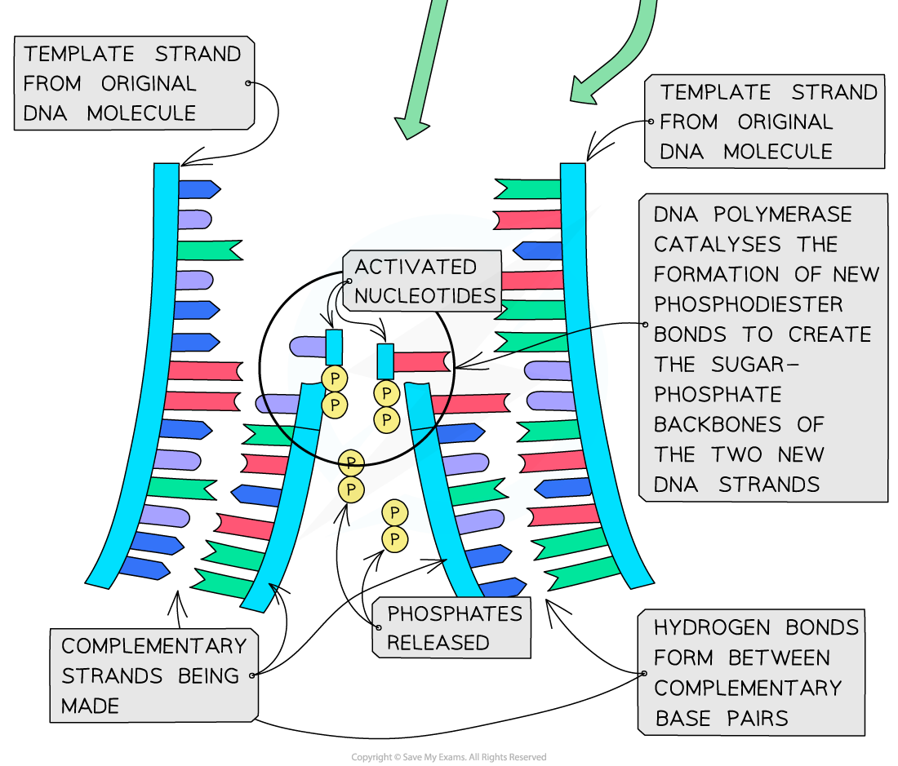
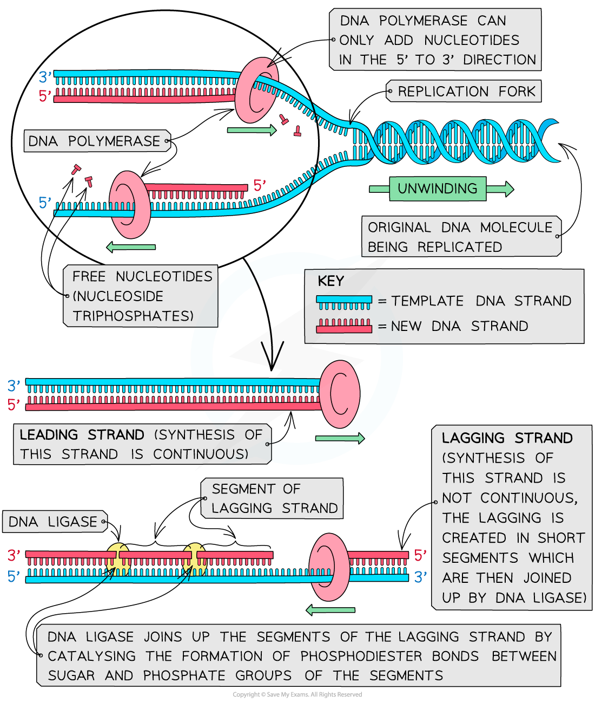

# Semi-Conservative DNA Replication

## Semi-Conservative DNA Replication

> **Spec point** — `spcpt_VCWrXdJ32XPKd2pw` · describe the semi-conservative replication of DNA during the S phase of the cell cycle, including:
• the roles of DNA polymerase and DNA ligase 
• the differences between leading strand and lagging strand replication as a consequence of DNA polymerase adding nucleotides only in a ′ to ′ direction

## Semi-conservative DNA replication

- DNA replication occurs in preparation for **mitosis** when a parent cell divides to produce two genetically identical daughter cells

  - This is because each daughter cell needs to contain the same number of chromosomes as the parent cell
  - Therefore the number of DNA molecules in the parent cell must be **doubled** before mitosis takes place
- DNA replication occurs during the **S phase** of the cell cycle

  - This occurs during **interphase** when a cell is **not dividing**
- The **hydrogen bonds** between the base pairs on the two antiparallel polynucleotide DNA strands are **broken**

  - This **‘unzips’** or **unwinds** the DNA double helix to form two single polynucleotide DNA strands
- Each of these single polynucleotide DNA strands acts as a **template** for the formation of a **new strand**

  - The original strand and the new strand then join together to form a new DNA molecule
- This method of replicating DNA is known as **semi-conservative replication** because **half of the original** DNA molecule is kept (**conserved**) in each of the two new DNA molecules

*Semi-conservative replication of DNA means that half of the original DNA molecule is conserved in each new DNA molecule*

### DNA polymerase

- In the nucleus, there are **free nucleotides** to which **two extra phosphates** have been added

  - These free nucleotides with three phosphate groups are known as **nucleoside triphosphates** or **‘activated nucleotides’**
- The extra phosphates activate the nucleotides, enabling them to take part in DNA replication
- The bases of the free nucleoside triphosphates **align** with their **complementary bases** on each of the **template** DNA strands
- The enzyme **DNA polymerase synthesises new DNA strands **from the two template strands
- It does this by catalysing *condensation reactions* between the** deoxyribose sugar and phosphate groups **of adjacent nucleotides within the new strands

  - This creates the** sugar-phosphate backbone **of the new DNA strands
- DNA polymerase cleaves (breaks off) the two extra phosphates and uses the **energy released** to create the **phosphodiester bonds** (between adjacent nucleotides)
- **Hydrogen bonds** then form between the **complementary base pairs** of the template and new DNA strands

*Nucleotides are bonded together by DNA polymerase to create new complementary DNA strands*

### Leading and lagging strands

- DNA polymerase can only** **add new DNA nucleotides in the** 5’ to 3’ direction**, so the new DNA strand is built from its 5' end towards its 3' end

  - This is because DNA polymerase is an enzyme with a **specific active site**, so can only attach to the **3’ end of the original strand** and **move towards its 5' end**
- On one of the DNA template strands the DNA polymerase enzyme can move continuously **towards the replication fork** as the DNA molecule is unzipped, so the new strand will be produced in **one long piece**

  - The strand that DNA polymerase synthesises **continuously** in this way is known as the **leading strand**
- On the other strand, which is antiparallel to the strand described above, DNA polymerase moves** away from the replication fork**, meaning that the new DNA is synthesised in short segments as the new sections of the template strand are exposed

  - The strand in which DNA is synthesised in short segments is known as the **lagging strand**
  - The short segments are known as Okazaki fragments
  - A second enzyme, **DNA ligase**, is needed to **join these short segments together** to form a continuous new DNA strand

*The synthesis of the leading and lagging strands occurs slightly differently due to the fact that DNA polymerase can only add nucleotides in a 5' to 3' direction*
