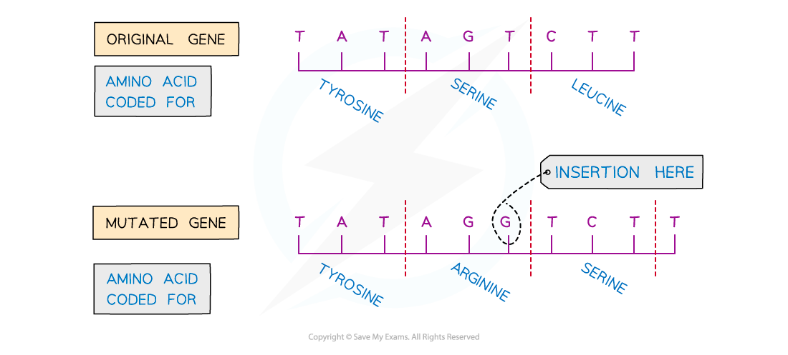

# Gene Mutations

## Gene Mutations & Their Effect on Polypeptides 

> **Spec point** — `spcpt_w56QshVDjBrwPXcX` · state that a gene mutation is a change in the sequence of base pairs in a DNA molecule that may result in an altered polypeptide

## Gene mutations & their effect on polypeptides

- A **gene mutation** is a change in the sequence of base pairs in a DNA molecule that may result in an altered polypeptide
- As the DNA base sequence determines the sequence of amino acids that make up a protein, **mutations in a gene can sometimes lead to a change in the polypeptide that the gene codes for**
- **Most mutations do not alter the polypeptide** or only alter it slightly so that its structure or function is not changed

  - This is because the genetic code is degenerate
- There are different ways that a mutation in the DNA base sequence can occur:

### Insertion of nucleotides

- A mutation that occurs when **a nucleotide (with a new base) is randomly inserted** into the DNA sequence is known as an** insertion mutation**
- An insertion mutation **changes the amino acid that would have been coded for by the original base triplet**, as it creates a **new, different** triplet of bases
- An insertion mutation also has a **knock-on effect** by **changing the triplets **(groups of three bases)** further on in the DNA sequence**

  - This is sometimes known as a frameshift mutation
- This **may dramatically change the amino acid sequence produced** from this gene and therefore the **ability of the polypeptide to function**

*An example of an insertion mutation*

### Deletion of nucleotides

- A mutation that occurs when **a nucleotide (and therefore its base) is randomly deleted** from the DNA sequence
- Like an insertion mutation, a deletion mutation:

  - **Changes the amino acid that would have been coded for**
  - Has a **knock-on effect** by **changing the groups of three bases further on in the DNA sequence**
  
    - This is another type of frameshift mutation
- This **may dramatically change the amino acid sequence produced** from this gene and therefore the **ability of the polypeptide to function**

### Substitution of nucleotides

- A mutation that occurs when **a base in the DNA sequence is randomly swapped for a different base**
- **Unlike** an insertion or deletion mutation, a substitution mutation will **only change the amino acid for the triplet **(a group of three bases)** in which the mutation occurs**

  - It will **not have a knock-on effect** (it is not a frameshift mutation)

*An example of a substitution mutation*

### The effect of gene mutations on polypeptides

- **Most mutations do not alter the polypeptide** or only alter it slightly so that its appearance or function is not changed
- However, a **small number of mutations **code for a** significantly altered polypeptide with a different shape**
- This **may affect the ability of the protein to perform its function**

  - For example:
  
    - If the shape of the active site on an enzyme changes, the substrate may no longer be able to bind to the active site
    - A structural protein (like collagen) may lose its strength if its shape changes
