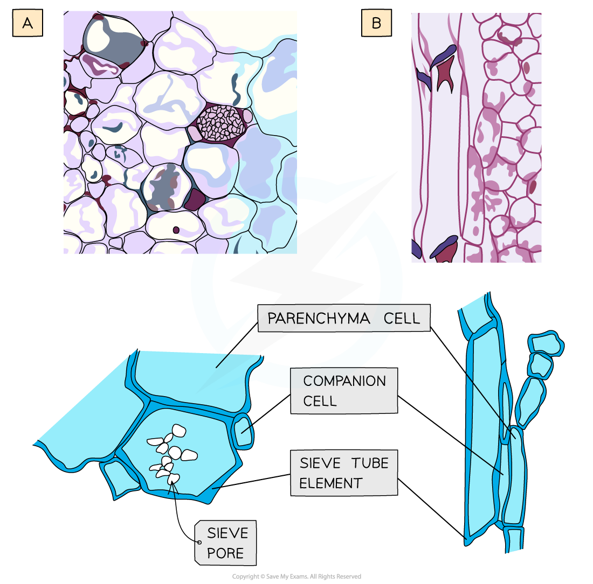
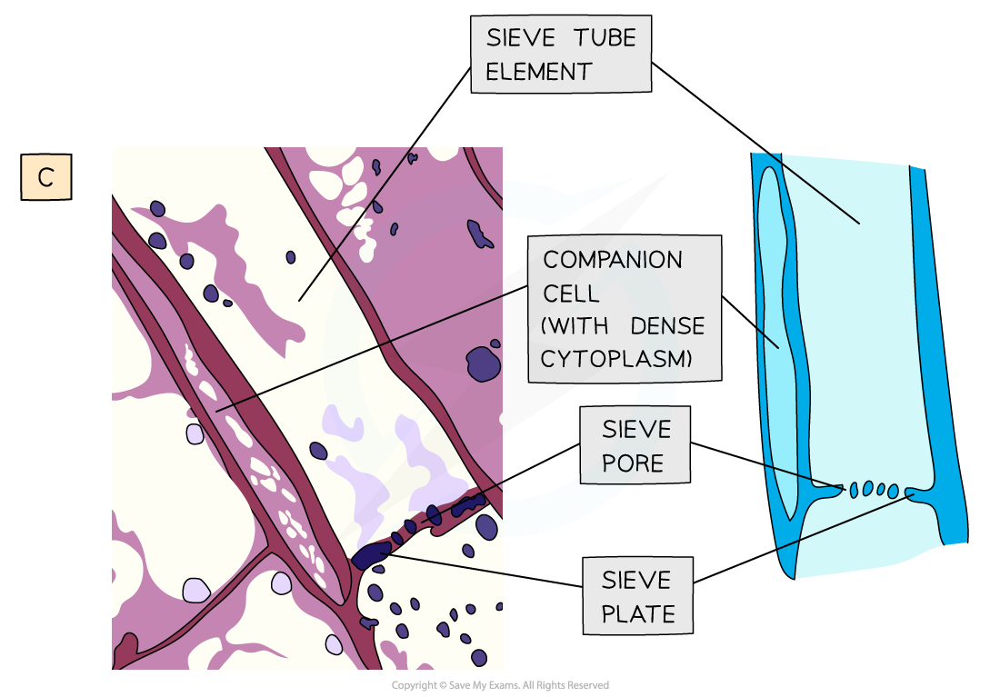

# Phloem Sieve Tube Elements

## Phloem Sieve Tube Elements & Companion Cells: Structure & Function

> **Spec point** — `spcpt_hyz7F5xrVMxQvNkt` · "draw and label xylem vessel elements, phloem sieve tube elements and companion cells from microscope slides, photomicrographs and electron micrographs
 relate the structure of xylem vessel elements, phloem sieve tube elements and companion cells to their functions"

## Phloem sieve tube elements & companion cells: structure & function

- The function of **phloem** tissue in a plant is to:

  - Transport **organic compounds** (*assimilates*), particularly sucrose, from the source (e.g. leaf) to the sink (e.g. roots)
  
    - The transport of these compounds in phloem tissue can occur **up** and **down** the plant
- The organic compounds are dissolved in water to form **sap**
- Phloem is a complex tissue made up of various cell types

  - Its bulk is made up of **sieve tube elements** which are the main conducting cells and **companion cells**
  - Other cell types of phloem tissue also include **parenchyma** for storage and strengthening fibres
- Mature phloem tissue contains **living cells**, unlike xylem tissue

*Structure of phloem tissue. (a) Microscope slide image and drawing of a sieve tube element and companion cell in transverse section (TS), (b) photomicrograph image and drawing of a sieve tube element and companion cell in longitudinal section (LS).*

*Structure of phloem tissue. (c) Transmission electron micrograph image and drawing of a sieve tube element and companion cell in transverse section (TS)*

### Sieve tube elements

- Sieve tube elements line up end to end to form a continuous tube
- They transport sugars and nutrients up and down the plants in sieve cells

| **Structure** | **Function** |
|---|---|
| Sieve plates with sieve pores | Allows for continuous movement of organic substances |
| Cellulose cell wall | Strengthens the wall to withstand the hydrostatic pressures that move assimilates |
| No nucleus, ribosomes or vacuole in mature cells | Maximises space for movement of assimilates |
| Thin cytoplasm | Reduces friction to facilitate movement of assimilates |

### Companion cells

- Each sieve tube element has a companion cell associated with it as companion cells control the metabolism of their associated sieve tube member
- They also play a role in loading and unloading of sugars into the phloem

| **Structure** | **Function** |
|---|---|
| Nucleus and other organelles present | Provides metabolic support to sieve tube elements and helps with loading and unloading of assimilates |
| Transport proteins in plasma membranes | Moves assimilates into and out of sieve tube elements |
| Large numbers of mitochondria | Provides ATP for the active transport of assimilates |
| Plasmodesmata (channels in cell wall) | The link to sieve tube elements, allowing organic compounds to move from the companion cells into the sieve tube elements |

### Comparing xylem and phloem

- Xylem and phloem are similar in some ways but there are key differences that ensure they can carry out their separate functions in transport around the plant

|   | **Xylem** | **Phloem** |
|---|---|---|
| Living cells | No (hollow cells) | Yes (sieve tube elements and companion cells) |
| Substances transported | Water and mineral ions | Organic compounds/assimilates |
| Process of transportation | Transpiration | Active translocation |
| Direction of flow | One way / upwards (roots to leaves) | Two ways / up and down (source to sink) |
| Presence of end walls | No | Yes (sieve plates) |
| Cell wall material | Lignin and cellulose | Cellulose |

> **Exam Hint**
> Understand the difference between sieve tube elements and companion cells, and how they are different to xylem tissue.
> 
> Remember that mature xylem tissue is dead, so there is no evidence of organelles, and they have lignified cell walls, whereas sieve tube elements have no lignin, do have sieve plates, and their companion cells contain nuclei and dense cytoplasm.
