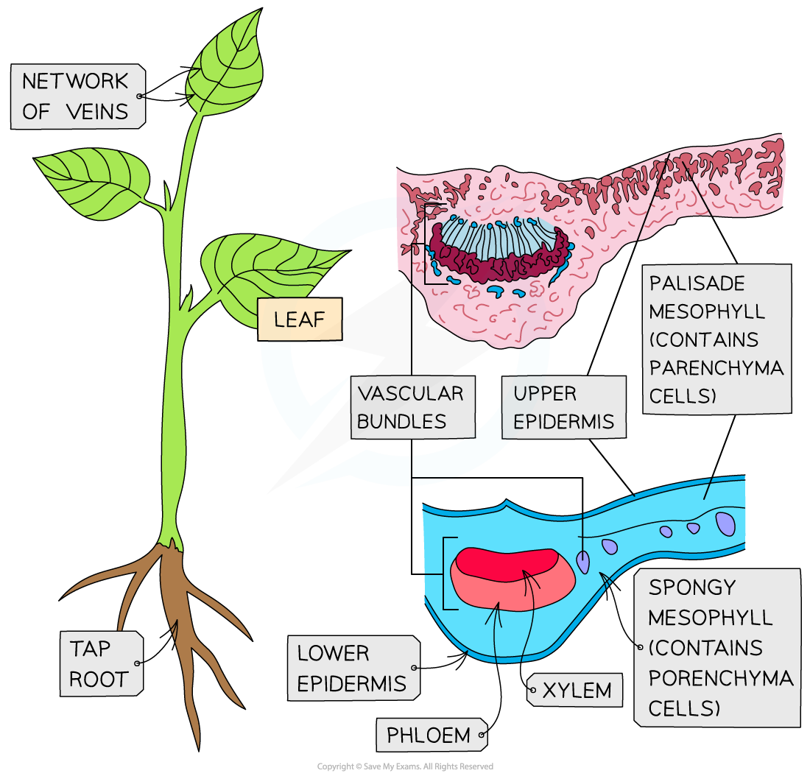
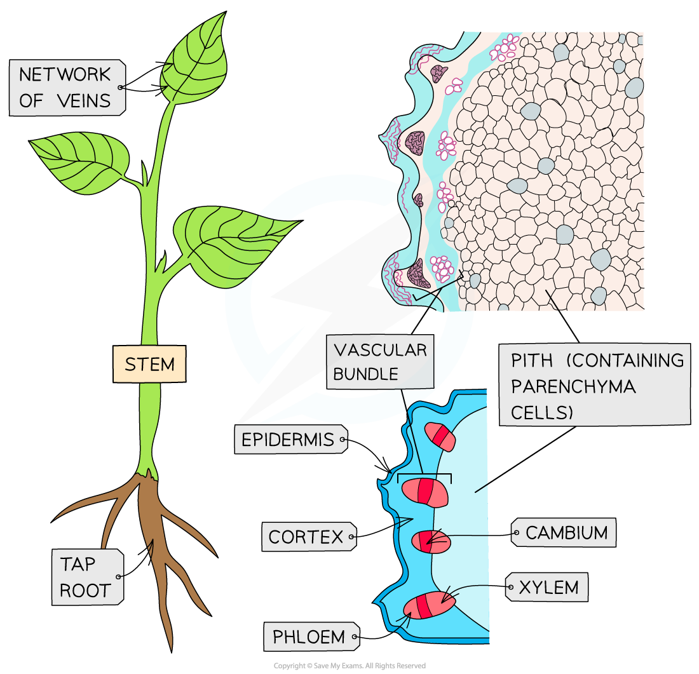
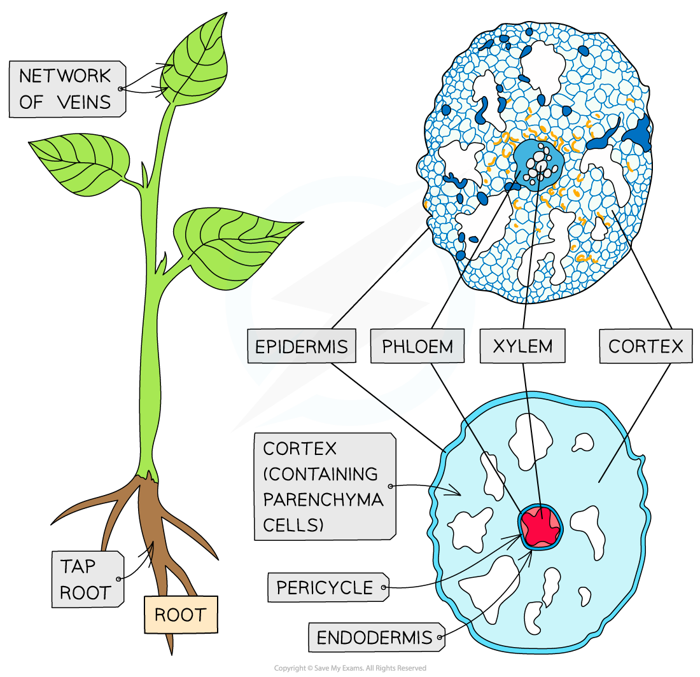

# Plant Transverse Sections

## Transverse Sections: Stems, Roots & Leaves

> **Spec point** — `spcpt_hw4bHdr8pbGqvdQD` · draw plan diagrams of transverse sections of stems, roots and leaves of herbaceous dicotyledonous plants from microscope slides and photomicrographs

## Transverse sections: stems, roots & leaves

### Transport systems

- Plants need transport systems to:

  - Meet their **metabolic demands** (glucose, hormones, mineral ions are required for various processes within plants)
  - **Efficiently move substances** up and down, e.g.
  
    - Sugars made in photosynthesis need to be transported, as sucrose, to parts of the plant that cannot photosynthesise
    - Water from the roots needs to be transported to the upper parts of a plant
    - Plants may store starch in storage organs, e.g. tubers, and need to convert it to sucrose and transport it to metabolically active parts of the plant
- Plants consist of **many layers of cells** and so cannot rely on diffusion from cell to cell to supply all their needs, as this would be **too slow**
- Plants therefore have a **vascular system** which involves a network of vessels (vascular tissue) running through the **leaves**, **stem** and **roots**

  - These three parts are the main **organs** involved in transport
- The **vascular system** is comprised of two distinct types:

  - **Xylem** transports water and mineral ions from the roots to the rest of the plant
  - **Phloem** transports substances from the source (e.g. a leaf) to the sink (e.g. root)
- The xylem and phloem are arranged together in **vascular bundles**
- The bundles are laid out differently in the leaves, stem and roots

*Tissue plan diagrams of a dicotyledonous leaf, stem and root*

> **Worked Example**
> The micrograph below shows a transverse section of root tissue.
> 
> Draw a plan diagram of this section of root tissue.
> 
> 
> 
> *Light micrograph (photomicrograph) of transverse root tissue*
> 
> **Step 1 Draw the outlines of each section **
> 
> Use a sharp pencil with no shading or sketching
> 
> Use a continuous line
> 
> **Step 2 **Add the outlines of the remaining tissues
> 
> A plan diagram shows tissues only, so do not draw any individual cells; for example, outline the xylem tissue at the centre of the root
> 
> **Step 3 Add labels**
> 
> Use a ruler to draw horizontal lines to each structure of interest
> 
> Label clearly with correct spelling
> 
> **Step 4 Add magnification **(if present on micrograph or question)
> 
> 
> 
> *Plan diagram of transverse root tissue*
> 
> The 'before-and-after' images look like this side-by-side:
> 
> 
> 
> *Root transverse section 'before-and-after' images side-by-side*

> **Exam Hint**
> When **drawing tissue plan diagrams** (which is common in the practical paper 3) you need to:
> 
> - Read the instructions carefully
> - Draw a large diagram
> - Use a sharp pencil and do not shade (including the nucleus)
> - Use clear, continuous lines
> - When using an eyepiece graticule, use it to ensure you have correct proportions or if you are not using a microscope then endeavour to keep the proportions between tissues to scale
> 
> - If drawing from a **low-power** image:
> 
>   - Do not draw individual cells
>   - Read the question carefully as you may only have to draw a portion of the image
>   - Include the magnification on the drawing
> 
> - If drawing from a **high-power **image:
> 
>   - Draw only a few of the required cells
>   - Draw the cell wall of the plant cells
>   - Include the magnification on the drawing
> 
> - When labelling, remember:
> 
>   - Use a ruler for label lines (and scale line if appropriate)
>   - Label-lines should stop exactly at the structure (do not use arrows)
>   - Don't cross label-lines over each other
>   - Label all tissues and relevant structures (those requested)
