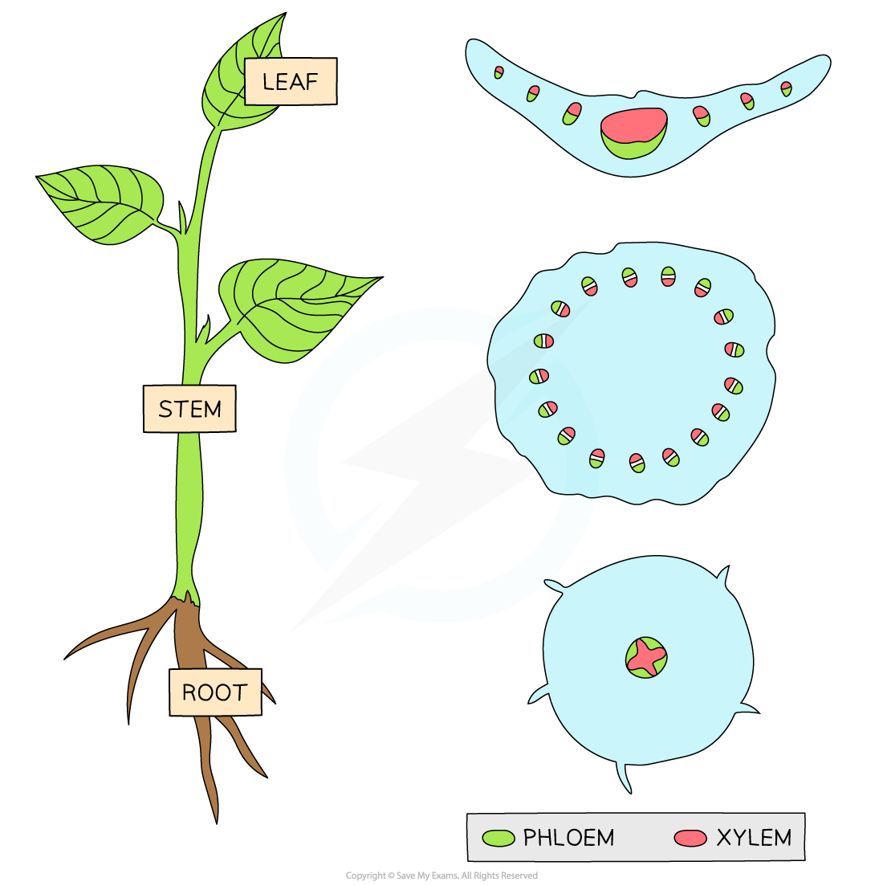

# Xylem & Phloem Distribution

## Xylem & Phloem Distribution

> **Spec point** — `spcpt_fFvtZ2n2TPfHDzZ4` · describe the distribution of xylem and phloem in transverse sections of stems, roots and leaves of herbaceous dicotyledonous plants

## Xylem & phloem distribution

### Xylem

- The functions of **xylem** tissue in a plant are:

  - Vascular tissue that carries **dissolved minerals** and **water** **up** the plant
  - **Structural **support
- Xylem tissue is found, along with phloem tissue and other tissues, in **vascular bundles**

### Phloem

- The **location **of the **vascular bundles** is dependent on which organ they are in, as the different organs are under different stresses:

  - In the **roots** the vascular bundle is found in the centre
  
    - **On the edges of the **centre core is the **phloem tissue**
  - In the **stems**, the vascular bundles are located around the outside
  
    - The **phloem tissue** is found on the **outside** (closest to the epidermis)
  - In the leaves, the vascular bundles form the midrib and a branching network of veins
  
    - The **phloem tissue** is found on the **lower side** of the bundles (closest to the lower epidermis)

*The distribution of xylem and phloem tissue in the roots, stem and leaves in a herbaceous dicotyledonous plant*

> **Exam Hint**
> In roots and stem, the xylem tissue is found on the **inside**.
> 
> However, in leaves, xylem is found **above** phloem tissue.
