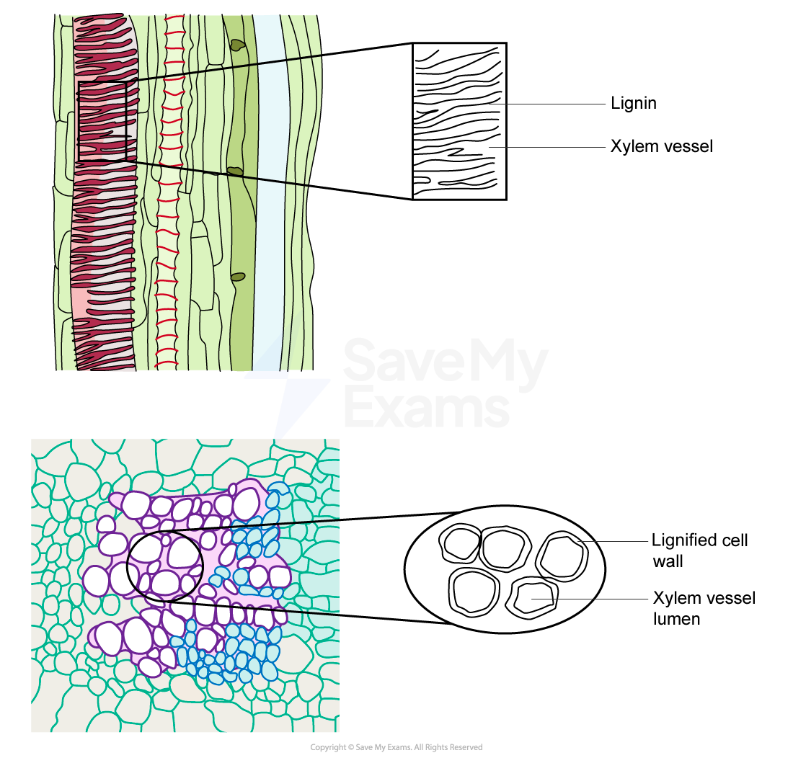
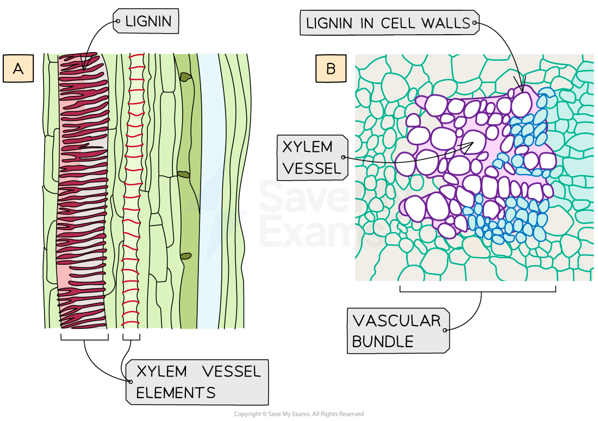

# Xylem Vessels Elements

## Xylem Vessel Elements: Structure & Function

> **Spec point** — `spcpt_pXyx8h7XMC2bppnJ` · draw and label xylem vessel elements, phloem sieve tube elements and companion cells from microscope slides, photomicrographs and electron micrographs

## Xylem vessel elements: structure & function

- The functions of **xylem** tissue in a plant are:

  - Vascular tissue that **transports** dissolved minerals and water around the plant
  - Structural **support**
  - Food storage
- Xylem tissue is made up of four cell types that function together:

  - **Tracheids **(long, narrow tapered cells with pits)
  - **Vessel elements **(large with thickened cell walls and no end plates when mature)
  - Xylem **parenchyma**
  - **Sclerenchyma **cells (fibres and sclereids)
- Most of the xylem tissue is made up of **tracheids** and **vessel elements**, which are both types of **water-conducting cell**

*Micrographs of xylem vessels allow structural lignin to be seen in both longitudinal section (A) and transverse section (B)*

*Biological drawing conventions can be applied to the drawing of xylem vessels from micrographs*

| **Structure** | **Function** |
|---|---|
| Lignified cell walls | Adds strength to withstand hydrostatic pressure so vessels do not collapse. Impermeable to water |
| No end plates | Allows for mass flow of water and dissolved solutes as cohesive (between water molecules) and adhesive (between water molecules and xylem wall) forces are not impeded |
| No protoplasm (cells are dead when mature) | Does not impede the mass flow of water and dissolved solutes |
| Pits in walls (in non-lignified sections) | Lateral movement of water allows for continuous flow in case of air bubbles forming in the vessel |
| Small diameter of vessels (although larger than tracheids) | Helps prevent the water column from breaking |

> **Exam Hint**
> You must be able to recognise the xylem vessel elements in images, so look for a **thicker **cell wall and a **larger diameter**.
> 
> You should be able to draw xylem vessel elements from micrograph images. For more detail on how to make biological drawings see our revision notes [*here*](https://www.savemyexams.com/a-level/biology/cie/25/revision-notes/7-transport-in-plants/7-1-structure-of-transport-tissues/plant-transverse-sections/)*.*
