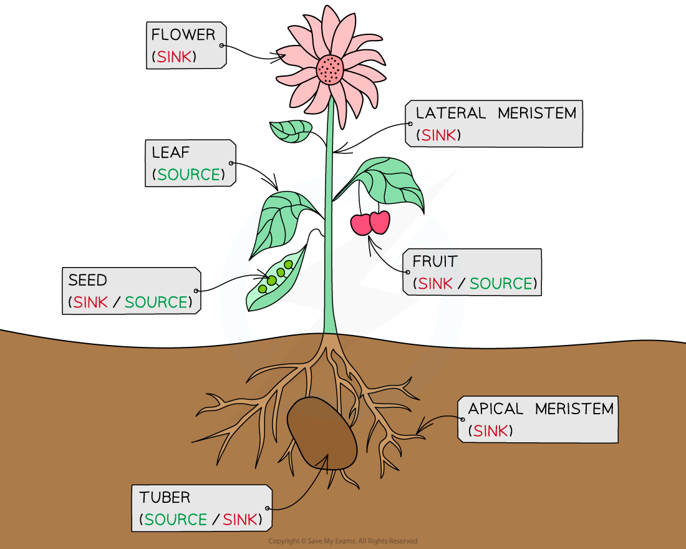
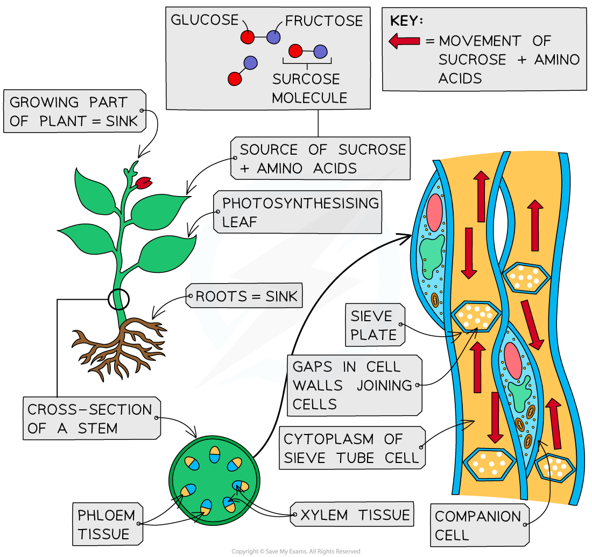

# Movement in the Phloem

## Movement in the Phloem

> **Spec point** — `spcpt_kdt88htn4F64p56w` · state that assimilates dissolved in water, such as sucrose and amino acids, move from sources to sinks in phloem sieve tubes

## Movement in the phloem

- Translocation is connected with the transport of *assimilates* in the phloem tissue
- Thus **translocation** within phloem tissue can be **defined **as the transport of assimilates from **source** to **sink** and requires the **input of metabolic energy** (ATP)
- The liquid that is being transported (found within phloem sieve tubes) is called **phloem sap**
- This phloem sap consists not only of sugars (mainly sucrose) but also of water and other dissolved substances such as amino acids, hormones and minerals
- The **source** of the assimilates could be:

  - Green leaves and green stem (photosynthesis produces glucose which is transported as sucrose, as sucrose has less of an osmotic effect than glucose)
  - Storage organs e.g. tubers and tap roots (unloading their stored substances at the beginning of a growth period)
  - Food stores in seeds (which are germinating)
- The **sinks** (where the assimilates are required) could be:

  - Meristems (apical or lateral) that are actively dividing
  - Roots that are growing and / or actively absorbing mineral ions
  - Any part of the plant where the assimilates are being stored (e.g. developing seeds, fruits or storage organs)

*Assimilates are moved through a plant by the process of translocation. They are moved from source to sink. Here are examples of sources and sinks*

- The loading and unloading of the sucrose from the source to the phloem, and from the phloem to the sink is an **active **process
- It can be slowed down or even stopped at high temperatures or by respiratory inhibitors
- Translocation of assimilates is not fully understood yet by scientists. The understanding they do have has come from studies such as:

  - On plants whose phloem sap does not clot quickly when cut, so that it can be collected and studied (e.g. castor oil plants)
  - Using aphids to collect the sap – after the aphid inserts its stylet (tubular mouthpart) scientists remove the aphids head and collect the sap that continues to flow
  - Using radioactively labelled metabolites (e.g. Carbon-14 labelled sugars) which can be traced during translocation
  - Advances in microscopes enabling the adaptations of companion cells to be seen
  - Observations about the importance of mitochondria to the process of translocation

*The translocation of assimilates from source to sink within phloem tissue*

> **Exam Hint**
> Assimilates can move upwards or downwards in the phloem sieve tubes as they move from source to sink.
