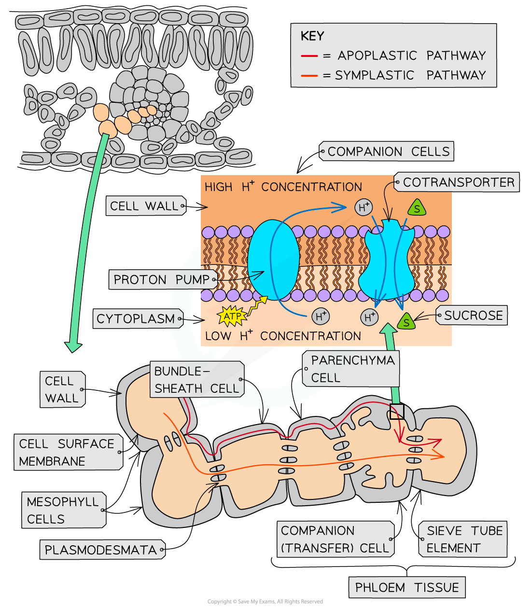

# The Sucrose Loading Mechanism

## The Sucrose Loading Mechanism

> **Spec point** — `spcpt_7HMQXCxSTfsGvDR8` · explain how companion cells transfer assimilates to phloem sieve tubes, with reference to proton pumps and cotransporter proteins

## The sucrose loading mechanism

- *Assimilates* such as sucrose are **transported from source to sink** through the phloem sieve tubes
- Carbohydrates are generally transported in plants in the form of **sucrose** because:

  - It allows for efficient **energy transfer and increased energy storage **(sucrose is a disaccharide and therefore contains more energy)
  - It is **less reactive **than glucose as it is a non-reducing sugar and therefore no intermediate reactions occur as it is being transported

### Loading of assimilates

- The pathway that sucrose molecules use to travel to the sieve tubes is not fully understood yet. The molecules may move by the:

  - **symplastic pathway** (through the cytoplasm and plasmodesmata) which is a **passive **process as the sucrose molecules move by diffusion
  - **apoplastic pathway** (through the cell walls) which is an **active **process
- If the sucrose molecules are taking the apoplastic pathway then modified **companion cells** (called transfer cells) **pump hydrogen ions** **out** of the cytoplasm via a **proton pump **and into their cell walls

  - This is an **active process** and therefore requires ATP as an energy source
- The large concentration of **hydrogen ions **in the cell wall of the companion cell results in the hydrogen ions moving down the concentration gradient back to the cytoplasm of the companion cell

  - The hydrogen ions move through a **cotransporter protein**
  - While transporting the hydrogen ions this protein also carries **sucrose **molecules **into the companion cell against the concentration gradient **for sucrose
- The sucrose molecules then move into the **sieve tubes **via the plasmodesmata from the companion cells

  - Companion cells have infoldings in their cell surface membrane to increase the available surface area for the active transport of solutes and many mitochondria to provide the energy for the proton pump
- This mechanism permits some plants to build up the sucrose in the phloem to up to three times the concentration of that in the mesophyll

### Unloading of assimilates

- The unloading of the assimilates (e.g. sucrose) occurs at the **sinks**
- Scientists believe that the unloading of sucrose is similar to the loading of sucrose, with the sucrose being **actively transported out of the companion cells** and then moving out of the phloem tissue via apoplastic or symplastic pathways
- To maintain a concentration gradient in the sink tissue, sucrose is converted into other molecules. This is a metabolic reaction so requires enzymes (e.g. invertase which hydrolyses sucrose into glucose and fructose)

*The apoplast and symplast pathways used when sucrose is loaded into the phloem tissue. The enlarged portion of the companion cell shows the proton and co-transporter proteins used to actively load the sucrose*

> **Exam Hint**
> Remember that the loading of sucrose requires two membrane proteins in the companion cell surface membrane: a proton pump (active transport using ATP) and a cotransporter protein (which uses the hydrogen ion gradient, not ATP directly).
