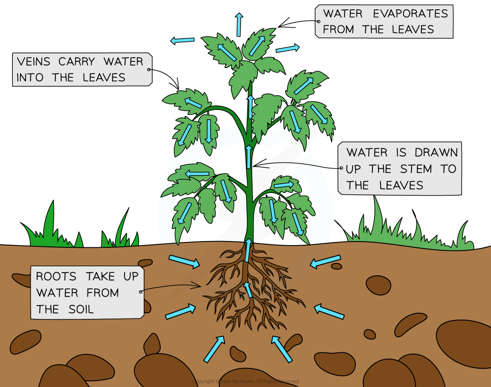
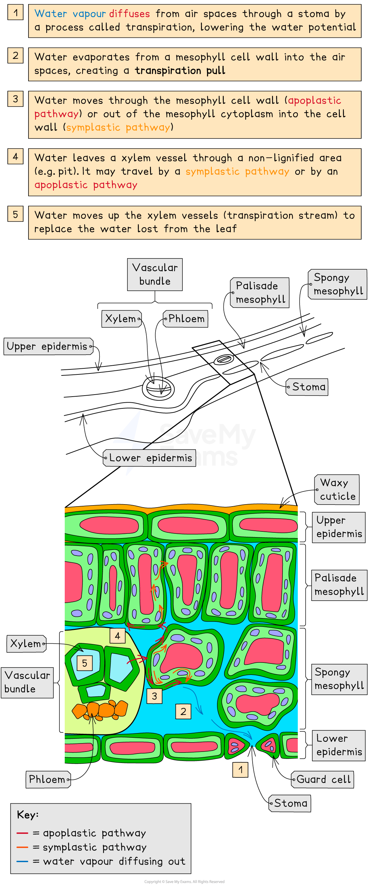

# Transpiration in Plants

## Transpiration Explained

> **Spec point** — `spcpt_8TztJ444XGbkJ4Hf` · explain that transpiration involves the evaporation of water from the internal surfaces of leaves followed by diffusion of water vapour to the atmosphere

## Transpiration explained

- The movement of water through a plant's xylem occurs due to the evaporation of water from the internal surfaces of the leaves (mesophyll cell walls) and the **cohesive** and **adhesive** properties exhibited by water molecules
- The** water potential gradient** is the driving force behind the movement of water from the soil (**high water potential**) to the atmosphere (**low water potential**), via the plant's cells

  - Plants are constantly taking water in at their roots and losing water via the **stomata** (in the leaves), maintaining the water potential gradient between the roots and the leaves
- Around 99 % of the water absorbed is lost as water vapour from the plant's leaves and stems in a process called transpiration
- Transpiration refers to the **loss of** **water vapour** **via the stomata by diffusion**

  - Note that this is different to the** transpiration stream** which is **the movement of water from the roots to the leaves**
- Transpiration is important to the plant in the following ways

  - It provides a means of **cooling** the plant via evaporative cooling
  - The transpiration stream is helpful in the **uptake of mineral ions**
  - The turgor pressure of the cells (due to the presence of water as it moves up the plant) provides **support** to leaves (enabling an increased surface area of the leaf blade) and the stem of non-woody plants

*The loss of water vapour from the leaves of plants (transpiration) results in a lower water potential in the leaves. This creates a water potential gradient between the roots and leaves and causes water to move upwards*

### Movement of water through leaves

- Certain environmental conditions (e.g. low humidity, high temperatures) can cause a water potential gradient between the air inside the leaves (**higher **water potential**)** and the air outside (**lower **water potential) which results in water vapour **diffusing** out of the leaves through the stomata (transpiration)
- The water vapour lost by transpiration **lowers the water potential **in the air spaces surrounding the mesophyll cells
- The water within the mesophyll cell walls **evaporates** into these air spaces resulting in a *transpiration pull*
- This transpiration pull results in water moving through the mesophyll cell walls or out of the mesophyll cytoplasm

  - Movement of water **through the cell walls** of a plant is said to occur via the **apoplast**, or apoplastic, pathway
  - Movement of water from the **cytoplasm of a cell **occurs via the **symplast**, or symplastic, pathway
- The pull from the water moving through the mesophyll cells results in water leaving the xylem vessels through **pits** (non-lignified areas), which then causes water to move **up** the xylem vessels to replace this lost water (due to the cohesive and adhesive properties of the water). This movement is called the **transpiration stream**

  - When rates of transpiration are high, the tension (negative pressure) in the water column increases and pulls the walls of the xylem inwards

### The role of the stomata

- Transpiration is mainly controlled by the pairs of guard cells that surround **stomata **(singular **stoma**)
- **Guard cells** open the stomata when they are **turgid **and close the stomata when they lose water
- When the stomata are **open **there is a greater rate of transpiration and of gaseous exchange
- When the stomata **close**, transpiration and gaseous exchange decrease
- As stomata allow gaseous exchange (CO2 in and O2 out) they are generally **open during the day**

*Water enters the leaf as a liquid from the xylem and diffuses out as water vapour through the stomata. This loss of water by evaporation and transpiration results in a water potential gradient between the leaves (low) and roots (high) causing water to move up the plant in the transpiration stream*

> **Exam Hint**
> Remember that **water evaporates** from the mesophyll cells into the air spaces in the leaf and then **water vapour diffuses** through the stomata.
> 
> **Transpiration** and the **transpiration stream** are different:
> 
> - **Transpiration** is the **loss of water vapour **from the leaves or stem
> - Whereas the **transpiration stream** is the **movement of water** through the xylem tissue and mesophyll cells.
