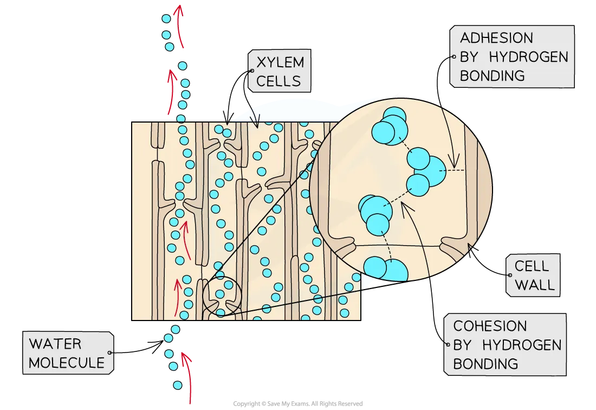
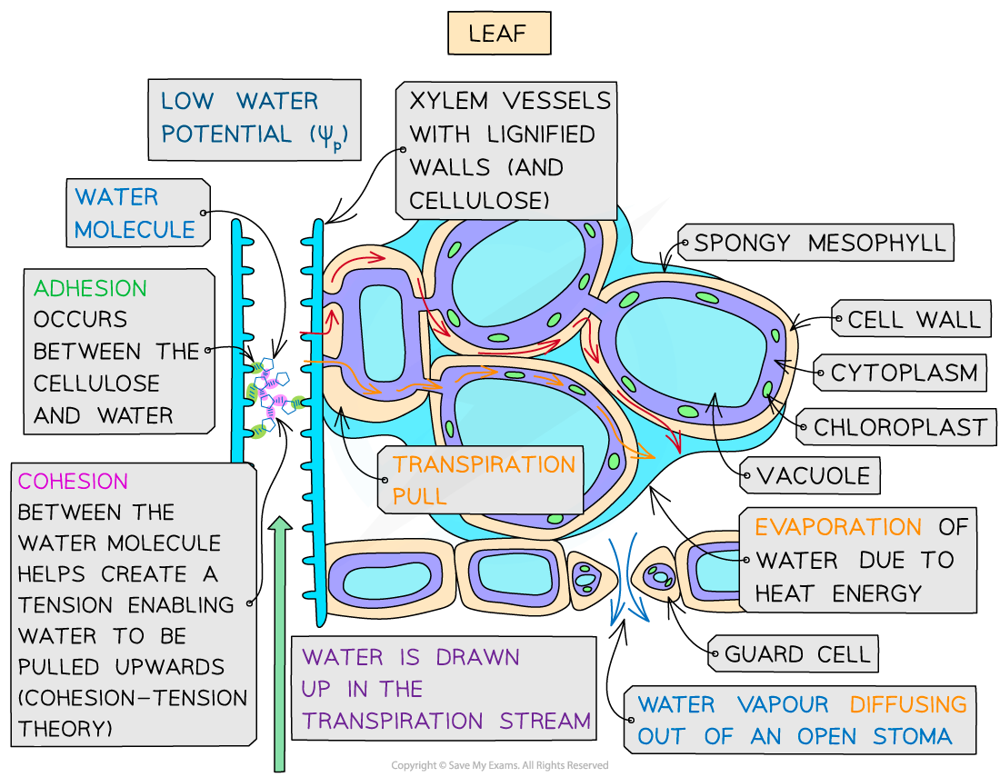
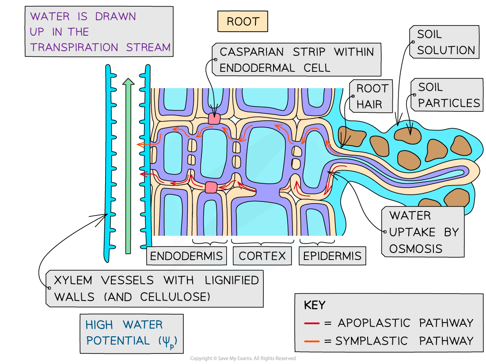

# Water & the Transpiration Pull

## Water & the Transpiration Pull

> **Spec point** — `spcpt_298SX2xC37m2kKYW` · explain how hydrogen bonding of water molecules is involved with movement of water in the xylem by cohesion-tension in transpiration pull and by adhesion to cellulose in cell walls

## Water & the transpiration pull

### The movement of water

- The **mass flow** of water in a plant is helped by the polar nature of water

  - Hydrogen bonds (H-bonds) form between water molecules which results in *cohesion* between water molecules and *adhesion* between the **cellulose** in the cell walls and the water molecules
- Water moves from the roots to the leaves because of a **difference in water potential **between the top and bottom of the plant

  - This **gradient** is present due to the constant **loss of water from the leaves** by transpiration and the constant **uptake of water at the roots** by osmosis
- The evaporation of water into the air spaces in the leaves creates **tension** in the xylem tissue which is transmitted all the way down the plant because of the cohesive nature of water molecules

  - The cohesive force results in a **continuous column of water** with high tensile strength (it is unlikely to break) and the adhesive force stops the water column from pulling away from the walls of the xylem vessels
  - This mechanism is called the **cohesion-tension theory**
- Xylem vessels have lignified walls to prevent them from collapsing inwards under the tension (negative pressure) in the water column

*Water molecules move in a continuous stream due to their cohesive nature caused by hydrogen bonds*

### The transpiration stream

- The pathway of the water from the soil through the roots up the xylem tissue to the leaves is the **transpiration stream**
- Water travels across the root either via the **apoplast pathway** or the **symplast pathway**

  - Note that water in the apoplast pathway does not cross cell membranes, so does not move by osmosis

*The transpiration stream involves the movement of water across the roots, up the xylem, and across the leaves of plants*

> **Exam Hint**
> When answering questions about transpiration it is important to include the following keywords:
> 
> - **Water potential gradient **(between leaves and roots),
> - **Diffusion** (of water vapour through the stomata)
> - **Transpiration pull** (evaporation of water from the walls of mesophyll cells in the leaves pulls other water molecules up from the xylem tissue)
> - **Cohesion** (between water molecules)
> - **Adhesion** (between water molecules and cellulose within the cell walls)
> - **Cohesion-tension theory** (evaporation from the leaves creates tension in the xylem; cohesion between water molecules, due to hydrogen bonding, means the water is pulled up as a continuous column)
> - **Osmosis** (water moving via the symplast pathway across the roots and leaves)
