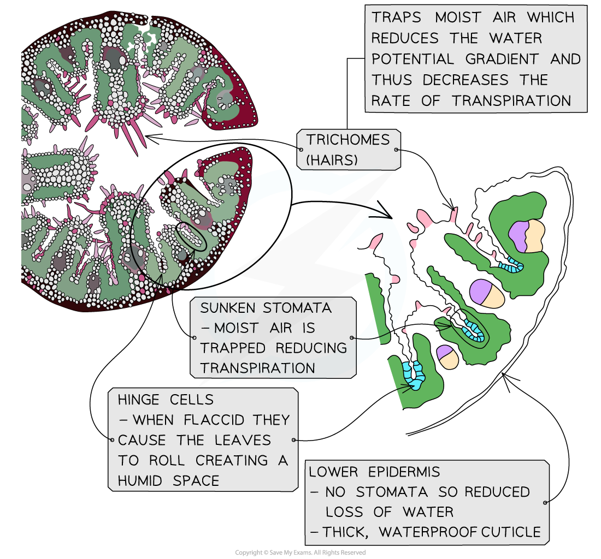

# Xerophytic Plant Leaf Adaptations

## Xerophytic Plant Leaf Adaptations

> **Spec point** — `spcpt_sWfHCp4y9cWnvw5n` · make annotated drawings of transverse sections of leaves from xerophytic plants to explain how they are adapted to reduce water loss by transpiration

## Xerophytic plant leaf adaptations

- Xerophytes (from the Greek *xero* for ‘dry’) are plants that are **adapted to dry and arid conditions**
- Xerophytes have physiological and structural (xeromorphic) adaptations to maximise **water conservation**

| **Xerophytic Adaptations of Leaves** | **Effect of Adaptation** | **Example** |
|---|---|---|
| Fleshy succulent leaves | Store of water for times of low availability | Bryophyllum |
| "Hinge cells" shrink when flaccid | Causes leaves to roll, exposing thick cuticle to the air and creating a humid space in the middle of the rolled leaf | Marram Grass (*Ammophila arenaria*) |
| Leaves reduced to scales, spines, needles.  Leaves curled, rolled or folded when flaccid | Reduced transpiration due to reduced surface area exposed | Cactus (*Opuntia*)  Marram Grass (*Ammophila arenaria*) |
| Stomata closed during daylight  Stomata open during night | Daytime water loss minimised  Carbon dioxide fixed at night | Pineapple, Yucca, American Aloe |
| Sunken stomata and leaf surface covered in fine hairs | Water loss minimised as moist air is trapped and diffusion gradient reduced | Pine, Nerium |
| Reduced numbers of stomata | Less water loss as fewer pores | Nerium, Prickly pear |
| Thick waxy cuticles | Water loss reduced via cuticle distance | Pine, Prickly pear |

*Photomicrograph and annotated drawing showing the xeromorphic features of a leaf of Ammophilia arenaria (Marram grass)*

> **Exam Hint**
> You will be expected to make annotated drawings of transverse sections of leaves from xerophytic plants to explain how they are adapted.
> 
> Remember not all leaves will have every feature listed above so if you are looking at an unfamiliar image consider whether the adaptations you can see will help reduce water being lost from the leaf.
