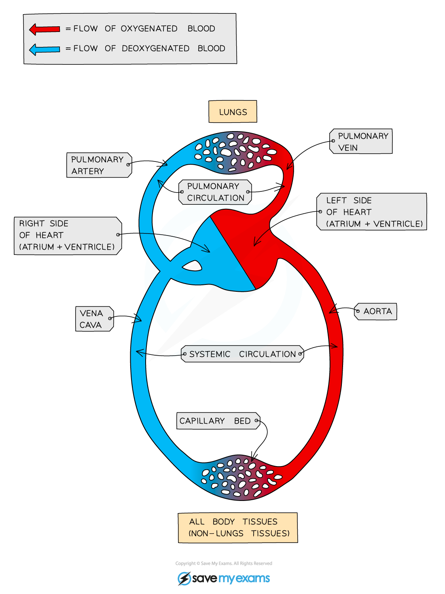

# Circulatory Systems

## Closed Double Circulatory System

> **Spec point** — `spcpt_2Wgr6ghVWNHbp6ZS` · state that the mammalian circulatory system is a closed double circulation consisting of a heart, blood and blood vessels including arteries, arterioles, capillaries, venules and veins

## Closed double circulatory system

### The need for a circulatory system

- The cells of all living organisms need a constant supply of **reactants for metabolism**, e.g. oxygen and glucose
- Single celled organisms can gain oxygen and glucose directly from their surroundings

  - The **molecules can diffuse to all parts of the cell quickly **due to short diffusion distances
- Larger organisms, however, are made up of **many layers of cells**

  - This means that the time taken for substances such as glucose and oxygen to diffuse to every cell in the body would be **far too long**
  
    - The **diffusion distances** involved are too great
- To solve this problem their exchange surfaces are connected to a **mass transport system,** for example

  - The digestive system is connected to the circulatory system
  - The lungs are connected to the circulatory system
- **Mass transport** is the **bulk movement** of gases or liquids in **one direction**, usually via a system of vessels and tubes
- The **circulatory system** in mammals is a well-studied example of a mass transport system

  - The one-way flow of blood within the blood vessels carries essential nutrients and gases to all the cells of the body

### Open and closed systems

- **Circulatory systems** are either described as being **open or closed**
- In a closed circulatory system, blood is pumped around the body and is always contained within a network of blood vessels

  - All vertebrates and many invertebrates have closed circulatory systems
- In an open circulatory system, blood is not contained within blood vessels but is pumped directly into body cavities

  - Organisms such as arthropods and molluscs have open circulatory systems
- **Humans have a closed double circulatory system**:

  - In one complete circuit of the body blood passes through the heart (the pump) twice
- The right side of the heart pumps deoxygenated blood to the lungs for gas exchange

  - This is the **pulmonary circulatory system**
- Blood then returns to the left side of the heart, so that oxygenated blood can be pumped efficiently (at high pressure) around the body

  - This is the **systemic circulatory system**

*The double circulatory system in mammals showing pulmonary and systemic circulation*

| **Structure** | **Function** |
|---|---|
| Heart | A hollow, muscular organ located in the chest cavity which pumps blood. Cardiac muscle tissue is specialised for repeated involuntary contraction without rest. |
| Arteries | Blood vessels which carry blood **away** from the heart. The walls of the arteries contain lots of muscle and elastic tissue and a narrow lumen,  to maintain high blood pressure. |
| Arterioles | Small arteries which branch from larger arteries and connect to capillaries. |
| Capillaries | Tiny blood vessels which connect arterioles and venules. Their size means they pass directly past cells and tissues and perform gas exchange and exchange of substances such as glucose. |
| Venules | Small veins which join capillaries to larger veins. |
| Veins | Blood vessels which carry blood back towards the heart. The walls of veins are thin in comparison to arteries, having less muscle and elastic tissue but a wider lumen. Valves help maintain blood flow back towards the heart. |

> **Exam Hint**
> Make sure you study any circulatory diagrams in the exam carefully to distinguish between single and double circulatory systems.
