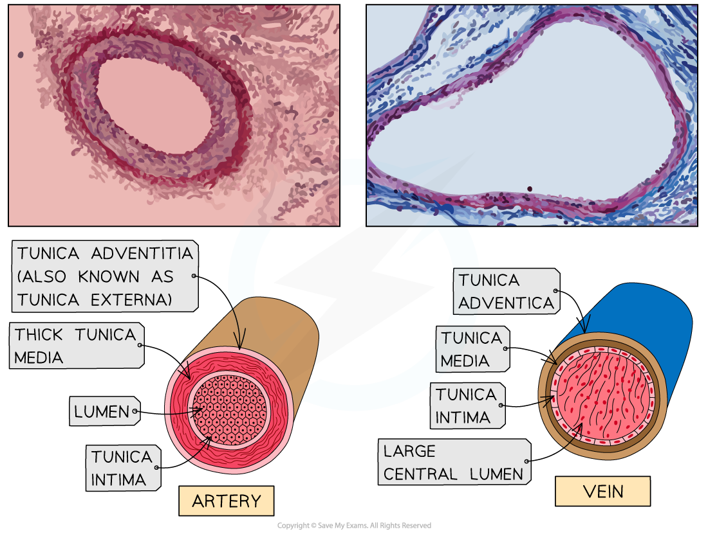

# Observing & Drawing Blood Vessels

## Arteries, Veins & Capillaries: Observing & Drawing

> **Spec point** — `spcpt_Xn3xGjXk2fvKWXg5` · recognise arteries, veins and capillaries from microscope slides, photomicrographs and electron micrographs and make plan diagrams showing the structure of arteries and veins in transverse section (TS) and longitudinal section (LS)

## Arteries, veins & capillaries: observing & drawing

- Arteries, veins and capillaries have distinctive structures which reflect their differing roles throughout the body
- The walls of arteries and veins contain the same components; but in differing proportions and with different wall thicknesses
- The walls of the capillaries are formed from a single layer of cells
- Plan diagrams show the structures of arteries and veins; these can be drawn in **transverse section** (TS) and **longitudinal section** (LS)

*A comparison of the structures of arteries and veins, along with photomicrographs*

### Arteries

- Arteries are blood vessels that carry blood at high pressures away from the heart
- Arteries have relatively thick walls which allow them to withstand the high pressure of blood as it surges through with each ventricular contraction of the heart
- The walls of arteries are composed of **elastic** and **muscular** tissue, as well as collagen fibres
- Arteries closer to the heart contain a **higher proportion** of elastic fibres

  - The walls of these arteries must be able to stretch and recoil to accommodate blood surging through, preventing them from bursting or from the blood pressure dropping
  - These arteries are described as being **elastic**
- Arteries further from the heart contain **less elastic** and **more smooth muscle tissue**

  - The diameter of these arteries can be adjusted to alter the blood flowing to different tissues
  - These arteries are described as being **muscular** and they branch into smaller arteries (arterioles)
  
    - The blood pressure in the arterioles is **lower** than that of the arteries
- The lumen of the arteries is relatively **narrow**

  - This ensures that blood remains at relatively **high pressure** for efficient delivery to the tissues whilst also providing resistance to blood flow to allow gas exchange as blood passes through the tissues

### Capillaries

- Arterioles branch into the smallest blood vessel – **the capillaries** – which form networks throughout most tissues of the body (where they are described as capillary beds)

  - Blood flowing through the capillaries is brought close to the cells of the body to allow efficient exchange of materials (particularly the diffusion of oxygen)
  - The endothelial wall of the capillaries is only one-cell thick, which ensures that substances can **diffuse** easily between the capillary and neighbouring cells
  - The walls are also **“leaky”** – there are small gaps between individual squamous epithelial cells that form the wall to allow small substances to leak out of the blood into the fluid surrounding the cells of the body

### Veins

- Capillaries join together to form larger blood vessels called venules which join to form veins
- The outer layer of the veins is relatively tough, composed largely of **collagen fibres**
- Conversely, the middle layer of the veins is relatively thin in comparison and contains only a **small amount of smooth muscle and elastic fibre**

  - This is because the blood flowing through veins is under very **low pressures** so the walls of the veins do not have to stretch and recoil to accommodate blood flow
  - The lumen of veins is characteristically large
  - Skeletal muscle contraction helps raise blood pressure temporarily within the veins, and the presence of one-way valves keeps blood moving back towards the heart

### Micrographs

- A **photomicrograph** is a photograph taken of a specimen observed using a light microscope
- An **electron micrograph** is a photograph taken of a specimen observed using an electron microscope
