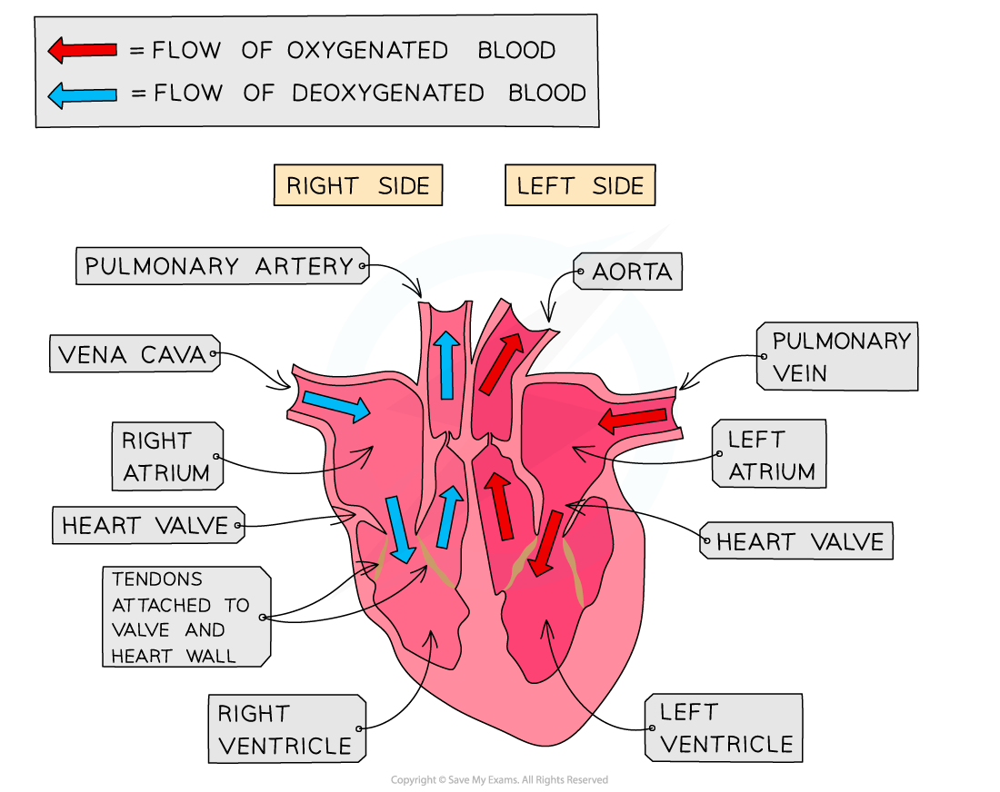
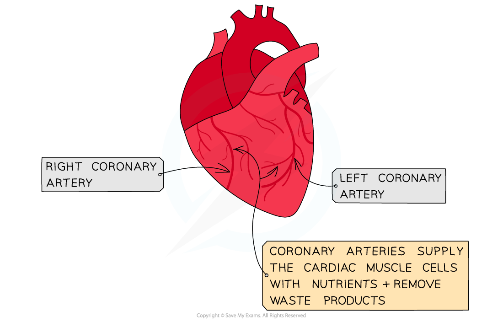

# Structure of the Heart

## Mammalian Heart Structure

> **Spec point** — `spcpt_zXHNZ2vvNh5ShMXy` · describe the external and internal structure of the mammalian heart

## Mammalian heart structure

### Heart structure

- The human heart has a mass of around 300g and is roughly the size of a closed fist
- The heart is a hollow, muscular organ located in the chest cavity

*The human heart has four chambers and is separated into two halves by the septum*

- The heart is divided into four chambers

  - The two top chambers are **atria** and the bottom two chambers are **ventricles**
- The left and right sides of the heart are separated by a wall of muscular tissue, called the **septum**

  - The septum is very important for ensuring blood doesn’t mix between the left and right sides of the heart

### Valves in the heart

- Valves in the heart:

  - **Open **when the pressure of blood behind them is greater than the pressure in front of them
  - **Close **when the pressure of blood in front of them is greater than the pressure behind them
- Valves are important for keeping blood flowing forward in the right direction and stopping it flowing backwards

  - They are also important for maintaining the correct pressure in the chambers of the heart
- The right atrium and right ventricle are separated by the atrioventricular valve

  - This is also known as the **tricuspid valve**
- The right ventricle and the pulmonary artery are separated by the **pulmonary valve**
- The left atrium and left ventricle are separated by the mitral valve

  - This is also known as the **bicuspid valve**
- The left ventricle and aorta are separated by the **aortic valve**
- There are two blood vessels bringing blood to the heart:

  - **Vena cava**
  - **Pulmonary vein**
- There are two blood vessels taking blood away from the heart:

  - **Pulmonary artery**
  - **Aorta**

### Coronary arteries

- The heart is a muscle and so requires its own blood supply for **aerobic respiration**
- The heart receives blood through arteries on its surface, called **coronary arteries**
- It’s important that these arteries remain clear of plaques, as this could lead to **angina** or a heart attack (myocardial infarction)

*The coronary arteries cover the outside of the heart, supplying it with oxygenated blood*

> **Exam Hint**
> When looking at the heart, remember the right side of the heart will appear on the page as being on the left. This is because the heart is labelled as if it were in your body and flipped around.
