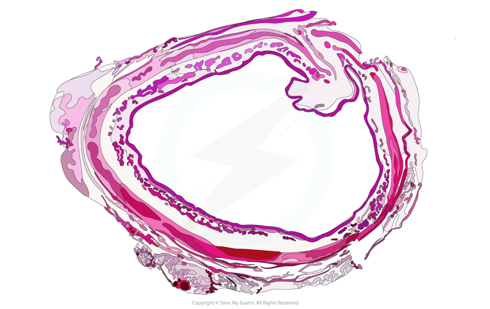
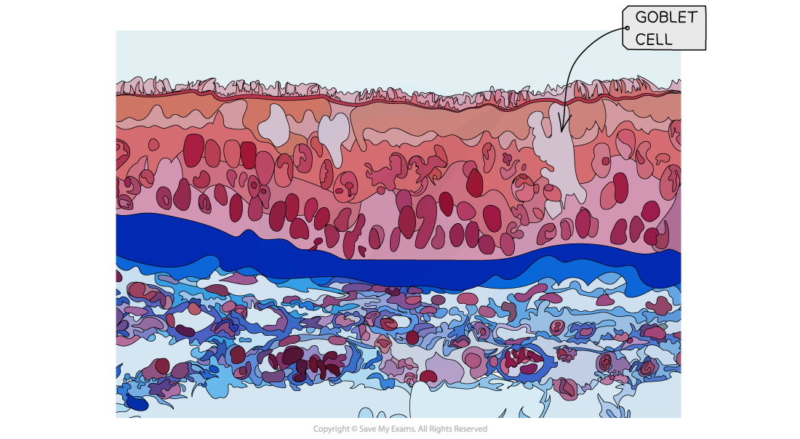
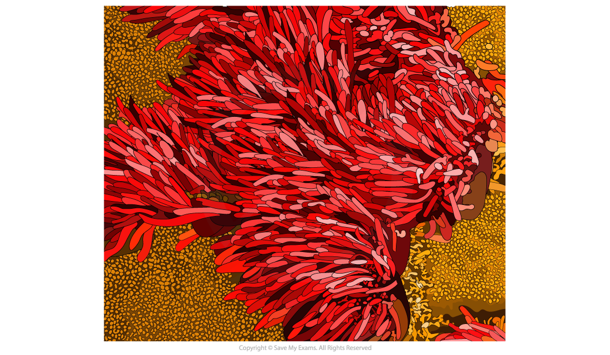
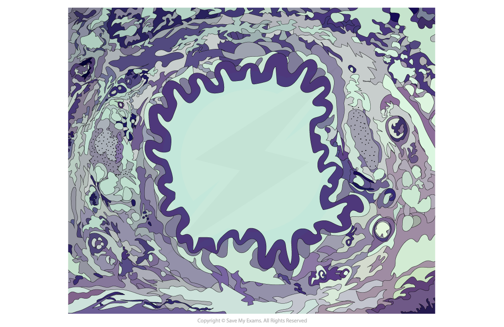
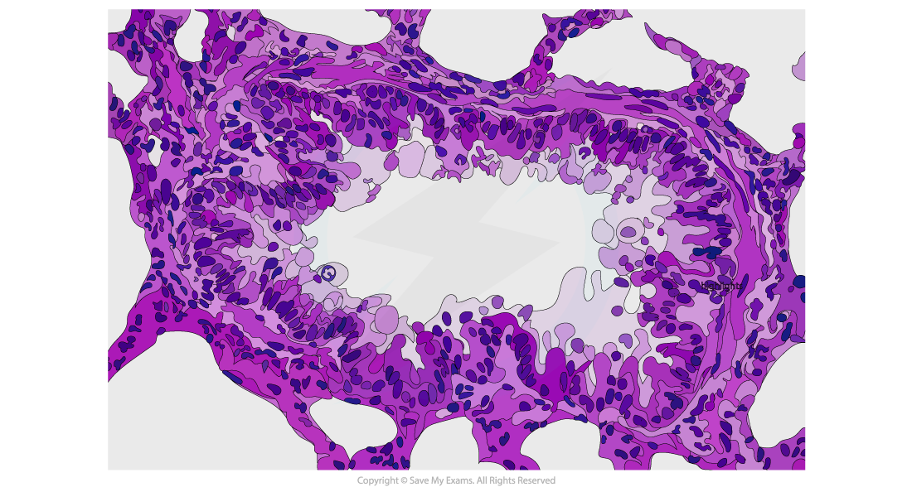
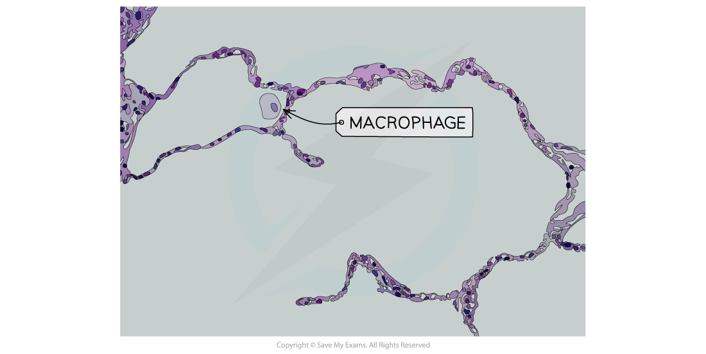
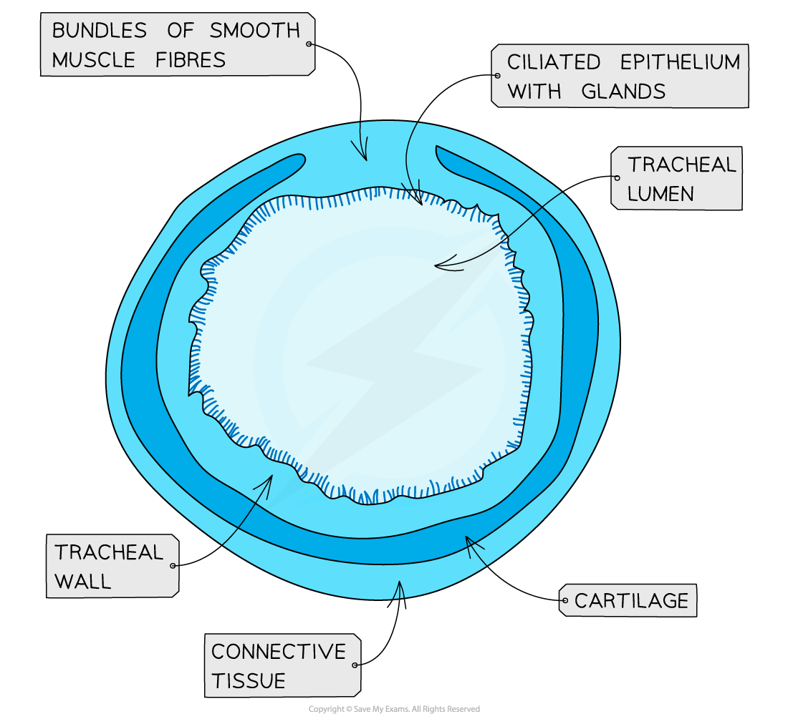
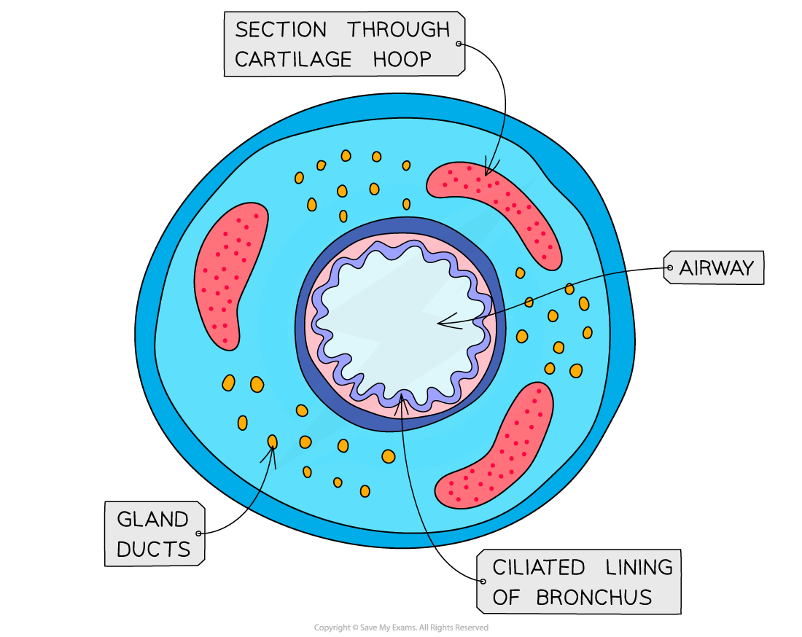

# Recognising Structures

## Recognising Structures in the Gas Exchange System

> **Spec point** — `spcpt_Hy68JNFPJTqqXHtt` · recognise trachea, bronchi, bronchioles and alveoli in microscope slides, photomicrographs and electron micrographs and make plan diagrams of transverse sections of the walls of the trachea and bronchus

## Recognising structures in the gas exchange system

### Trachea

- A **tracheal cross-section** shows the large lumen, which air has to travel through
- The innermost cells of the trachea are the ciliated epithelia with projections called cilia

*Trachea cross-section as shown under a light microscope*

- The cells of the **ciliated epithelium** are shown in the light micrograph below

  - The cells are tightly packed and interspersed with goblet cells, which are shown in light grey

*A photomicrograph image showing tissue of the trachea*

- The density of the** cilia** are shown in the electron micrograph below

  - The cilia are essential for sweeping bacteria and dust-filled mucus away from the lungs and up the trachea into the back of the mouth
  - This mucus is then swallowed, with any pathogens hopefully destroyed by the acidic conditions in the stomach

*An electron micrograph of the tissues that can be found inside the trachea*

### Bronchi

- **Bronchi** are distinctive from the trachea because their lumen is narrower (around 8-9mm instead of 18mm
- However, like the trachea, they are lined by ciliated epithelium

*A photomicrograph image showing tissue of the bronchi in cross section*

### Bronchioles

- **Bronchioles** are approximately 1mm or less in diameter
- Smooth muscle and cuboidal epithelium are found in their walls

*A photomicrograph showing bronchiole tissues in the gas exchange system*

### Alveoli

- Alveoli have a sponge-like appearance under a microscope due to their air spaces.
- They are surrounded by an extensive capillary network and are lined by squamous epithelium

*The cells surrounding the alveolus air sac as viewed by a light microscope*

### Walls of the trachea and bronchus

#### Trachea

- The tracheal lumen is around 15 to 20 mm and is lined by ciliated epithelia
- The tracheal wall is surrounded by strong and flexible cartilage which flexes during breathing
- The smooth muscle of the trachea constricts and allows air to be expelled with more force

*Labelled diagram of a cross section of the trachea*

#### Bronchus

- Like the trachea, the **bronchus **is lined with ciliated epithelium
- The cartilage hoops provide structural support to the bronchi and the gland ducts secrete mucus in the bronchial tubes

*Parts of the cross section of a bronchus. This would be the same in both bronchi*
