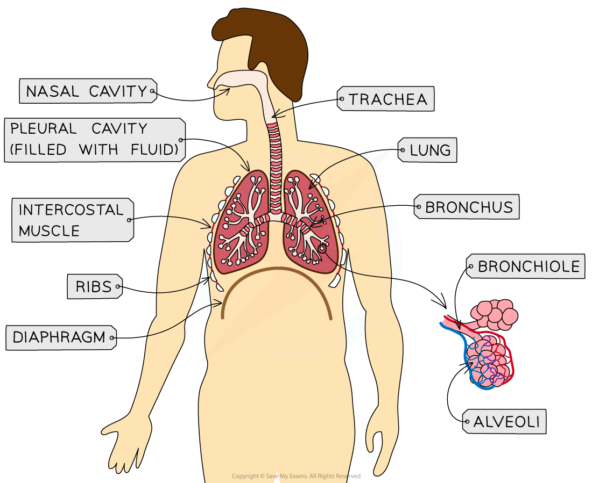

# The Human Gas Exchange System

## The Human Gas Exchange System

> **Spec point** — `spcpt_mc2WBthbYJD9XgZ9` · describe the structure of the human gas exchange system, limited to:
• lungs
• trachea
• bronchi
• bronchioles
• alveoli
• capillary network

## The human gas exchange system

- Gas exchange takes place in the human thorax

  - This is a collection of organs and tissues in the chest cavity

*The main structures of the human gas exchange system*

| **Structure in thorax** | **Description** |
|---|---|
| Lungs | Humans have two lungs, both of which are a central part of the breathing system and where gas exchange takes place |
| Trachea | This airway leads from the mouth and nose to the bronchi  The trachea is lined with mucus-secreting goblet cells and cilia  The cilia sweep microorganisms and dust away from the lungs |
| Bronchi | “Bronchi” is the plural of “bronchus”  The left and right bronchi are at the bottom of the trachea and are similar in structure, but narrower  The bronchi lead to bronchioles |
| Bronchioles | These are narrow tubes (less than 1mm) which carry air from the bronchi to the alveoli |
| Alveoli | The main site of gas exchange within the lungs  These are tiny sacs with many structural adaptations to enable efficient gas exchange, such as their thin walls and large surface area to volume ratio |
| Capillary network | An extensive network of capillaries surrounds the alveoli  They are an exchange surface between the lungs and the blood  During gas exchange, oxygen diffuses from the alveoli and into the capillaries, while carbon dioxide diffuses the other way and is exhaled |

> **Exam Hint**
> Remember to pay attention to command words in exams, as they will be asking different things. For example, a question asking you to “Describe” the structure of the alveoli is different from a question asking you to “Explain” the structure of the alveoli. “Describe” questions are asking you to give an account of something or to write events or processes in a logical order. “Explain” questions are asking you to write why something happens or to link its structure to its function—as a result of this, “because” will be an important part of your answer.
