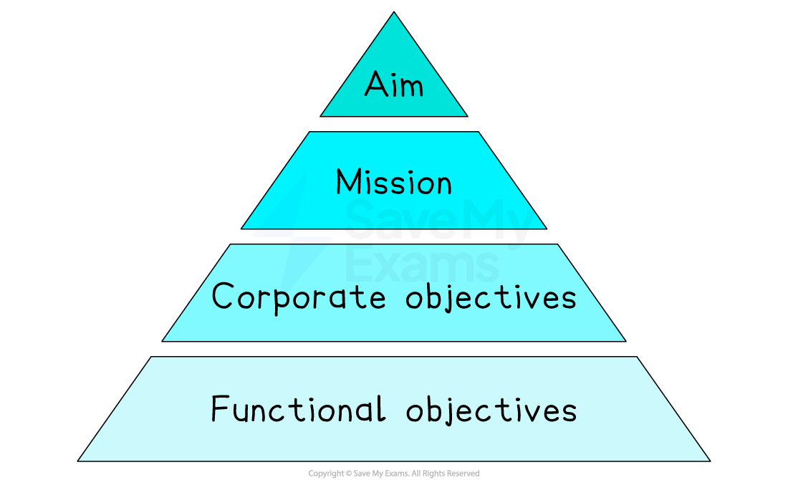
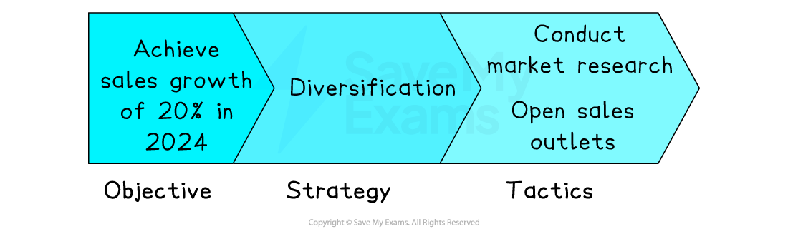

# Objectives and Business Decisions

## The Role of Objectives in Business Decision Making

> **Spec point** — `spcpt_nnKwZcng8zb43KTY`

## The role of objectives in business decision making

- Objectives provide a **sense of direction** and **focus** to those running and making decisions within a business

  - Objectives act as **targets**
  
    - Decisions that contribute to achieving these targets can be pursued, whilst those that make little contribution can be discarded
    - **Poor decisions** that fail to achieve objectives can be avoided in future and may inform **management training**
  - Objectives allow **success criteria** to be determined and **outcomes** to be measured
  
    - Suitable **strategies** that have the greatest chances of success can be implemented
    - Inappropriate or risky strategies may be avoided

## The Hierarchy of Aims, Mission & Objectives

> **Spec point** — `spcpt_zgghvcvrG4HVQkcK`

## The hierarchy of aims, mission and objectives

- A business's **aim** is its **long-term direction, **which is usually **broadly stated** and often **aspirational**

  - It is usually **set by senior executives**
  - E.g. To be the most successful independent coffee shop chain in the country
- Some businesses express their aim in a **mission statement**

  - Mission statements usually include words or attractive phrases that appeal to key ***stakeholders***
  - E.g. Bring the World of Coffee to Every Neighbourhood
- **Business objectives** are derived from the aim and mission

  - Objectives state, **specifically** and in **measurable** terms, what the business **wants to achieve**
  - E.g. Increase sales of coffee by 25% in 2024
  
    - **Corporate objectives** are whole-business targets
    - **Functional objectives** are derived from corporate objectives and describe the targets of business departments or functional areas
- The link between a business's aim, mission and objectives can be illustrated as a **hierarchy**

#### The hierarchy of aims, mission and objectives

*The business aim informs its mission, corporate objectives and functional objectives*

## SMART Objectives

> **Spec point** — `spcpt_r36YGYYvc7XtgVQC`

## SMART Objectives

- The most effective objectives are **clearly stated** and allow **progress to be assessed**
- These types of objectives can be summarised using the acronym **SMART**

  - **S**pecific: what exactly the business is measuring, such as the value of sales or sales volume
  - **M**easurable: a quantifiable success measure, such as a percentage increase
  - **A**greed; the objective is shared with workers and perhaps mutually agreed
  - **R**ealistic: Ambitious, but capable of being achieved in normal circumstances
  - **T**ime-bound: a date or time by which the objective should be achieved

#### Example of a SMART Objective

*This objective is specific, measurable and time-bound*

## Strategy & Tactics

> **Spec point** — `spcpt_rpNhWtfRhY8bNyZv`

## Strategy and tactics

- A business strategy is a **long-term approach** a business adopts **to achieve its key objectives**

  - E.g., A business pursuing an objective of** growth** may choose to adopt a strategy of ***diversification***, targeting new customers with innovative products
- Tactics are the **short-term actions** a business takes as **part of its overall strategy**

  - A business pursuing a strategy of **diversification** may choose to adopt the tactic of conducting research in the target market before establishing sales outlets in a new location

#### Objectives, strategy and tactics

*Businesses decide on a suitable strategy to achieve their objectives, which informs short-term tactics*

## Strategy, Tactics & Budgets

> **Spec point** — `spcpt_yShFSXXSNX3McJbT`

## Strategy, tactics and budgets

- Once tactics have been determined, managers can **set targets** and **allocate *****budgets*** to teams and individuals
- Adhering to budgets and meeting these targets **contribute to achieving the overall business objectives**

  - Careful **monitoring** and** adjustment**, taking account of the ***external environment***, is crucial
  
    - Budgets may need to be increased or more tightly controlled
    - If targets change, their impact on the likelihood of achieving objectives will need to be considered
    - Further resources may be required to meet deadlines or achieve budgetary targets

> **Exam Hint**
> This topic area contains a large number of key terms that you could be asked to define or explain in an exam.
> 
> Whilst 'define' questions simply ask for the meaning of a key term, you need to remember that 'explain' questions will need some reference to the business scenario you are given.

## How Objectives Change over time

> **Spec point** — `spcpt_6RYXbppHWqPJ6mfS`

## How objectives change over time

- Businesses operate in a **dynamic** **environment,** which may require them to pivot between different **objectives**
- These changes are often necessary to ensure that the business **remains competitive, profitable, and compliant with regulations **

#### Factors that cause business objectives to change over time

| **Factor** | **Explanation** | **Example** |
|---|---|---|
| **Market conditions** | - Market conditions such as competition, demand, and **changing consumer *****price sensitivity*** can have a significant impact on a business's aims and objectives | - Uber and Lyft were initially focused on **capturing the largest share** of the ride-hailing market (market share) - As competition intensified, both companies **shifted their focus to profitability,** and their objectives changed accordingly (profit maximisation) |
| **Technology** | - A business may shift its focus from traditional brick-and-mortar retail to online retail as **technology allows for a more cost-effective way** to reach customers | - Amazon began as an **online bookstore**, but as technology advanced, it expanded into a wide range of retail categories such as electronics, clothing and groceries - Their objective changed from **increasing** **market share **to** market development** |
| **Performance** | - If a business is not meeting its **sales goals** in one area, it may change its objectives to try an **improve its financial performance** - In some cases, this may involve **retrenchment** (moving out of existing markets) | - In 2018 Ford announced that it was shifting its **focus away from producing passenger cars** and focusing more on SUVs and trucks - The move was driven by the company's poor financial performance and the new objectives were aimed at **improving sales and profitability** |
| **Legislation** | - A company may need to shift its focus to comply with new regulations or **capitalise on new opportunities** created by **changes in legislation** | - With the passage of the Affordable Care Act in the USA in 2014, **healthcare providers** had to adjust their aims and objectives to comply with new regulations and take advantage of new opportunities created by the law |
| **Ethics and social change** | - Over time, attitudes towards **social issues** and what is considered to be **right and wrong** develop, forcing a business to change its objectives | - Until the 1950s, tobacco companies' marketing objectives included **promoting health-giving effects of smoking** and increasing sales to young people - By 2023, British American Tobacco (BAT) had changed its sales objective 'To have 50 million consumers of our non-combustible products by 2030' |
| **Internal reasons** | - Factors such as changes in **management** or the ***company culture*** can also influence a business's aims and objectives - **Innovation** or advances in processes might mean that more ambitious objectives may be set | - In 2014, Microsoft appointed Satya Nadella as the company's CEO    - He shifted the company's **focus from software to cloud services **and the company's objectives changed accordingly |

## Communicating the Business Objectives

> **Spec point** — `spcpt_scrpbmCbcWNPQP9V`

## Communicating the business objectives

- Communicating the business objectives effectively, helps to ensure that **employees are all working towards the same purposes**

  - A range of other stakeholders benefit from this too
- Businesses share objectives with key stakeholders in a range of ways
- ***Public limited companies*** publish an **annual report** that shows a company's operations and financial performance in the preceding 12 months and details the objectives it expects to achieve over the next twelve months

  - ***Shareholders*** and** potential investors** can use this information to determine the likely return on investment they will receive
- Businesses often share their **mission statement** in marketing materials such as brochures or via their websites

  - **Customers, employees **and the** local community** are often interested in understanding the broad aim of a business in which they have an interest
- Objectives are also commonly shared with employees in** business meetings** and, particularly, during the ***appraisal*** process

  - Individual targets can be set for workers that set out the contribution they will make to achieving objectives
  - Performance of staff can be measured and rewarded
  - Understanding their role in meeting objectives can be a powerful ***intrinsic motivator***

## Ethics & Objectives

> **Spec point** — `spcpt_CK3zxSDzsQmD8pVX`

## Ethics and objectives

- Many businesses consider the **ethical impact of their decisions** and are increasingly adopting an ethical approach in their decision making, including the setting of aims and objectives
- Some have adopted an **ethical code of practice** that provides a framework for **responsible and fair** ***strategic*** decision making and provides **guidelines on staff behaviour**
