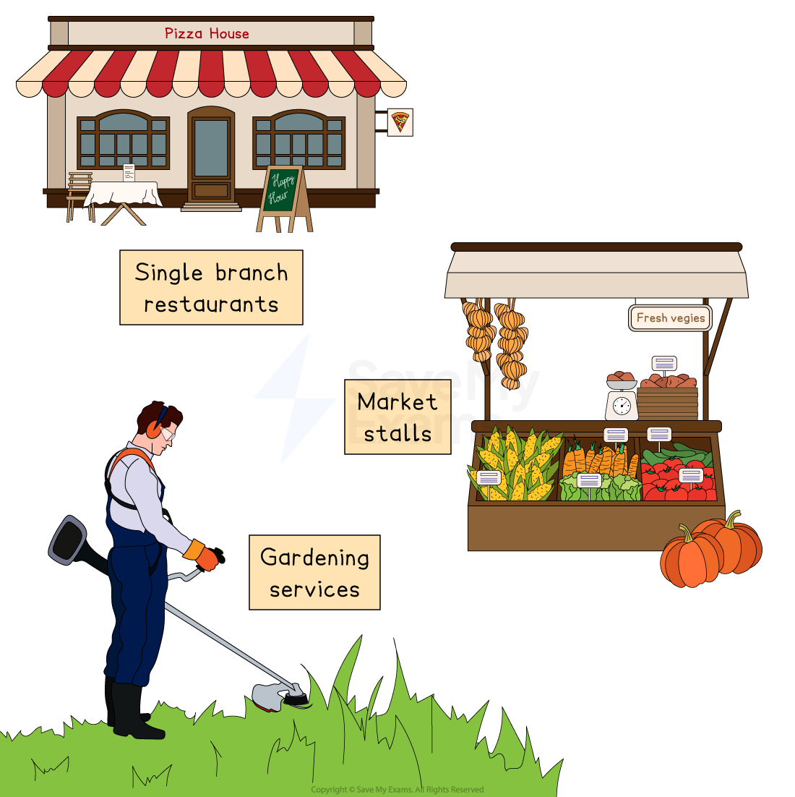

# Local, National, International Businesses and MNCs

## Local Businesses

> **Spec point** — `spcpt_zgCSMZWGGnx5gQnz`

## Local businesses

- Local businesses operate in a **specific and limited location,** such as a town, city zone or within a tourist attraction
- Their owners usually focus on providing a **service to the surrounding community** and tend to **remain small**

#### Examples of local businesses

*Local businesses provide a service to customers within a limited geographical area*

## National Businesses

> **Spec point** — `spcpt_3WZR6k7KhhZTDJpM`

## National businesses

- National businesses operate outlets or provide services in **numerous locations across the country**
- Their focus is on meeting the needs of **customers of a particular nationality**
- They usually aim to increase ***market share*** and achieve ***economies of scale***
- Examples of national businesses include:

  - **Bricoman** in France is a national retailer of DIY and building supplies
  - **Spoon** in Costa Rica is a national chain of fast food restaurants
  - **Amasvin** is a popular bubble tea brand with more than 80 stores across South Korea

## International Businesses

> **Spec point** — `spcpt_p5BzWgt53NJgdkHm`

## International businesses

- International businesses operate outlets or provide services in **more than one country**
- They tend to operate in countries that **share characteristics of their home country,** such as

  - Similar customer needs and wants
  - Common business procedures or regulations
  - The same language
- Examples of international businesses include

  - Fashion retailer **Zara**
  - Holiday company **Eurocamp**
  - Publisher **Time Out**

## Multinational Businesses

> **Spec point** — `spcpt_Tf5WHFN44fVQdpjp`

## Multinational businesses

- **A multinational company (MNC)** is a business that is registered in one country but has manufacturing operations/outlets in different countries

  - E.g. Starbucks headquarters are in Washington, USA but they have 32,000 stores in 80 countries
- Factors such as ***globalisation*** and ***deregulation*** have contributed to the growth of MNC’s
- MNC’s choose locations based on factors such as **cost advantages** and access to markets

  - Nike originates from the USA, but 50% of their manufacturing takes place in China, Vietnam and Indonesia due to the **lower production costs** in these countries
- The impact of multinationals are considered in more detail later in the course

> **Exam Hint**
> The scale of a business can be an important factor in determining its objectives.
> 
> Local businesses are likely to want to remain relatively small, with the objective of providing a good service, while international businesses may be looking to grow and operate in more countries to become multinationals and maximise profit.
